# BALLS Security Assessment Report — vulnapp-ebcc0ee5

**Project:** vulnapp-ebcc0ee5  
**Target:** /Users/mkunz/Documents/antigravity/vulnapp  
**Generated:** 2026-11-18T03:31:32.850270+00:00  
**Scan ID:** 20261117-vulnapp-ebcc0ee5  
**Overall risk rating:** High

---

## Executive Summary

This static source-code security audit assessed vulnapp (gist vulnapp), a Python Flask 0.12.2 employee directory application backed by Flask-SQLAlchemy (SQLite), bcrypt, and requests across four components: web-app, auth, pictures, and config-supply-chain. All 27 component-by-category coverage units were reviewed using CodeGraph 1.6.2 call-graph analysis, parallel Flash component reviewers and hunters, an independent coverage critic, and 22 dedicated Pro finding verifiers, resulting in an overall High risk posture with Critical multi-step exploit chains.

The audit established 22 verified findings (8 High, 10 Medium, and 4 Low; 21 CONFIRMED and 1 LIKELY) and 4 validated cross-component exploit chains, with 0 unresolved candidates remaining open out of 35 total recorded hypotheses (13 merged duplicates). The most severe weaknesses allow unauthenticated callers to download config.py and database.db directly via the catch-all send_file(path) route (BALLS-003) and forge Flask session cookies using hardcoded SECRET_KEY values (BALLS-004) for full privileged account takeover, perform unauthenticated full-read SSRF via profile picture fetching (BALLS-006), bypass employee-directory email restrictions via a fail-open User.limited=None partial commit on signup (BALLS-002), execute Stored and Reflected XSS because Flask 0.12.2 disables autoescaping on .jinja2 templates (BALLS-005, BALLS-008), and trigger persistent or synchronous denial of service (BALLS-001, BALLS-007).

Immediate remediation should remove the unrestricted /<path:path> send_file handler, externalize and rotate Flask SECRET_KEY secrets, replace the shared static BCRYPT_SALT with per-user bcrypt.gensalt()/checkpw(), enable Jinja2 autoescaping across all .jinja2 templates alongside CSRF protection, enforce atomic fail-closed User.limited=True registration, and harden or disable server-side URL picture fetching. Static review cannot observe external reverse-proxy rules, runtime FLASK_ENV overrides, or the upstream directory.nginx.service implementation; BALLS-018 remains rated LIKELY pending those external deployment details.

### Key Statistics

| Metric | Value |
|---|---:|
| Components analyzed | 4 |
| Component/category work units | 27 |
| Raw hunter findings | 22 |
| Candidate ledger records | 35 |
| Reported findings after review | 22 |
| Needs-validation candidates | 0 |
| False positives dismissed | 0 |
| Suppressed findings | 0 |
| Exploit chains | 4 |

**Verification confidence:** High: 22  
**Council verdicts:** CONFIRMED: 21, LIKELY: 1

### Highest-Priority Findings

- **BALLS-001 — Unauthenticated Pre-Auth Full-Table Load and Unbounded Bio Storage Amplification** (`app.py:53-65`): Persistent memory and SQLite I/O exhaustion across process restarts from low-cost unauthenticated GET / traffic.
- **BALLS-002 — Fail-Open User.limited Privilege Bypass via Non-Atomic Signup** (`app.py:113-135`): Complete bypass of the employee-directory limited privilege gate, exposing all registered users' email addresses to any registrant.
- **BALLS-003 — Unrestricted File Read and Path Traversal via catch_all send_file(path)** (`app.py:151-159`): Unauthenticated disclosure of database.db (all user emails, bios, password hashes), config.py signing keys, source code, .git metadata, and readable host files.
- **BALLS-004 — Hardcoded Flask SECRET_KEY Enabling Session Cookie Forgery** (`config.py:11-38`): Complete authentication bypass and arbitrary user impersonation across all accounts, disclosing protected employee directory emails.
- **BALLS-005 — Stored Cross-Site Scripting (XSS) in Directory Template** (`directory.jinja2:8-26`): Cross-user Stored XSS across all authenticated directory visitors, enabling exfiltration of restricted employee emails and DOM/session abuse.

---

## Methodology

Using the Antigravity edition of BALLS, CodeGraph 1.6.2 indexed all 4 Python files (49 nodes, 70 edges) prior to dispatching 12 concurrent Flash subagents (4 component reviewers and 8 category hunters) across 27 explicit component-by-category units. Every hypothesis (35 total; 22 unique and 13 merged duplicates) was recorded in candidates.json before verification, audited by a separate Flash coverage critic (which surfaced 2 additional confirmed findings), and independently verified by 22 fresh Pro verifier subagents using zero direct model API calls.

| Stage | Work performed | Recorded coverage |
|---|---|---|
| Reconnaissance | Repository structure, stack, and local code graph recorded. | 4 files; 49 graph nodes; graph status indexed. |
| Component review | Focused reviewers traced one component at a time. | 4 component reviewers; 4 registered components. |
| Category hunting | Focused component-scoped category passes were run. | 0 initial broad groups; 8 component-scoped hunter assignments; 27 total units. |
| Independent verification | Independent verifiers checked reachability, defenses, and impact. | 22 verifier assignments. |
| Model execution | Antigravity reviewers, hunters, and verifiers used the active session. | Direct model API calls: 0; observed concurrency: 12 of configured 12. |
| Report generation | Findings, IDs, counts, source excerpts, indexes, diagrams, and appendices were assembled from scan artifacts. | Deterministic SQLite-backed renderer. |

### Components Analyzed

| Component | Type | Files / paths | Verified findings | Highest severity |
|---|---|---|---:|---|
| web-app | web-service | app.py, base.jinja2, directory.jinja2, signin.jinja2, signup.jinja2, style.css | 12 | High |
| auth | library | auth.py | 3 | Medium |
| pictures | library | pictures.py | 2 | High |
| config-supply-chain | configuration | config.py, run.sh, requirements.txt | 5 | High |

### Vulnerability Categories Assessed

| Category | Components reviewed | Unit status |
|---|---:|---|
| api-security | 1 | confirmed |
| authentication-abuse | 1 | confirmed |
| authn | 1 | confirmed |
| authz | 1 | confirmed |
| business-logic | 1 | confirmed |
| config | 1 | confirmed |
| cors-csrf | 1 | confirmed |
| crypto | 1 | confirmed |
| data-exposure | 1 | confirmed |
| deserialization | 1 | not-applicable |
| exceptional-conditions | 1 | confirmed |
| file-upload | 1 | reviewed-no-finding |
| injection | 1 | reviewed-no-finding |
| logging | 1 | confirmed |
| memory | 1 | not-applicable |
| outbound-http-trust | 2 | confirmed |
| path-traversal | 1 | confirmed |
| race-condition | 1 | confirmed |
| resource-exhaustion | 2 | confirmed |
| secrets | 1 | confirmed |
| ssrf | 2 | confirmed |
| supply-chain | 1 | confirmed |
| xss | 1 | confirmed |
| xxe | 1 | not-applicable |

### Component-by-Category Coverage

**Coverage status counts:** confirmed: 22, not-applicable: 3, reviewed-no-finding: 2

**Execution and limits:** configuredMaxConcurrentSubagents=12; maxObservedConcurrentSubagents=12; directModelApiCalls=0; focusedComponentReviewers=4; categoryHunterAssignments=8; coverageCriticAgents=1; independentVerifierAgents=22

| Unit | Component | Category | Status | Review assignment | Evidence note |
|---|---|---|---|---|---|
| web-app::path-traversal | web-app | path-traversal | confirmed | hunt-web-path-authz | Unrestricted send_file(path) in catch_all confirmed. |
| web-app::authz | web-app | authz | confirmed | hunt-web-path-authz | Fail-open User.limited=None, unauthenticated catch_all, and open self-registration confirmed. |
| web-app::cors-csrf | web-app | cors-csrf | confirmed | hunt-web-csrf-xss | CSRF on POST /signin, POST /signup, and GET /signout confirmed; no permissive CORS headers. |
| web-app::xss | web-app | xss | confirmed | hunt-web-csrf-xss | Stored XSS in directory.jinja2 and Reflected XSS in signin.jinja2 due to .jinja2 autoescape exclusion in Flask 0.12.2. |
| web-app::authentication-abuse | web-app | authentication-abuse | confirmed | hunt-web-authn-inj | Account enumeration, missing rate limiting, and weak password policy confirmed. |
| web-app::injection | web-app | injection | reviewed-no-finding | hunt-web-authn-inj | All SQLAlchemy ORM queries use parameterized filter_by/model APIs, Jinja2 template filenames are static literals, and no OS command/LDAP/eval sinks exist. |
| web-app::logging | web-app | logging | confirmed | hunt-web-log-exp | Plaintext password logging in after_request and absent security event audit logging confirmed. |
| web-app::data-exposure | web-app | data-exposure | confirmed | hunt-web-log-exp | Root file/DB exposure, open signup directory exposure, and email enumeration confirmed. |
| web-app::exceptional-conditions | web-app | exceptional-conditions | confirmed | hunt-web-exc-logic | Partial state commit before download_picture failure and unhandled TypeError/UnicodeEncodeError in hash_password confirmed. |
| web-app::business-logic | web-app | business-logic | confirmed | hunt-web-exc-logic | Two-step registration state split and unused DOMAIN check confirmed. |
| web-app::race-condition | web-app | race-condition | confirmed | hunt-web-exc-logic | Intermediate committed limited=None window merged into BALLS-002; unique email constraint prevents duplicate-user races. |
| web-app::api-security | web-app | api-security | confirmed | hunt-web-exc-logic | Missing endpoint throttling, enumeration oracles, and missing security headers confirmed; no mass assignment or BOLA on GET /. |
| web-app::resource-exhaustion | web-app | resource-exhaustion | confirmed | critic-coverage | Unauthenticated pre-auth User.query.all() and unbounded bio storage with MAX_CONTENT_LENGTH=None confirmed. |
| auth::authn | auth | authn | confirmed | hunt-auth | Password validation/encoding flaws and missing server-side session revocation confirmed. |
| auth::crypto | auth | crypto | confirmed | hunt-auth | Hardcoded SECRET_KEY and global static BCRYPT_SALT reuse with == comparison confirmed. |
| auth::ssrf | auth | ssrf | confirmed | hunt-auth | Unencoded email path/query manipulation against EMPLOYEE_API_URL verified as LIKELY. |
| auth::outbound-http-trust | auth | outbound-http-trust | confirmed | hunt-auth | Cleartext HTTP to EMPLOYEE_API_URL, redirects enabled, and uncaught JSON ValueError/AttributeError merged into BALLS-018. |
| pictures::ssrf | pictures | ssrf | confirmed | hunt-pictures | Unauthenticated full-read SSRF in download_picture confirmed. |
| pictures::outbound-http-trust | pictures | outbound-http-trust | confirmed | hunt-pictures | Unvalidated HTTP status/MIME and unrestricted redirects merged into BALLS-006. |
| pictures::resource-exhaustion | pictures | resource-exhaustion | confirmed | hunt-pictures | Missing timeout and unbounded res.content memory/disk exhaustion confirmed. |
| pictures::file-upload | pictures | file-upload | reviewed-no-finding | hunt-pictures | No multipart upload sink; server generates uuid4().jpg filename under PICTURES_DIR (missing payload MIME/size checks and nosniff header tracked under BALLS-006, BALLS-007, and BALLS-020). |
| config-supply-chain::secrets | config-supply-chain | secrets | confirmed | hunt-config | Hardcoded SECRET_KEY and BCRYPT_SALT confirmed. |
| config-supply-chain::config | config-supply-chain | config | confirmed | hunt-config | Default DEBUG=True, missing Secure/SameSite cookie flags, and missing HTTP security headers confirmed. |
| config-supply-chain::supply-chain | config-supply-chain | supply-chain | confirmed | hunt-config | EOL Flask==0.12.2 / vulnerable requests==2.25.1 without lockfile hashes and missing jQuery 1.12.4 SRI confirmed. |
| web-app::deserialization | web-app | deserialization | not-applicable |  | No pickle, YAML, marshal, or custom object deserialization sinks exist in the repository. |
| web-app::xxe | web-app | xxe | not-applicable |  | No XML, SOAP, or server-side SVG parsers exist in the repository. |
| web-app::memory | web-app | memory | not-applicable |  | Pure Python codebase with no custom C/C++/Rust/ctypes/CFFI modules. |

**Assignments**

| Assignment | Component | Role | Status | Unit IDs |
|---|---|---|---|---|
| rev-web-app | web-app | component-reviewer | completed | web-app::* |
| rev-auth | auth | component-reviewer | completed | auth::* |
| rev-pictures | pictures | component-reviewer | completed | pictures::* |
| rev-config | config-supply-chain | component-reviewer | completed | config-supply-chain::* |
| hunt-web-path-authz | web-app | category-hunter | completed | web-app::path-traversal, web-app::authz |
| hunt-web-csrf-xss | web-app | category-hunter | completed | web-app::cors-csrf, web-app::xss |
| hunt-web-authn-inj | web-app | category-hunter | completed | web-app::authentication-abuse, web-app::injection |
| hunt-web-log-exp | web-app | category-hunter | completed | web-app::logging, web-app::data-exposure |
| hunt-web-exc-logic | web-app | category-hunter | completed | web-app::exceptional-conditions, web-app::business-logic, web-app::race-condition, web-app::api-security, web-app::resource-exhaustion |
| hunt-auth | auth | category-hunter | completed | auth::authn, auth::crypto, auth::ssrf, auth::outbound-http-trust |
| hunt-pictures | pictures | category-hunter | completed | pictures::ssrf, pictures::outbound-http-trust, pictures::resource-exhaustion, pictures::file-upload |
| hunt-config | config-supply-chain | category-hunter | completed | config-supply-chain::secrets, config-supply-chain::config, config-supply-chain::supply-chain |
| critic-coverage | all | coverage-critic | completed | all |

### Raw and Validated Finding Counts

| Pipeline stage | Count | Meaning |
|---|---:|---|
| Raw findings | 22 | Candidate reports entered by hunters before deterministic deduplication. |
| Candidate ledger records | 35 | Hypotheses and verified/merged dispositions retained for audit. |
| Promoted findings | 22 | Independently dispositioned rows included in the report. |
| Confirmed | 21 | Independently supported findings promoted to the report. |
| Likely | 1 | Promoted with one stated unresolved assumption. |
| Possible | 0 | Unpromoted leads retained in the candidate ledger. |
| Needs validation | 0 | Separate leads excluded from verified totals. |
| False positives | 0 | Rejected by verification. |
| Final unique findings | 22 | Verified findings after deduplication. |

### Limitations

- Static source review only; target code and dependencies were not executed or installed.
- CodeGraph was installed during follow-up; earlier assignments used direct source inspection and later resource-exhaustion hunters used graph queries.
- External employee-directory behavior, deployment logging, proxy controls, and runtime credentials are not established by the source.
- Confirmed findings and needs-validation candidates are reported separately.

---

## Scope

The audit covered the complete committed repository at gist-ebcc0ee597dd4c2bf924f7ee2a751a27: four Python modules (app.py, auth.py, config.py, pictures.py), four Jinja2 templates (base.jinja2, directory.jinja2, signin.jinja2, signup.jinja2), requirements.txt, and run.sh. External infrastructure, live runtime testing, dependency installation, and the implementation of the upstream employee directory HTTP service (directory.nginx.service) were out of scope.

### Technology Stack

- Python 3
- Flask 0.12.2 (Jinja2 templates, Werkzeug session cookies)
- Flask-SQLAlchemy 2.5.1 (SQLite sqlite:///database.db)
- bcrypt 3.2.0
- requests 2.25.1
- Bootstrap 4.5.2 & jQuery 1.12.4 (CDN)

### Component Interaction Map

```mermaid
flowchart LR
  browser["Untrusted Client Browser"]
  webapp["Flask Web App (app.py + Jinja2)"]
  auth["Auth & Session Helper (auth.py)"]
  pictures["Picture Downloader (pictures.py)"]
  config["App Config (config.py)"]
  sqlite["SQLite DB (database.db)"]
  emp_api["Employee Directory Service"]
  ext_url["Arbitrary Remote URL"]
  fs["Local Filesystem"]
  browser -->|HTTP GET/POST + signed session cookie| webapp
  config -->|SECRET_KEY, DEBUG, BCRYPT_SALT, URLs| webapp
  webapp -->|SQLAlchemy User read/write| sqlite
  webapp -->|hash/check password, session, check_limited| auth
  auth -->|HTTP GET lookup_url/email| emp_api
  webapp -->|download_picture(form.picture)| pictures
  pictures -->|requests.get(url)| ext_url
  pictures -->|write ./pictures/<uuid>.jpg| fs
  webapp -->|send_file(path) via /<path:path>| fs
```

### Component Details

| Component | Assessment summary |
|---|---|
| web-app | Implements all five Flask routes, the SQLAlchemy User model, Jinja2 templates, and after_request debug logging. Twelve verified findings (5 High, 5 Medium, 2 Low) affect this component, led by unrestricted file reads in catch_all (BALLS-003), Stored and Reflected XSS on .jinja2 templates (BALLS-005, BALLS-008), fail-open User.limited=None signup bypass (BALLS-002), and pre-auth User.query.all() amplification (BALLS-001). |
| auth | Provides session user_id helpers, bcrypt password hashing/checking, and the outbound check_limited employee lookup. Three verified Medium findings affect auth directly: missing password policy/UTF-8 handling and 72-byte truncation (BALLS-014), global static BCRYPT_SALT reuse with == comparison (BALLS-016), and LIKELY path/query manipulation plus cleartext HTTP in check_limited (BALLS-018, dependent on runtime FLASK_ENV and upstream service behavior). |
| pictures | Fetches remote profile image URLs during signup and writes raw response bytes to ./pictures/<uuid4>.jpg. Two verified High findings affect pictures: unauthenticated full-read SSRF (BALLS-006) and unbounded request timeout, RAM buffering, and disk exhaustion (BALLS-007). |
| config-supply-chain | Defines BaseConfig, LocalConfig, ProductionConfig, run.sh, requirements.txt, and base.jinja2 CDN assets. Five verified findings (1 High, 2 Medium, 2 Low) affect this component, led by hardcoded SECRET_KEY session forgery (BALLS-004), missing Secure/SameSite cookie flags and logout revocation (BALLS-015), and EOL Flask 0.12.2 / vulnerable requests 2.25.1 dependencies without a hash-pinned lockfile (BALLS-017). |

### web-app

**Entry points**
- GET / (index)
- GET, POST /signin (signin)
- GET /signout (signout)
- GET, POST /signup (signup)
- GET /<path:path> (catch_all)

**Trust boundaries**
- Untrusted HTTP requests (form parameters, URL paths, session cookies) into Flask route handlers and after_request logger
- Browser DOM rendering of Jinja2 templates and external CDN scripts

### auth

**Entry points**
- auth.check_limited(email, lookup_url)
- auth.check_password(plaintext, password_hash, salt)
- auth.hash_password(plaintext, salt)
- auth.get_user_id()
- auth.set_user(user_id)

**Trust boundaries**
- Signed Flask cookie session storing user_id
- Outbound HTTP GET from check_limited to internal employee lookup API

### pictures

**Entry points**
- pictures.download_picture(url, pictures_dir)

**Trust boundaries**
- Outbound HTTP GET to user-supplied picture URL
- Local filesystem writes under PICTURES_DIR (./pictures/<uuid>.jpg)

### config-supply-chain

**Entry points**
- config.configure(app)
- run.sh (FLASK_APP=app.py flask run)

**Trust boundaries**
- FLASK_ENV environment variable selecting BaseConfig vs LocalConfig vs ProductionConfig
- Third-party Python packages and CDN JavaScript assets

### Out of Scope

- Implementation of the external Employee Directory HTTP service (directory.nginx.service).
- Dynamic runtime testing, live server execution, and dependency installation.
- Host/network firewall, reverse proxy, and TLS termination outside the repository.

---

## Findings Summary

Verified weaknesses cluster around four systemic root causes across the 8 High, 10 Medium, and 4 Low findings: (1) broken filesystem and secret boundaries, where catch_all exposes app.root_path (including database.db and config.py) while BaseConfig and ProductionConfig commit static session-signing keys and a single global bcrypt salt; (2) unsafe multi-step registration and outbound HTTP handling, where POST /signup commits User rows with limited=None before unguarded outbound picture downloads (enabling fail-open privilege escalation, full-read SSRF, and unbounded worker/memory/disk exhaustion); (3) legacy Flask 0.12.2 defaults, which disable Jinja2 autoescaping on .jinja2 extensions (enabling Stored and Reflected XSS) and omit SameSite/Secure cookie protections and CSRF tokens; and (4) absent authentication guardrails, including plaintext password debug logging, account enumeration, missing rate limiting, and weak password validation.

### Finding Index

| ID | Severity | Attack Vector | Type | Component | File | Lines | Confidence |
|----|----------|--------------|------|-----------|------|-------|------------|
| [BALLS-001](#balls-001) | High | Network | Unauthenticated Pre-Auth Full-Table Load and Unbounded Bio Storage Amplification | web-app | `app.py` | 53-65 | High |
| [BALLS-002](#balls-002) | High | Network | Fail-Open User.limited Privilege Bypass via Non-Atomic Signup | web-app | `app.py` | 113-135 | High |
| [BALLS-003](#balls-003) | High | Network | Unrestricted File Read and Path Traversal via catch_all send_file(path) | web-app | `app.py` | 151-159 | High |
| [BALLS-004](#balls-004) | High | Network | Hardcoded Flask SECRET_KEY Enabling Session Cookie Forgery | config-supply-chain | `config.py` | 11-38 | High |
| [BALLS-005](#balls-005) | High | Network | Stored Cross-Site Scripting (XSS) in Directory Template | web-app | `directory.jinja2` | 8-26 | High |
| [BALLS-006](#balls-006) | High | Network | Unauthenticated Full-Read Server-Side Request Forgery (SSRF) | pictures | `pictures.py` | 8-14 | High |
| [BALLS-007](#balls-007) | High | Network | Unbounded Outbound Timeout, Memory Buffering, and Disk Exhaustion | pictures | `pictures.py` | 8-14 | High |
| [BALLS-008](#balls-008) | High | Network | Cross-Site Triggerable Reflected XSS in Sign-In Error Flash | web-app | `signin.jinja2` | 9-17 | High |
| [BALLS-009](#balls-009) | Medium | Network | Open Unverified Self-Registration Exposing Employee Directory Profiles | web-app | `app.py` | 53-65 | High |
| [BALLS-010](#balls-010) | Medium | Network | Cross-Site Request Forgery on Authentication and State-Changing GET Signout | web-app | `app.py` | 68-148 | High |
| [BALLS-011](#balls-011) | Medium | Network | Missing Rate Limiting and Brute-Force Protection on Authentication Routes | web-app | `app.py` | 68-149 | High |
| [BALLS-012](#balls-012) | Medium | Network | Account Enumeration via Distinct Error Messages and Work Asymmetry | web-app | `app.py` | 68-124 | High |
| [BALLS-013](#balls-013) | Medium | Local / Log Access | Plaintext Credentials and Request Parameters Logged in after_request | web-app | `app.py` | 171-180 | High |
| [BALLS-014](#balls-014) | Medium | Network | Missing Server-Side Password Policy, ASCII Crash, and 72-Byte Bcrypt Truncation | auth | `auth.py` | 22-23 | High |
| [BALLS-015](#balls-015) | Medium | Network | Missing Secure/SameSite Session Cookie Attributes and Server-Side Logout Revocation | config-supply-chain | `config.py` | 6-38 | High |
| [BALLS-016](#balls-016) | Medium | Local / Database Leak | Hardcoded Global BCRYPT_SALT Reused Across All Users | auth | `config.py` | 7 | High |
| [BALLS-017](#balls-017) | Medium | Network | Outdated/EOL Dependencies with Reachable requests Advisories and Missing Lockfile | config-supply-chain | `requirements.txt` | 1-4 | High |
| [BALLS-018](#balls-018) | Medium | Network | Internal API Path/Query Injection and Cleartext HTTP in Employee Lookup | auth | `auth.py` | 8-15 | High |
| [BALLS-019](#balls-019) | Low | Network | Insufficient Security Audit Logging for Authentication and Lifecycle Events | web-app | `app.py` | 68-148 | High |
| [BALLS-020](#balls-020) | Low | Network | Missing HTTP Security Response Headers (Framing, Nosniff, Cache-Control) | web-app | `app.py` | 171-180 | High |
| [BALLS-021](#balls-021) | Low | Network | Missing Subresource Integrity on EOL Third-Party jQuery CDN Script | config-supply-chain | `base.jinja2` | 11 | High |
| [BALLS-022](#balls-022) | Low | Network | Active Debug Flag by Default in BaseConfig | config-supply-chain | `config.py` | 8-37 | High |

### By Severity

| Severity | Confirmed | Likely | Possible | Total |
|---|---:|---:|---:|---:|
| High | 8 | 0 | 0 | **8** |
| Medium | 9 | 1 | 0 | **10** |
| Low | 4 | 0 | 0 | **4** |
| **Total** | 21 | 1 | 0 | **22** |

### By Attack Vector

| Attack vector | Findings | IDs |
|---|---:|---|
| Network | 20 | BALLS-001, BALLS-002, BALLS-003, BALLS-004, BALLS-005, BALLS-006, BALLS-007, BALLS-008, BALLS-009, BALLS-010, BALLS-011, BALLS-012, BALLS-014, BALLS-015, BALLS-017, BALLS-018, BALLS-019, BALLS-020, BALLS-021, BALLS-022 |
| Local / Database Leak | 1 | BALLS-016 |
| Local / Log Access | 1 | BALLS-013 |

### By Component

| Component | Findings | IDs |
|---|---:|---|
| web-app | 12 | BALLS-001, BALLS-002, BALLS-003, BALLS-005, BALLS-008, BALLS-009, BALLS-010, BALLS-011, BALLS-012, BALLS-013, BALLS-019, BALLS-020 |
| config-supply-chain | 5 | BALLS-004, BALLS-015, BALLS-017, BALLS-021, BALLS-022 |
| auth | 3 | BALLS-014, BALLS-016, BALLS-018 |
| pictures | 2 | BALLS-006, BALLS-007 |

### By CWE Category

| CWE | Findings | IDs |
|---|---:|---|
| CWE-400 — Uncontrolled Resource Consumption | 2 | BALLS-001, BALLS-007 |
| CWE-79 — Improper Neutralization of Input During Web Page Generation ('Cross-site Scripting') | 2 | BALLS-005, BALLS-008 |
| CWE-918 — Server-Side Request Forgery (SSRF) | 2 | BALLS-006, BALLS-018 |
| CWE-1104 — Use of Unmaintained Third-Party Components | 1 | BALLS-017 |
| CWE-204 — Observable Response Discrepancy | 1 | BALLS-012 |
| CWE-22 — Improper Limitation of a Pathname to a Restricted Directory ('Path Traversal') | 1 | BALLS-003 |
| CWE-284 — Improper Access Control | 1 | BALLS-009 |
| CWE-307 — Improper Restriction of Excessive Authentication Attempts | 1 | BALLS-011 |
| CWE-321 — Use of Hard-coded Cryptographic Key | 1 | BALLS-004 |
| CWE-352 — Cross-Site Request Forgery (CSRF) | 1 | BALLS-010 |
| CWE-489 — Active Debug Code | 1 | BALLS-022 |
| CWE-494 — Download of Code Without Integrity Check | 1 | BALLS-021 |
| CWE-521 — Weak Password Requirements | 1 | BALLS-014 |
| CWE-532 — Insertion of Sensitive Information into Log File | 1 | BALLS-013 |
| CWE-614 — Sensitive Cookie in HTTPS Session Without 'Secure' Attribute | 1 | BALLS-015 |
| CWE-636 — Not Failing Securely ('Fail Open') | 1 | BALLS-002 |
| CWE-693 — Protection Mechanism Failure | 1 | BALLS-020 |
| CWE-760 — Use of a One-Way Hash with a Predictable Salt | 1 | BALLS-016 |
| CWE-778 — Insufficient Logging | 1 | BALLS-019 |

---

## Detailed Findings

### High Findings

### BALLS-001

**Unauthenticated Pre-Auth Full-Table Load and Unbounded Bio Storage Amplification (High)**

- **Severity:** High  ·  **Confidence:** High  ·  **Council:** CONFIRMED
- **Attack vector:** Network
- **Component:** web-app
- **CWE:** [CWE-400](https://cwe.mitre.org/data/definitions/400.html) — Uncontrolled Resource Consumption
- **Location:** `app.py`:53-65

#### Finding Summary

In app.py:53-65, index() executes users = User.query.all() unconditionally at line 56 before checking whether the requester is authenticated (if user: at line 57), while POST /signup commits unbounded db.Text() bio strings with MAX_CONTENT_LENGTH unset across config.py. Unauthenticated callers can durably bloat database.db via /signup and repeatedly force full-table deserialization into Python memory via zero-cost unauthenticated GET / requests.

#### Technical Evidence

**Vulnerable code (before)**

```
53  @app.route("/")
54  def index():
55      user = User.query.filter_by(id=auth.get_user_id()).first()
56      users = User.query.all()
57      if user:
58          return render_template(
59              "directory.jinja2",
60              title="Directory",
61              current_user=user,
62              users=users,
63          )
64      else:
65          return redirect("/signin")
```

**Data flow**

- Source: POST /signup unbounded bio (MAX_CONTENT_LENGTH=None) + unauthenticated GET /
- Sink: User.create() at app.py:113-121 + eager User.query.all() at app.py:56 prior to auth check at app.py:57
- Sanitization: None (no MAX_CONTENT_LENGTH, no bio length limit, no pre-query auth check, no pagination)
- Proof: config.py:6-38 + app.py:29,53-65,113-121

#### Attack Path and Preconditions

**Attack scenario**

Requires only unauthenticated HTTP access to POST /signup and GET /. Submitting large bio values to POST /signup commits rows in User.create() prior to download_picture(), after which repeated unauthenticated GET / requests eagerly load every User row and bio blob before returning a 302 redirect to /signin.

#### Reproduction Steps

_No safe reproduction steps were established from the available source evidence._
#### Security Impact and Limits

**Impact**

High availability impact: persistent SQLite bloat and amplified memory/CPU exhaustion across restarts from unauthenticated traffic. Exact OOM thresholds depend on host RAM and any external reverse-proxy request size caps.

#### Independent Assessment

**Council perspectives**

- Attacker: An unauthenticated caller persists large db.Text() bio payloads via POST /signup (MAX_CONTENT_LENGTH=None) and then sends zero-cost unauthenticated GET / requests that eagerly materialize the entire user table into Python RAM before redirecting to /signin.
- Defender: POST /signup incurs cost-12 bcrypt CPU per inserted row, and unauthenticated GET / skips Jinja rendering.
- Auditor: Confirmed High-severity persistent amplification DoS: insertion cost is paid once into durable SQLite storage, whereas every unauthenticated GET / incurs zero bcrypt cost while deserializing the entire bloated User table.

#### Example Fixed Code (After)

```python
@app.route("/")
def index():
    user_id = auth.get_user_id()
    user = User.query.filter_by(id=user_id).first() if user_id else None
    if not user:
        return redirect("/signin")
    page = max(1, request.args.get("page", 1, type=int))
    users = User.query.order_by(User.id).paginate(page=page, per_page=20, error_out=False).items
    return render_template("directory.jinja2", title="Directory", current_user=user, users=users)
```

**Notes:** Also set MAX_CONTENT_LENGTH = 1024 * 1024 in BaseConfig and bound bio length in signup().
#### Recommended Remediation

**Remediation steps**

1. Move User.query after the authentication check in index() and paginate directory results.
2. Configure MAX_CONTENT_LENGTH in BaseConfig and validate maximum character lengths on bio, name, and email in signup().

#### Standards and References

- **CWE:** [CWE-400 — Uncontrolled Resource Consumption](https://cwe.mitre.org/data/definitions/400.html)
- **OWASP:** [OWASP Top 10:2025 X01 — Lack of Application Resilience (additional risk)](https://top10.owasp.org/2025/X01_2025-Next_Steps/)
- **OWASP:** [OWASP Denial of Service Cheat Sheet](https://cheatsheetseries.owasp.org/cheatsheets/Denial_of_Service_Cheat_Sheet.html)

### BALLS-002

**Fail-Open User.limited Privilege Bypass via Non-Atomic Signup (High)**

- **Severity:** High  ·  **Confidence:** High  ·  **Council:** CONFIRMED
- **Attack vector:** Network
- **Component:** web-app
- **CWE:** [CWE-636](https://cwe.mitre.org/data/definitions/636.html) — Not Failing Securely ('Fail Open')
- **Location:** `app.py`:113-135

#### Finding Summary

signup() in app.py:113-135 commits User.create() with nullable User.limited=None before calling user.update(limited=auth.check_limited(...), picture=download_picture(...)). When the optional picture field is left blank or fails in requests.get(url), an uncaught RequestException aborts signup() before user.update() runs, leaving limited=NULL in SQLite so subsequent /signin passes  in directory.jinja2:24.

#### Technical Evidence

**Vulnerable code (before)**

```
113              user = User.create(
114                  email=request.form.get("email"),
115                  bio=request.form.get("bio"),
116                  name=request.form.get("name"),
117                  password_hash=auth.hash_password(
118                      request.form.get("password"),
119                      app.config.get("BCRYPT_SALT"),
120                  ),
121              )
122          except IntegrityError:
123              flash("Email already exists")
124          else:
125              # Run longer operations next
126              user.update(
127                  limited=auth.check_limited(
128                      user.email,
129                      lookup_url=app.config.get("EMPLOYEE_API_URL"),
130                  ),
131                  picture=download_picture(
132                      request.form.get("picture"),
133                      pictures_dir=app.config.get("PICTURES_DIR"),
134                  ),
135              )
```

**Data flow**

- Source: POST /signup with empty or unreachable picture URL followed by POST /signin
- Sink: User.create() commit (limited=None) at app.py:113-121 -> directory.jinja2:24 
- Sanitization: None (User.limited nullable without default=True; download_picture unguarded; negative truthiness check)
- Proof: app.py:31,37-41,113-135 -> pictures.py:10 -> app.py:68-91 -> directory.jinja2:24-26

#### Attack Path and Preconditions

**Attack scenario**

An unauthenticated caller submits POST /signup with a fresh email, name, password, and an empty picture field (causing HTTP 500 after User.create commits limited=NULL), then authenticates via POST /signin and loads GET /.

#### Reproduction Steps

_No safe reproduction steps were established from the available source evidence._
#### Security Impact and Limits

**Impact**

High confidentiality and authorization impact: completely bypasses the limited employee privilege check across all config profiles, exposing every registered user's email address in directory.jinja2.

#### Independent Assessment

**Council perspectives**

- Attacker: Submitting POST /signup with the optional picture field empty commits User with limited=NULL and then raises MissingSchema in download_picture() before user.update() runs; signing in via POST /signin then passes  (not None == True) and exposes all user emails.
- Defender: auth.check_limited() fails closed to True on RequestException, and Flask-SQLAlchemy tears down the session on 500 errors.
- Auditor: Confirmed High-severity fail-open authorization bypass: User.create() explicitly calls db.session.commit() at app.py:40 prior to evaluating download_picture(), discarding check_limited()'s True return value and persisting limited=NULL across all configs.

#### Example Fixed Code (After)

```python
limited = auth.check_limited(email, lookup_url=app.config.get("EMPLOYEE_API_URL"))
picture_url = (request.form.get("picture") or "").strip()
picture = download_picture(picture_url, pictures_dir=app.config.get("PICTURES_DIR")) if picture_url else None
user = User.create(email=email, bio=bio, name=name, limited=bool(limited), picture=picture, password_hash=pw_hash)
```

**Notes:** Pair with nullable=False, default=True on User.limited and try/except around download_picture.
#### Recommended Remediation

**Remediation steps**

1. Define User.limited as db.Column(db.Boolean(), nullable=False, default=True).
2. Compute check_limited() and handle optional download_picture() errors before committing User.create() in a single atomic transaction.
3. Update directory.jinja2:24 to check .

#### Standards and References

- **CWE:** [CWE-636 — Not Failing Securely ('Fail Open')](https://cwe.mitre.org/data/definitions/636.html)
- **OWASP:** [OWASP Top 10:2025 A10 — Mishandling of Exceptional Conditions](https://top10.owasp.org/2025/A10_2025-Mishandling_of_Exceptional_Conditions/)
- **OWASP:** [OWASP Error Handling Cheat Sheet](https://cheatsheetseries.owasp.org/cheatsheets/Error_Handling_Cheat_Sheet.html)

### BALLS-003

**Unrestricted File Read and Path Traversal via catch_all send_file(path) (High)**

- **Severity:** High  ·  **Confidence:** High  ·  **Council:** CONFIRMED
- **Attack vector:** Network
- **Component:** web-app
- **CWE:** [CWE-22](https://cwe.mitre.org/data/definitions/22.html) — Improper Limitation of a Pathname to a Restricted Directory ('Path Traversal')
- **Location:** `app.py`:151-159

#### Finding Summary

The unauthenticated @app.route('/<path:path>') catch_all handler in app.py:151-159 passes user-controlled path directly to flask.send_file(path), which resolves relative paths against app.root_path without confinement or authentication. Any caller can directly download config.py, database.db, .git/ files, application source, and user pictures—and escape app.root_path when un-normalized dot-dot segments reach Werkzeug.

#### Technical Evidence

**Vulnerable code (before)**

```
151  @app.route("/<path:path>")
152  def catch_all(path: str):
153      """
154      Serve static assets like favicion.ico
155  
156      :param path: asset path
157      :return: file
158      """
159      return send_file(path)
```

**Data flow**

- Source: Unauthenticated HTTP GET /<path:path> URL parameter path at app.py:151-152
- Sink: flask.send_file(path) at app.py:159
- Sanitization: None (no authentication, no allowlist, no send_from_directory containment)
- Proof: app.py:19,151-159 + config.py:10,12 (Flask==0.12.2 send_file resolves relative to app.root_path)

#### Attack Path and Preconditions

**Attack scenario**

Unauthenticated HTTP GET requests to root-relative paths (such as /config.py or /database.db, requiring no .. traversal) or un-normalized parent traversal paths return raw file bytes via send_file(path).

#### Reproduction Steps

_No safe reproduction steps were established from the available source evidence._
#### Security Impact and Limits

**Impact**

High confidentiality impact (escalating to Critical in Chain 1): exposes all user emails and password hashes in database.db, hardcoded SECRET_KEY and BCRYPT_SALT in config.py, .git repository history, and readable host files.

#### Independent Assessment

**Council perspectives**

- Attacker: Without needing any '..' segments, an unauthenticated GET request to /config.py or /database.db downloads hardcoded SECRET_KEY/BCRYPT_SALT values and the entire SQLite user database; raw or %2e%2e dot segments reaching Werkzeug also escape app.root_path.
- Defender: Standard browsers/proxies normalize literal '../' segments and PathConverter blocks leading slashes, though neither protects files inside app.root_path.
- Auditor: Confirmed High-severity arbitrary file read and repository-root disclosure; chains directly with hardcoded SECRET_KEY (CAND-SECRETS-01) and static BCRYPT_SALT (CAND-SECRETS-02) for Critical impact.

#### Example Fixed Code (After)

```python
@app.route("/favicon.ico")
@app.route("/style.css")
def serve_root_asset():
    return send_from_directory(app.root_path, request.path.lstrip("/"))
```

**Notes:** Move database.db into an unserved instance folder and serve PICTURES_DIR via a separate authenticated send_from_directory route.
#### Recommended Remediation

**Remediation steps**

1. Remove the catch_all /<path:path> route and never pass user-controlled paths to send_file().
2. Serve explicit static assets (favicon.ico, style.css) from a dedicated static/ directory via send_from_directory, and serve user pictures from an authenticated /pictures/<filename> route confined to PICTURES_DIR.

#### Standards and References

- **CWE:** [CWE-22 — Improper Limitation of a Pathname to a Restricted Directory ('Path Traversal')](https://cwe.mitre.org/data/definitions/22.html)
- **OWASP:** [OWASP Top 10:2025 A01 — Broken Access Control](https://top10.owasp.org/2025/A01_2025-Broken_Access_Control/)
- **OWASP:** [OWASP WSTG-ATHZ-01 — Directory Traversal / File Include](https://wstg.owasp.org/stable/4-Web_Application_Security_Testing/05-Authorization_Testing/01-Testing_Directory_Traversal_File_Include/)
- **OWASP:** [OWASP Path Traversal Prevention Cheat Sheet](https://cheatsheetseries.owasp.org/cheatsheets/Path_Traversal_Prevention_Cheat_Sheet.html)

### BALLS-004

**Hardcoded Flask SECRET_KEY Enabling Session Cookie Forgery (High)**

- **Severity:** High  ·  **Confidence:** High  ·  **Council:** CONFIRMED
- **Attack vector:** Network
- **Component:** config-supply-chain
- **CWE:** [CWE-321](https://cwe.mitre.org/data/definitions/321.html) — Use of Hard-coded Cryptographic Key
- **Location:** `config.py`:11-38

#### Finding Summary

config.py commits static Flask SECRET_KEY literals in both BaseConfig (line 11, an all-zero placeholder active by default via run.sh) and ProductionConfig (line 23), and configure(app) unconditionally assigns app.secret_key from them. Because Flask 0.12.2 authenticates users solely via client-side HMAC-signed cookies storing session['user_id'], knowing the committed key lets an attacker mint valid session cookies for any User.id.

#### Technical Evidence

**Vulnerable code (before)**

```
11      SECRET_KEY = "[REDACTED]"
12      SQLALCHEMY_DATABASE_URI = "sqlite:///database.db"
13      SQLALCHEMY_TRACK_MODIFICATIONS = False
14  
15  
16  class LocalConfig(BaseConfig):
17      EMPLOYEE_API_URL = "http://localhost:8080/lookup/"
18  
19  
20  class ProductionConfig(BaseConfig):
21      DEBUG = False
22      EMPLOYEE_API_URL = "http://directory.nginx.service/lookup/"
23      SECRET_KEY = "[REDACTED]"
24  
25  
26  config_map = {
27      "default": BaseConfig,
28      "local": LocalConfig,
29      "test": LocalConfig,
30      "production": ProductionConfig,
31  }
32  
33  
34  def configure(app: Flask):
35      app.config.from_object(
36          config_map.get(os.getenv("FLASK_ENV"), config_map["default"])
37      )
38      app.secret_key = app.config.get("SECRET_KEY")
```

**Data flow**

- Source: Hardcoded SECRET_KEY in config.py:11,23 + client Cookie header
- Sink: app.secret_key at config.py:38 verifying session['user_id'] in auth.get_user_id() at auth.py:26-27 and app.py:55
- Sanitization: None (no environment override, no server-side session token)
- Proof: run.sh:2 -> config.py:11,23,34-38 -> auth.py:26-27 -> app.py:55

#### Attack Path and Preconditions

**Attack scenario**

An unauthenticated caller obtains SECRET_KEY from repository source, guesses the all-zero BaseConfig default, or downloads config.py via BALLS-003, signs a session cookie for a target sequential user_id (e.g., 1), and requests GET /.

#### Reproduction Steps

_No safe reproduction steps were established from the available source evidence._
#### Security Impact and Limits

**Impact**

High authentication and confidentiality impact: complete authentication bypass and impersonation of any account (including limited=False users able to view all directory emails).

#### Independent Assessment

**Council perspectives**

- Attacker: Knowing either the all-zero BaseConfig SECRET_KEY (used by default via run.sh) or the committed ProductionConfig SECRET_KEY (also readable over HTTP via catch_all), an unauthenticated attacker signs a session cookie with any sequential user_id (e.g., 1) to impersonate any account including limited=False users.
- Defender: ProductionConfig uses a random-looking key if source access is prevented, and GET / is read-only without admin write actions.
- Auditor: Confirmed Critical authentication bypass: default BaseConfig uses a trivial all-zero key, ProductionConfig commits its key in source (and catch_all leaks config.py over HTTP), enabling complete account impersonation and privilege bypass.

#### Example Fixed Code (After)

```python
secret_key = os.environ.get("SECRET_KEY")
if not secret_key:
    raise RuntimeError("SECRET_KEY environment variable must be set")
app.secret_key = secret_key
```

**Notes:** For explicit local-only unit tests, generate an ephemeral key via os.urandom(32) rather than a static literal.
#### Recommended Remediation

**Remediation steps**

1. Remove all hardcoded SECRET_KEY values from config.py and require SECRET_KEY from an environment variable or secret manager at startup, failing closed when unset.
2. Rotate all previously committed keys immediately.

#### Standards and References

- **CWE:** [CWE-321 — Use of Hard-coded Cryptographic Key](https://cwe.mitre.org/data/definitions/321.html)
- **OWASP:** [OWASP Top 10:2025 A04 — Cryptographic Failures](https://top10.owasp.org/2025/A04_2025-Cryptographic_Failures/)
- **OWASP:** [OWASP Secrets Management Cheat Sheet](https://cheatsheetseries.owasp.org/cheatsheets/Secrets_Management_Cheat_Sheet.html)
- **OWASP:** [OWASP Session Management Cheat Sheet](https://cheatsheetseries.owasp.org/cheatsheets/Session_Management_Cheat_Sheet.html)

### BALLS-005

**Stored Cross-Site Scripting (XSS) in Directory Template (High)**

- **Severity:** High  ·  **Confidence:** High  ·  **Council:** CONFIRMED
- **Attack vector:** Network
- **Component:** web-app
- **CWE:** [CWE-79](https://cwe.mitre.org/data/definitions/79.html) — Improper Neutralization of Input During Web Page Generation ('Cross-site Scripting')
- **Location:** `directory.jinja2`:8-26

#### Finding Summary

Flask 0.12.2's default select_jinja_autoescape only enables HTML autoescaping for .html, .htm, .xml, and .xhtml files, leaving all .jinja2 templates unescaped. User-supplied name, bio, and email submitted to POST /signup are stored verbatim in SQLite and rendered unescaped in directory.jinja2:8,22,23,25 for every authenticated visitor.

#### Technical Evidence

**Vulnerable code (before)**

```
 8                  <p class="lead text-muted">Signed in as {{ current_user.email }}</p>
 9                  <p>
10                      <a href="{{ url_for('signout') }}" class="btn btn-link my-2">Sign out</a>
11                  </p>
12              </div>
13          </section>
14          <div class="album py-5">
15              <div class="container">
16                  <div class="row">
17                      
18                          <div class="col-md-4">
19                              <div class="card mb-4 box-shadow">
20                                  
21                                  <div class="card-body">
22                                      <p class="card-text font-weight-bold">{{ user.name }}</p>
23                                      <p class="card-text">{{ user.bio }}</p>
24                                      
25                                          <a href="mailto:{{ user.email }}" class="text-muted">{{ user.email }}</a>
26                                      
```

**Data flow**

- Source: POST /signup form fields name, bio, email at app.py:114-116
- Sink: directory.jinja2:8,22,23,25 ({{ current_user.email }}, {{ user.name }}, {{ user.bio }}, {{ user.email }})
- Sanitization: None (select_jinja_autoescape excludes .jinja2 in Flask 0.12.2; no |e filter or CSP)
- Proof: app.py:19,58-63,113-121 -> directory.jinja2:8,22-25 (Flask==0.12.2)

#### Attack Path and Preconditions

**Attack scenario**

An unauthenticated attacker submits HTML/JavaScript markup in bio or name via POST /signup (persisted in User.create even if download_picture fails); any authenticated user loading GET / executes the script in the application origin.

#### Reproduction Steps

_No safe reproduction steps were established from the available source evidence._
#### Security Impact and Limits

**Impact**

High integrity and confidentiality impact: cross-user Stored XSS across all authenticated directory viewers (including limited=False employees), allowing DOM exfiltration of all directory emails and same-origin actions. Direct document.cookie theft is mitigated by HttpOnly=True.

#### Independent Assessment

**Council perspectives**

- Attacker: Any unauthenticated client registers via POST /signup with HTML/script markup in name, bio, or email (committed before download_picture even executes); every authenticated user loading GET / executes the script in the application origin.
- Defender: SESSION_COOKIE_HTTPONLY defaults to True in Flask 0.12.2 and GET / requires an authenticated session.
- Auditor: Confirmed High-severity Stored XSS: HttpOnly prevents document.cookie exfiltration but does not prevent script execution in every authenticated employee's browser, reading rendered directory emails, or issuing same-origin requests.

#### Example Fixed Code (After)

```python
class AutoEscapeFlask(Flask):
    def select_jinja_autoescape(self, filename: str) -> bool:
        if filename is None:
            return True
        return filename.endswith((".html", ".htm", ".xml", ".xhtml", ".jinja2"))

app = AutoEscapeFlask(__name__, template_folder="./")
```

**Notes:** Enables HTML autoescaping across all four .jinja2 templates.
#### Recommended Remediation

**Remediation steps**

1. Enable Jinja2 autoescaping for .jinja2 templates by overriding Flask.select_jinja_autoescape (or renaming templates to .html and upgrading Flask).
2. Validate email syntax server-side and add a strict Content-Security-Policy header.

#### Standards and References

- **CWE:** [CWE-79 — Improper Neutralization of Input During Web Page Generation ('Cross-site Scripting')](https://cwe.mitre.org/data/definitions/79.html)
- **OWASP:** [OWASP Top 10:2025 A05 — Injection](https://top10.owasp.org/2025/A05_2025-Injection/)
- **OWASP:** [OWASP Cross Site Scripting Prevention Cheat Sheet](https://cheatsheetseries.owasp.org/cheatsheets/Cross_Site_Scripting_Prevention_Cheat_Sheet.html)
- **OWASP WSTG:** [WSTG-INPV-02 — Stored Cross-Site Scripting](https://wstg.owasp.org/stable/4-Web_Application_Security_Testing/07-Input_Validation_Testing/02-Testing_for_Stored_Cross_Site_Scripting/)

### BALLS-006

**Unauthenticated Full-Read Server-Side Request Forgery (SSRF) (High)**

- **Severity:** High  ·  **Confidence:** High  ·  **Council:** CONFIRMED
- **Attack vector:** Network
- **Component:** pictures
- **CWE:** [CWE-918](https://cwe.mitre.org/data/definitions/918.html) — Server-Side Request Forgery (SSRF)
- **Location:** `pictures.py`:8-14

#### Finding Summary

POST /signup passes request.form.get('picture') directly to pictures.download_picture() (pictures.py:8-14), which executes requests.get(url) with automatic redirects enabled and no host/IP/status/MIME validation, writes raw response bytes to ./pictures/<uuid4>.jpg, renders that path in directory.jinja2:20, and serves the saved bytes verbatim via catch_all.

#### Technical Evidence

**Vulnerable code (before)**

```
 8  def download_picture(url: Optional[str], pictures_dir: str):
 9      Path(pictures_dir).mkdir(exist_ok=True)
10      res = requests.get(url)
11      filename = Path(pictures_dir) / f"{uuid4()}.jpg"
12      with open(filename, "wb") as fp:
13          fp.write(res.content)
14      return str(filename)
```

**Data flow**

- Source: POST /signup request.form.get('picture') at app.py:132
- Sink: requests.get(url) at pictures.py:10 saved to ./pictures/<uuid4>.jpg and served via send_file(path) at app.py:159
- Sanitization: None (no scheme/host/IP allowlist, redirects enabled, no status/MIME check)
- Proof: app.py:131-134 -> pictures.py:8-14 -> directory.jinja2:20 -> app.py:151-159

#### Attack Path and Preconditions

**Attack scenario**

An unauthenticated caller registers on POST /signup with picture set to an internal HTTP URL (or external redirect to loopback/internal hosts such as localhost:8080 or directory.nginx.service), reads the generated pictures/<uuid4>.jpg path on GET /, and downloads the raw internal HTTP response.

#### Reproduction Steps

_No safe reproduction steps were established from the available source evidence._
#### Security Impact and Limits

**Impact**

High confidentiality impact: unauthenticated full-read HTTP/HTTPS SSRF into loopback and internal service networks reachable from the host. Restricted to HTTP/HTTPS GET by requests==2.25.1.

#### Independent Assessment

**Council perspectives**

- Attacker: Unauthenticated POST /signup controls url passed to requests.get(url) with redirects enabled, saves arbitrary response bytes to ./pictures/<uuid4>.jpg, reads the path on GET /, and retrieves the raw internal HTTP response via GET /pictures/<uuid4>.jpg.
- Defender: requests==2.25.1 restricts schemes to HTTP/HTTPS and uses standard GET without custom headers, blocking file:// or raw TCP smuggling and token-gated endpoints.
- Auditor: Confirmed High-severity unauthenticated full-read HTTP/HTTPS SSRF under default launch path (run.sh where CWD == app.root_path), reaching loopback and internal service-network HTTP endpoints.

#### Example Fixed Code (After)

_No standalone fixed-code example was established; use the remediation steps below._
#### Recommended Remediation

**Remediation steps**

1. Allowlist http/https schemes, resolve DNS and block non-public IPv4/IPv6 ranges while pinning the validated IP on connection, and set allow_redirects=False.
2. Verify HTTP 200 status, image Content-Type, bounded size, and valid image structure (e.g., via Pillow) before saving.

#### Standards and References

- **CWE:** [CWE-918 — Server-Side Request Forgery (SSRF)](https://cwe.mitre.org/data/definitions/918.html)
- **OWASP:** [OWASP Top 10:2025 A01 — Broken Access Control (includes SSRF)](https://top10.owasp.org/2025/A01_2025-Broken_Access_Control/)
- **OWASP:** [OWASP SSRF Prevention Cheat Sheet](https://cheatsheetseries.owasp.org/cheatsheets/Server_Side_Request_Forgery_Prevention_Cheat_Sheet.html)

### BALLS-007

**Unbounded Outbound Timeout, Memory Buffering, and Disk Exhaustion (High)**

- **Severity:** High  ·  **Confidence:** High  ·  **Council:** CONFIRMED
- **Attack vector:** Network
- **Component:** pictures
- **CWE:** [CWE-400](https://cwe.mitre.org/data/definitions/400.html) — Uncontrolled Resource Consumption
- **Location:** `pictures.py`:8-14

#### Finding Summary

pictures.download_picture() calls requests.get(url) synchronously inside unauthenticated POST /signup with timeout=None and stream=False, buffering arbitrary responses in RAM (res.content) and writing unpruned files to ./pictures/<uuid4>.jpg.

#### Technical Evidence

**Vulnerable code (before)**

```
 8  def download_picture(url: Optional[str], pictures_dir: str):
 9      Path(pictures_dir).mkdir(exist_ok=True)
10      res = requests.get(url)
11      filename = Path(pictures_dir) / f"{uuid4()}.jpg"
12      with open(filename, "wb") as fp:
13          fp.write(res.content)
14      return str(filename)
```

**Data flow**

- Source: POST /signup request.form.get('picture') at app.py:132
- Sink: requests.get(url) (timeout=None, res.content) and fp.write(res.content) at pictures.py:10-13
- Sanitization: None (no timeout, no stream=True byte cap, no storage quota or rate limit)
- Proof: app.py:131-134 -> pictures.py:10-13

#### Attack Path and Preconditions

**Attack scenario**

Unauthenticated POST /signup requests pointing picture at a slow/stalled HTTP endpoint block synchronous Flask workers indefinitely, while oversized or compressed responses exhaust process memory and persistent disk space.

#### Reproduction Steps

_No safe reproduction steps were established from the available source evidence._
#### Security Impact and Limits

**Impact**

High availability impact: low-cost unauthenticated worker starvation, OOM crashes, and persistent disk exhaustion surviving restarts.

#### Independent Assessment

**Council perspectives**

- Attacker: Unauthenticated POST /signup accepts any unique email and passes picture directly to requests.get(url) with timeout=None and stream=False, letting slow responses stall workers indefinitely or large/compressed payloads exhaust RAM and ./pictures disk.
- Defender: User.create enforces unique email and cost-12 bcrypt adds ~250ms per request, while auth.check_limited uses timeout=3.
- Auditor: Confirmed High-severity DoS: unique email strings are free to generate, bcrypt cost-12 does not prevent holding synchronous workers indefinitely via timeout=None or buffering multi-GB bodies in res.content.

#### Example Fixed Code (After)

_No standalone fixed-code example was established; use the remediation steps below._
#### Recommended Remediation

**Remediation steps**

1. Set explicit connect/read timeouts on requests.get(), stream chunks with a strict cumulative byte limit, enforce storage quotas, and rate-limit /signup.

#### Standards and References

- **CWE:** [CWE-400 — Uncontrolled Resource Consumption](https://cwe.mitre.org/data/definitions/400.html)
- **OWASP:** [OWASP Top 10:2025 X01 — Lack of Application Resilience (additional risk)](https://top10.owasp.org/2025/X01_2025-Next_Steps/)
- **OWASP:** [OWASP Denial of Service Cheat Sheet](https://cheatsheetseries.owasp.org/cheatsheets/Denial_of_Service_Cheat_Sheet.html)

### BALLS-008

**Cross-Site Triggerable Reflected XSS in Sign-In Error Flash (High)**

- **Severity:** High  ·  **Confidence:** High  ·  **Council:** CONFIRMED
- **Attack vector:** Network
- **Component:** web-app
- **CWE:** [CWE-79](https://cwe.mitre.org/data/definitions/79.html) — Improper Neutralization of Input During Web Page Generation ('Cross-site Scripting')
- **Location:** `signin.jinja2`:9-17

#### Finding Summary

When POST /signin receives an unrecognized email address, app.py:88 calls flash(f'User with {email} does not exist') and immediately renders signin.jinja2:13 without HTML escaping (due to .jinja2 extension in Flask 0.12.2) and without CSRF validation.

#### Technical Evidence

**Vulnerable code (before)**

```
 9          
10              
11                  
12                      <div class="alert alert-danger" role="alert">
13                          {{ message }}
14                      </div>
15                  
16              
17          
```

**Data flow**

- Source: POST /signin request.form.get('email') at app.py:73
- Sink: flash() at app.py:88 -> {{ message }} in signin.jinja2:13
- Sanitization: None (Flask 0.12.2 select_jinja_autoescape excludes .jinja2; no CSRF check or CSP)
- Proof: app.py:73,75,88,92-97 -> signin.jinja2:9-17 (Flask==0.12.2)

#### Attack Path and Preconditions

**Attack scenario**

A third-party webpage auto-submits a cross-origin POST form to /signin with markup in email, executing arbitrary JavaScript on the authentic /signin origin in the victim's browser.

#### Reproduction Steps

_No safe reproduction steps were established from the available source evidence._
#### Security Impact and Limits

**Impact**

High client-side integrity/confidentiality impact: credential harvesting on the real sign-in form, DOM spoofing, and same-origin requests.

#### Independent Assessment

**Council perspectives**

- Attacker: A third-party page auto-submits a cross-site POST form to /signin with a non-existent email containing HTML/script markup; Flask flashes the unescaped string and renders signin.jinja2 with autoescaping disabled, executing script on the target origin.
- Defender: signin.jinja2 uses input type='email' in the browser UI, and Flask 0.12.2 sets SESSION_COOKIE_HTTPONLY=True.
- Auditor: Confirmed High-severity Reflected XSS: HTML5 input types are bypassed by cross-origin POST forms because /signin lacks CSRF validation, and Flask 0.12.2 leaves .jinja2 templates unescaped without CSP.

#### Example Fixed Code (After)

_No standalone fixed-code example was established; use the remediation steps below._
#### Recommended Remediation

**Remediation steps**

1. Enable Jinja2 autoescaping for .jinja2 templates, replace the email-reflecting alert with a generic 'Invalid email or password' message, and enforce CSRF tokens on /signin.

#### Standards and References

- **CWE:** [CWE-79 — Improper Neutralization of Input During Web Page Generation ('Cross-site Scripting')](https://cwe.mitre.org/data/definitions/79.html)
- **OWASP:** [OWASP Top 10:2025 A05 — Injection](https://top10.owasp.org/2025/A05_2025-Injection/)
- **OWASP:** [OWASP Cross Site Scripting Prevention Cheat Sheet](https://cheatsheetseries.owasp.org/cheatsheets/Cross_Site_Scripting_Prevention_Cheat_Sheet.html)
- **OWASP WSTG:** [WSTG-INPV-01 — Reflected Cross-Site Scripting](https://wstg.owasp.org/stable/4-Web_Application_Security_Testing/07-Input_Validation_Testing/01-Testing_for_Reflected_Cross_Site_Scripting/)

### Medium Findings

### BALLS-009

**Open Unverified Self-Registration Exposing Employee Directory Profiles (Medium)**

- **Severity:** Medium  ·  **Confidence:** High  ·  **Council:** CONFIRMED
- **Attack vector:** Network
- **Component:** web-app
- **CWE:** [CWE-284](https://cwe.mitre.org/data/definitions/284.html) — Improper Access Control
- **Location:** `app.py`:53-65

#### Finding Summary

POST /signup ignores BaseConfig.DOMAIN ('example.com'), performs no email ownership verification, and immediately grants an authenticated limited=True session able to view all directory users' names, bios, and pictures on GET /.

#### Technical Evidence

**Vulnerable code (before)**

```
53  @app.route("/")
54  def index():
55      user = User.query.filter_by(id=auth.get_user_id()).first()
56      users = User.query.all()
57      if user:
58          return render_template(
59              "directory.jinja2",
60              title="Directory",
61              current_user=user,
62              users=users,
63          )
64      else:
65          return redirect("/signin")
```

**Data flow**

- Source: Open POST /signup granting session via auth.set_user(user.id) at app.py:138
- Sink: index() User.query.all() rendered in directory.jinja2:17-30
- Sanitization: directory.jinja2:24 withholds user.email when current_user.limited is True
- Proof: config.py:9 (unused DOMAIN) + app.py:53-65,107-139 + directory.jinja2:17-30

#### Attack Path and Preconditions

**Attack scenario**

An external caller registers with an arbitrary email and reachable picture URL on POST /signup and follows the redirect to GET / to enumerate all employees' names, bios, and profile pictures.

#### Reproduction Steps

_No safe reproduction steps were established from the available source evidence._
#### Security Impact and Limits

**Impact**

Unauthorized external enumeration of the organization's user directory roster (names, bios, and pictures).

#### Independent Assessment

**Council perspectives**

- Attacker: Any external actor self-registers with an arbitrary email on POST /signup, immediately receives a limited=True session cookie, and enumerates every employee's name, bio, and profile picture on GET /.
- Defender: directory.jinja2 intentionally withholds user.email when current_user.limited is True.
- Auditor: Confirmed Medium-severity access-control gap: BaseConfig.DOMAIN='example.com' and EMPLOYEE_API_URL establish an internal employee directory context, yet open unverified signup collapses the authentication boundary on GET /.

#### Example Fixed Code (After)

_No standalone fixed-code example was established; use the remediation steps below._
#### Recommended Remediation

**Remediation**

Enforce DOMAIN restrictions and out-of-band email verification on /signup before granting sessions, and restrict directory listing for unverified/limited accounts.

#### Standards and References

- **CWE:** [CWE-284 — Improper Access Control](https://cwe.mitre.org/data/definitions/284.html)
- **OWASP:** [OWASP Top 10:2025 A01 — Broken Access Control](https://top10.owasp.org/2025/A01_2025-Broken_Access_Control/)
- **OWASP:** [OWASP Authorization Cheat Sheet](https://cheatsheetseries.owasp.org/cheatsheets/Authorization_Cheat_Sheet.html)

### BALLS-010

**Cross-Site Request Forgery on Authentication and State-Changing GET Signout (Medium)**

- **Severity:** Medium  ·  **Confidence:** High  ·  **Council:** CONFIRMED
- **Attack vector:** Network
- **Component:** web-app
- **CWE:** [CWE-352](https://cwe.mitre.org/data/definitions/352.html) — Cross-Site Request Forgery (CSRF)
- **Location:** `app.py`:68-148

#### Finding Summary

POST /signin, POST /signup, and state-changing GET /signout lack anti-CSRF tokens and Origin/Referer validation, while Flask 0.12.2 emits session cookies without SameSite attributes.

#### Technical Evidence

**Vulnerable code (before)**

```
 68  @app.route("/signin", methods=["GET", "POST"])
 69  def signin():
 70      user = None
 71      if request.method == "POST":
 72          # Check user
 73          email = request.form.get("email")
 74          password = request.form.get("password")
 75          user = User.query.filter_by(email=email).first()
 76  
 77          if user:
 78              if auth.check_password(
 79                  password,
 80                  user.password_hash,
 81                  app.config.get("BCRYPT_SALT"),
 82              ):
 83                  auth.set_user(user.id)
 84              else:
 85                  flash(f"Incorrect password")
 86                  user = None
 87          else:
 88              flash(f"User with {email} does not exist")
 89  
 90      if user:
 91          return redirect("/")
 92      return render_template(
 93          "./signin.jinja2",
 94          title="Sign In",
 95          alt_action="signup",
 96          alt_label="Sign Up",
 97      )
 98  
 99  
100  @app.route("/signout", methods=["GET"])
101  def signout():
102      auth.set_user(None)
103      flash("Successfully signed out")
104      return redirect("/")
105  
106  
107  @app.route("/signup", methods=["GET", "POST"])
108  def signup():
109      user = None
110      if request.method == "POST":
111          # Create user first
112          try:
113              user = User.create(
114                  email=request.form.get("email"),
115                  bio=request.form.get("bio"),
116                  name=request.form.get("name"),
117                  password_hash=auth.hash_password(
118                      request.form.get("password"),
119                      app.config.get("BCRYPT_SALT"),
120                  ),
121              )
122          except IntegrityError:
123              flash("Email already exists")
124          else:
125              # Run longer operations next
126              user.update(
127                  limited=auth.check_limited(
128                      user.email,
129                      lookup_url=app.config.get("EMPLOYEE_API_URL"),
130                  ),
131                  picture=download_picture(
132                      request.form.get("picture"),
133                      pictures_dir=app.config.get("PICTURES_DIR"),
134                  ),
135              )
136  
137              # Set user
138              auth.set_user(user.id)
139  
140      if user:
141          return redirect("/")
142      else:
143          return render_template(
144              "./signup.jinja2",
145              title="Sign Up",
146              alt_action="signin",
147              alt_label="Sign In",
148          )
```

**Data flow**

- Source: Cross-site GET /signout and cross-site HTML form POST /signin, /signup
- Sink: auth.set_user() at app.py:83,102,138, User.create/update, and reflected flash at app.py:88
- Sanitization: None (no CSRF tokens in signin.jinja2/signup.jinja2, GET /signout, no SameSite header)
- Proof: app.py:68-148 + signin.jinja2:6 + signup.jinja2:6 + directory.jinja2:10

#### Attack Path and Preconditions

**Attack scenario**

A victim visits an external page that either navigates to GET /signout (terminating their session) or auto-submits a cross-site POST form to /signin or /signup (binding their session or triggering Reflected XSS).

#### Reproduction Steps

_No safe reproduction steps were established from the available source evidence._
#### Security Impact and Limits

**Impact**

Forced session termination, login/signup session confusion, and cross-site delivery of Reflected XSS on /signin.

#### Independent Assessment

**Council perspectives**

- Attacker: A third-party page can force logout via top-level GET /signout (permitted even under browser SameSite=Lax defaults), bind a victim's browser to an attacker account via Login/Signup CSRF, and trigger cross-site POST /signin Reflected XSS.
- Defender: No authenticated profile-edit or admin mutation routes exist beyond GET /signout, and modern browsers default missing SameSite to Lax for subresource requests.
- Auditor: Confirmed Medium-severity CSRF across all auth state transitions, directly enabling cross-site delivery of the POST /signin Reflected XSS primitive.

#### Example Fixed Code (After)

_No standalone fixed-code example was established; use the remediation steps below._
#### Recommended Remediation

**Remediation**

Enforce synchronizer CSRF tokens (e.g., Flask-WTF CSRFProtect) on all POST routes, change /signout from GET to CSRF-protected POST, and add SameSite=Lax to session cookies.

#### Standards and References

- **CWE:** [CWE-352 — Cross-Site Request Forgery (CSRF)](https://cwe.mitre.org/data/definitions/352.html)
- **OWASP:** [OWASP Top 10:2025 A01 — Broken Access Control (includes CSRF)](https://top10.owasp.org/2025/A01_2025-Broken_Access_Control/)
- **OWASP:** [OWASP Cross-Site Request Forgery Prevention Cheat Sheet](https://cheatsheetseries.owasp.org/cheatsheets/Cross-Site_Request_Forgery_Prevention_Cheat_Sheet.html)

### BALLS-011

**Missing Rate Limiting and Brute-Force Protection on Authentication Routes (Medium)**

- **Severity:** Medium  ·  **Confidence:** High  ·  **Council:** CONFIRMED
- **Attack vector:** Network
- **Component:** web-app
- **CWE:** [CWE-307](https://cwe.mitre.org/data/definitions/307.html) — Improper Restriction of Excessive Authentication Attempts
- **Location:** `app.py`:68-149

#### Finding Summary

POST /signin and POST /signup enforce no per-IP or per-account rate limiting, progressive backoff, or lockout controls, allowing unlimited credential stuffing, password spraying, and cost-12 bcrypt / signup resource consumption.

#### Technical Evidence

**Vulnerable code (before)**

```
 68  @app.route("/signin", methods=["GET", "POST"])
 69  def signin():
 70      user = None
 71      if request.method == "POST":
 72          # Check user
 73          email = request.form.get("email")
 74          password = request.form.get("password")
 75          user = User.query.filter_by(email=email).first()
 76  
 77          if user:
 78              if auth.check_password(
 79                  password,
 80                  user.password_hash,
 81                  app.config.get("BCRYPT_SALT"),
 82              ):
 83                  auth.set_user(user.id)
 84              else:
 85                  flash(f"Incorrect password")
 86                  user = None
 87          else:
 88              flash(f"User with {email} does not exist")
 89  
 90      if user:
 91          return redirect("/")
 92      return render_template(
 93          "./signin.jinja2",
 94          title="Sign In",
 95          alt_action="signup",
 96          alt_label="Sign Up",
 97      )
 98  
 99  
100  @app.route("/signout", methods=["GET"])
101  def signout():
102      auth.set_user(None)
103      flash("Successfully signed out")
104      return redirect("/")
105  
106  
107  @app.route("/signup", methods=["GET", "POST"])
108  def signup():
109      user = None
110      if request.method == "POST":
111          # Create user first
112          try:
113              user = User.create(
114                  email=request.form.get("email"),
115                  bio=request.form.get("bio"),
116                  name=request.form.get("name"),
117                  password_hash=auth.hash_password(
118                      request.form.get("password"),
119                      app.config.get("BCRYPT_SALT"),
120                  ),
121              )
122          except IntegrityError:
123              flash("Email already exists")
124          else:
125              # Run longer operations next
126              user.update(
127                  limited=auth.check_limited(
128                      user.email,
129                      lookup_url=app.config.get("EMPLOYEE_API_URL"),
130                  ),
131                  picture=download_picture(
132                      request.form.get("picture"),
133                      pictures_dir=app.config.get("PICTURES_DIR"),
134                  ),
135              )
136  
137              # Set user
138              auth.set_user(user.id)
139  
140      if user:
141          return redirect("/")
142      else:
143          return render_template(
144              "./signup.jinja2",
145              title="Sign Up",
146              alt_action="signin",
147              alt_label="Sign In",
148          )
149  
```

**Data flow**

- Source: Unauthenticated POST /signin and POST /signup requests
- Sink: Unthrottled auth.check_password, auth.hash_password, User.create, and download_picture
- Sanitization: bcrypt cost-12 per-hash work only; zero throttling or lockout
- Proof: app.py:68-149 + requirements.txt:1-4 (no rate limiter or attempt tracking)

#### Attack Path and Preconditions

**Attack scenario**

An unauthenticated caller enumerates valid emails on /signin and runs sustained online password guessing/credential stuffing without triggering any throttling or cooldown.

#### Reproduction Steps

_No safe reproduction steps were established from the available source evidence._
#### Security Impact and Limits

**Impact**

Account compromise risk for weak/reused passwords and CPU/storage degradation under sustained authentication or registration requests.

#### Independent Assessment

**Council perspectives**

- Attacker: Unauthenticated callers can submit unlimited login guesses (after cheaply enumerating valid emails without invoking bcrypt) and unlimited registration requests without encountering HTTP 429, delay, or lockout.
- Defender: bcrypt cost factor 12 slows single-core brute-force throughput against high-entropy passwords.
- Auditor: Confirmed Medium-severity missing authentication throttling: continuous credential stuffing/spraying against weak passwords and repeated CPU/DB/disk work on /signin and /signup are completely unpenalized.

#### Example Fixed Code (After)

_No standalone fixed-code example was established; use the remediation steps below._
#### Recommended Remediation

**Remediation**

Add per-IP and per-account rate limiting (e.g., Flask-Limiter with shared Redis storage) and short-window exponential backoff on /signin and /signup.

#### Standards and References

- **CWE:** [CWE-307 — Improper Restriction of Excessive Authentication Attempts](https://cwe.mitre.org/data/definitions/307.html)

### BALLS-012

**Account Enumeration via Distinct Error Messages and Work Asymmetry (Medium)**

- **Severity:** Medium  ·  **Confidence:** High  ·  **Council:** CONFIRMED
- **Attack vector:** Network
- **Component:** web-app
- **CWE:** [CWE-204](https://cwe.mitre.org/data/definitions/204.html) — Observable Response Discrepancy
- **Location:** `app.py`:68-124

#### Finding Summary

POST /signin flashes distinct alerts ('Incorrect password' vs 'User with {email} does not exist') and skips cost-12 bcrypt when user is absent, while POST /signup flashes 'Email already exists' on duplicate emails.

#### Technical Evidence

**Vulnerable code (before)**

```
 68  @app.route("/signin", methods=["GET", "POST"])
 69  def signin():
 70      user = None
 71      if request.method == "POST":
 72          # Check user
 73          email = request.form.get("email")
 74          password = request.form.get("password")
 75          user = User.query.filter_by(email=email).first()
 76  
 77          if user:
 78              if auth.check_password(
 79                  password,
 80                  user.password_hash,
 81                  app.config.get("BCRYPT_SALT"),
 82              ):
 83                  auth.set_user(user.id)
 84              else:
 85                  flash(f"Incorrect password")
 86                  user = None
 87          else:
 88              flash(f"User with {email} does not exist")
 89  
 90      if user:
 91          return redirect("/")
 92      return render_template(
 93          "./signin.jinja2",
 94          title="Sign In",
 95          alt_action="signup",
 96          alt_label="Sign Up",
 97      )
 98  
 99  
100  @app.route("/signout", methods=["GET"])
101  def signout():
102      auth.set_user(None)
103      flash("Successfully signed out")
104      return redirect("/")
105  
106  
107  @app.route("/signup", methods=["GET", "POST"])
108  def signup():
109      user = None
110      if request.method == "POST":
111          # Create user first
112          try:
113              user = User.create(
114                  email=request.form.get("email"),
115                  bio=request.form.get("bio"),
116                  name=request.form.get("name"),
117                  password_hash=auth.hash_password(
118                      request.form.get("password"),
119                      app.config.get("BCRYPT_SALT"),
120                  ),
121              )
122          except IntegrityError:
123              flash("Email already exists")
124          else:
```

**Data flow**

- Source: POST /signin and POST /signup email form parameter
- Sink: Distinct flash() strings at app.py:85,88,123 and conditional auth.check_password execution
- Sanitization: None
- Proof: app.py:75-88,122-123 -> signin.jinja2:9-17, signup.jinja2:9-17

#### Attack Path and Preconditions

**Attack scenario**

An unauthenticated caller submits candidate emails (such as employee names paired with example.com) to POST /signin and filters confirmed accounts via the distinct flashed alert and timing.

#### Reproduction Steps

_No safe reproduction steps were established from the available source evidence._
#### Security Impact and Limits

**Impact**

Deterministic unauthenticated confirmation of registered user email addresses, aiding targeted credential stuffing and phishing.

#### Independent Assessment

**Council perspectives**

- Attacker: Unauthenticated callers probe candidate emails on POST /signin to receive an immediate 'User with <email> does not exist' vs ~250ms bcrypt 'Incorrect password' oracle, bypassing the limited-user email-hiding gate in directory.jinja2.
- Defender: Open signup already reveals registered names/bios on /, and enumeration returns a boolean existence signal rather than credentials.
- Auditor: Confirmed Medium-severity account enumeration: directory.jinja2 explicitly treats user.email as restricted for limited/unauthenticated users, yet /signin exposes an unthrottled zero-side-effect confirmation oracle.

#### Example Fixed Code (After)

_No standalone fixed-code example was established; use the remediation steps below._
#### Recommended Remediation

**Remediation**

Return a single generic 'Invalid email or password' message on /signin, execute a dummy bcrypt check when user is None, and decouple /signup duplicate-email feedback via out-of-band email verification.

#### Standards and References

- **CWE:** [CWE-204 — Observable Response Discrepancy](https://cwe.mitre.org/data/definitions/204.html)
- **OWASP:** [OWASP Top 10:2025 A07 — Authentication Failures](https://top10.owasp.org/2025/A07_2025-Authentication_Failures/)
- **OWASP:** [OWASP Authentication Cheat Sheet — generic authentication responses](https://cheatsheetseries.owasp.org/cheatsheets/Authentication_Cheat_Sheet.html)

### BALLS-013

**Plaintext Credentials and Request Parameters Logged in after_request (Medium)**

- **Severity:** Medium  ·  **Confidence:** High  ·  **Council:** CONFIRMED
- **Attack vector:** Local / Log Access
- **Component:** web-app
- **CWE:** [CWE-532](https://cwe.mitre.org/data/definitions/532.html) — Insertion of Sensitive Information into Log File
- **Location:** `app.py`:171-180

#### Finding Summary

The @app.after_request debug hook unconditionally logs request.url and request.values (which includes POST form fields such as plaintext password and email on /signin and /signup) via app.logger.debug, active by default under run.sh (BaseConfig.DEBUG=True).

#### Technical Evidence

**Vulnerable code (before)**

```
171  @app.after_request
172  def debug(response: Response) -> Response:
173      """Trigger logic after a request"""
174      app.logger.debug(
175          "%s %s %s",
176          request.remote_addr,
177          request.url,
178          request.values,
179      )
180      return response
```

**Data flow**

- Source: POST /signin and /signup form data in request.values + request.url
- Sink: app.logger.debug('%s %s %s', request.remote_addr, request.url, request.values) at app.py:174-179
- Sanitization: None (no field redaction or CRLF sanitization; DEBUG=True by default in BaseConfig)
- Proof: run.sh:2 -> config.py:8,34-37 -> app.py:73-74,114-118,171-180

#### Attack Path and Preconditions

**Attack scenario**

Any user authenticating via POST /signin or registering via POST /signup under default BaseConfig has their plaintext password written to application stderr/logs, exposing credentials to anyone with log access.

#### Reproduction Steps

_No safe reproduction steps were established from the available source evidence._
#### Security Impact and Limits

**Impact**

Plaintext exposure of user passwords and PII in application logs, enabling credential harvesting and account takeover.

#### Independent Assessment

**Council perspectives**

- Attacker: Under default run.sh execution (FLASK_ENV unset -> BaseConfig.DEBUG=True) or LocalConfig, every /signin and /signup response logs the CombinedMultiDict containing plaintext user passwords and emails to stderr/logs, also allowing CRLF log injection.
- Defender: ProductionConfig sets DEBUG=False, which suppresses DebugLogger emission in Flask 0.12.2, and logs go to stderr rather than HTTP responses.
- Auditor: Confirmed Medium-severity credential logging: default repository launch path enables DEBUG=True and logs unredacted passwords on every authentication/registration event.

#### Example Fixed Code (After)

_No standalone fixed-code example was established; use the remediation steps below._
#### Recommended Remediation

**Remediation**

Remove request.values and query strings from @app.after_request logging (log only method, sanitized path, and status code), sanitize CRLF characters, and set BaseConfig.DEBUG = False.

#### Standards and References

- **CWE:** [CWE-532 — Insertion of Sensitive Information into Log File](https://cwe.mitre.org/data/definitions/532.html)
- **OWASP:** [OWASP Top 10:2025 A09 — Security Logging and Alerting Failures](https://top10.owasp.org/2025/A09_2025-Security_Logging_and_Alerting_Failures/)
- **OWASP:** [OWASP Logging Cheat Sheet](https://cheatsheetseries.owasp.org/cheatsheets/Logging_Cheat_Sheet.html)

### BALLS-014

**Missing Server-Side Password Policy, ASCII Crash, and 72-Byte Bcrypt Truncation (Medium)**

- **Severity:** Medium  ·  **Confidence:** High  ·  **Council:** CONFIRMED
- **Attack vector:** Network
- **Component:** auth
- **CWE:** [CWE-521](https://cwe.mitre.org/data/definitions/521.html) — Weak Password Requirements
- **Location:** `auth.py`:22-23

#### Finding Summary

POST /signup and /signin pass raw password form values directly into bcrypt.hashpw(bytes(plaintext, 'ascii'), salt), permitting empty/1-character passwords, silently truncating >72-byte passphrases, and raising unhandled TypeError/UnicodeEncodeError on missing or non-ASCII UTF-8 inputs.

#### Technical Evidence

**Vulnerable code (before)**

```
22  def hash_password(plaintext: str, salt: bytes) -> str:
23      return bcrypt.hashpw(bytes(plaintext, "ascii"), salt).decode("ascii")
```

**Data flow**

- Source: POST /signup and /signin request.form.get('password') at app.py:74,118
- Sink: bcrypt.hashpw(bytes(plaintext, 'ascii'), salt) at auth.py:23
- Sanitization: Client-side HTML required attribute only
- Proof: app.py:74,118 -> auth.py:18-23 + requirements.txt:1 (bcrypt==3.2.0)

#### Attack Path and Preconditions

**Attack scenario**

Users or automated callers register weak/empty passwords (guessable via unthrottled /signin), collide >72-byte passphrases, or trigger unhandled 500s with non-ASCII characters.

#### Reproduction Steps

_No safe reproduction steps were established from the available source evidence._
#### Security Impact and Limits

**Impact**

Trivially guessable weak/empty accounts, silent entropy loss past 72 bytes, and broken UTF-8 password availability.

#### Independent Assessment

**Council perspectives**

- Attacker: Empty or 1-character passwords register cleanly on POST /signup and are trivially guessable on unthrottled POST /signin; >72-byte passphrases collide on their 72-byte prefix; missing or non-ASCII passwords trigger unhandled HTTP 500s.
- Defender: HTML required blocks empty passwords in standard browser forms, and failures occur before DB commit or session setup.
- Auditor: Confirmed Medium-severity authentication validation flaw across length policy, UTF-8 encoding, and bcrypt 72-byte boundary handling.

#### Example Fixed Code (After)

_No standalone fixed-code example was established; use the remediation steps below._
#### Recommended Remediation

**Remediation**

Validate non-empty string passwords of 12-72 UTF-8 bytes (rejecting NUL bytes) server-side in auth.py and signup(), and handle validation errors cleanly.

#### Standards and References

- **CWE:** [CWE-521 — Weak Password Requirements](https://cwe.mitre.org/data/definitions/521.html)

### BALLS-015

**Missing Secure/SameSite Session Cookie Attributes and Server-Side Logout Revocation (Medium)**

- **Severity:** Medium  ·  **Confidence:** High  ·  **Council:** CONFIRMED
- **Attack vector:** Network
- **Component:** config-supply-chain
- **CWE:** [CWE-614](https://cwe.mitre.org/data/definitions/614.html) — Sensitive Cookie in HTTPS Session Without 'Secure' Attribute
- **Location:** `config.py`:6-38

#### Finding Summary

config.py leaves SESSION_COOKIE_SECURE at Flask 0.12.2's False default, Flask 0.12.2 lacks SESSION_COOKIE_SAMESITE, and auth.set_user(None) only mutates the client-side cookie so previously captured session cookies remain valid for 31 days after signout.

#### Technical Evidence

**Vulnerable code (before)**

```
 6  class BaseConfig:
 7      BCRYPT_SALT = b"$2b$12$BuJdiyOo2JcUDFgYFhU6Lu"
 8      DEBUG = True
 9      DOMAIN = "example.com"
10      PICTURES_DIR = "./pictures"
11      SECRET_KEY = "[REDACTED]"
12      SQLALCHEMY_DATABASE_URI = "sqlite:///database.db"
13      SQLALCHEMY_TRACK_MODIFICATIONS = False
14  
15  
16  class LocalConfig(BaseConfig):
17      EMPLOYEE_API_URL = "http://localhost:8080/lookup/"
18  
19  
20  class ProductionConfig(BaseConfig):
21      DEBUG = False
22      EMPLOYEE_API_URL = "http://directory.nginx.service/lookup/"
23      SECRET_KEY = "[REDACTED]"
24  
25  
26  config_map = {
27      "default": BaseConfig,
28      "local": LocalConfig,
29      "test": LocalConfig,
30      "production": ProductionConfig,
31  }
32  
33  
34  def configure(app: Flask):
35      app.config.from_object(
36          config_map.get(os.getenv("FLASK_ENV"), config_map["default"])
37      )
38      app.secret_key = app.config.get("SECRET_KEY")
```

**Data flow**

- Source: config.py:6-38 + Flask==0.12.2 SecureCookieSessionInterface + auth.py:30-34
- Sink: Set-Cookie session header and stateless session.get('user_id') lookup
- Sanitization: SESSION_COOKIE_HTTPONLY=True by default in Flask 0.12.2
- Proof: config.py:6-38 + requirements.txt:2 + auth.py:26-34 + app.py:100-104

#### Attack Path and Preconditions

**Attack scenario**

An attacker captures a session cookie over an unencrypted HTTP request and continues replaying it against GET / for up to 31 days even after the user explicitly signs out.

#### Reproduction Steps

_No safe reproduction steps were established from the available source evidence._
#### Security Impact and Limits

**Impact**

Cleartext session cookie exposure on HTTP networks and inability to revoke compromised sessions upon logout.

#### Independent Assessment

**Council perspectives**

- Attacker: On-path HTTP interception captures the un-Secured session cookie, and even after the victim clicks GET /signout, the captured cookie remains accepted by Flask for up to 31 days due to zero server-side revocation.
- Defender: SESSION_COOKIE_HTTPONLY defaults to True (blocking JS document.cookie reads), and stateless signed cookies are not susceptible to pre-login session-ID fixation.
- Auditor: Confirmed Medium-severity session cookie & revocation weakness (rejecting overstated session-fixation and user_id=0 sub-claims while confirming missing Secure/SameSite and post-logout replay).

#### Example Fixed Code (After)

_No standalone fixed-code example was established; use the remediation steps below._
#### Recommended Remediation

**Remediation**

Upgrade Flask, set SESSION_COOKIE_SECURE=True, SESSION_COOKIE_HTTPONLY=True, and SESSION_COOKIE_SAMESITE='Lax', bound PERMANENT_SESSION_LIFETIME, and validate a server-side session_version token rotated on signout.

#### Standards and References

- **CWE:** [CWE-614 — Sensitive Cookie in HTTPS Session Without 'Secure' Attribute](https://cwe.mitre.org/data/definitions/614.html)

### BALLS-016

**Hardcoded Global BCRYPT_SALT Reused Across All Users (Medium)**

- **Severity:** Medium  ·  **Confidence:** High  ·  **Council:** CONFIRMED
- **Attack vector:** Local / Database Leak
- **Component:** auth
- **CWE:** [CWE-760](https://cwe.mitre.org/data/definitions/760.html) — Use of a One-Way Hash with a Predictable Salt
- **Location:** `config.py`:7

#### Finding Summary

BaseConfig defines a single hardcoded BCRYPT_SALT inherited by all environments and passed to bcrypt.hashpw() for every user password, while check_password() recomputes and compares via Python == instead of bcrypt.checkpw().

#### Technical Evidence

**Vulnerable code (before)**

```
7      BCRYPT_SALT = b"$2b$12$BuJdiyOo2JcUDFgYFhU6Lu"
```

**Data flow**

- Source: BaseConfig.BCRYPT_SALT at config.py:7
- Sink: auth.hash_password / auth.check_password at auth.py:18-23
- Sanitization: bcrypt cost factor 12, but zero per-user salt uniqueness
- Proof: config.py:7,16-38 -> app.py:78-82,117-120 -> auth.py:18-23

#### Attack Path and Preconditions

**Attack scenario**

An attacker downloads config.py and database.db (or obtains a DB backup), correlates identical password_hash digests across users, and runs a single-salt dictionary pass against all accounts simultaneously.

#### Reproduction Steps

_No safe reproduction steps were established from the available source evidence._
#### Security Impact and Limits

**Impact**

Loss of per-user password salt isolation, enabling cross-user password correlation and O(1)-amortized multi-target offline cracking.

#### Independent Assessment

**Council perspectives**

- Attacker: Obtaining the committed BCRYPT_SALT and database.db (both directly downloadable via catch_all) lets an attacker immediately spot shared passwords across accounts, precompute tables for the fixed salt, and crack all N user hashes in O(W) single-pass work.
- Defender: bcrypt cost factor 12 (b$) still protects high-entropy passwords per guess and masks Python == nanosecond timing differences over HTTP.
- Auditor: Confirmed Medium-severity cryptographic storage flaw: global salt reuse eliminates per-user salt isolation across all environments and chains directly with catch_all database.db exposure.

#### Example Fixed Code (After)

_No standalone fixed-code example was established; use the remediation steps below._
#### Recommended Remediation

**Remediation**

Remove BCRYPT_SALT from config.py, generate a fresh per-user salt via bcrypt.gensalt(rounds=12) on signup/reset, and verify logins with constant-time bcrypt.checkpw().

#### Standards and References

- **CWE:** [CWE-760 — Use of a One-Way Hash with a Predictable Salt](https://cwe.mitre.org/data/definitions/760.html)
- **OWASP:** [OWASP Top 10:2025 A04 — Cryptographic Failures](https://top10.owasp.org/2025/A04_2025-Cryptographic_Failures/)
- **OWASP:** [OWASP Password Storage Cheat Sheet](https://cheatsheetseries.owasp.org/cheatsheets/Password_Storage_Cheat_Sheet.html)

### BALLS-017

**Outdated/EOL Dependencies with Reachable requests Advisories and Missing Lockfile (Medium)**

- **Severity:** Medium  ·  **Confidence:** High  ·  **Council:** CONFIRMED
- **Attack vector:** Network
- **Component:** config-supply-chain
- **CWE:** [CWE-1104](https://cwe.mitre.org/data/definitions/1104.html) — Use of Unmaintained Third-Party Components
- **Location:** `requirements.txt`:1-4

#### Finding Summary

requirements.txt pins EOL Flask==0.12.2 and vulnerable requests==2.25.1 (affected by CVE-2023-32681 and CVE-2024-47081 at reachable pictures.py:10 requests.get(url)) without a hash-pinned transitive lockfile.

#### Technical Evidence

**Vulnerable code (before)**

```
1  bcrypt==3.2.0
2  Flask==0.12.2
3  Flask-SQLAlchemy==2.5.1
4  requests==2.25.1
```

**Data flow**

- Source: requirements.txt:1-4 + POST /signup picture URL at app.py:132
- Sink: requests.get(url) at pictures.py:10 (requests==2.25.1 with trust_env=True, allow_redirects=True)
- Sanitization: Direct version pins only; no transitive lockfile or SHA-256 hashes
- Proof: requirements.txt:2,4 -> app.py:131-134 -> pictures.py:10

#### Attack Path and Preconditions

**Attack scenario**

When deployed in an environment with HTTP_PROXY credentials or a .netrc file, an attacker supplies a crafted URL or HTTPS redirect to POST /signup picture to leak host/proxy credentials via requests==2.25.1.

#### Reproduction Steps

_No safe reproduction steps were established from the available source evidence._
#### Security Impact and Limits

**Impact**

Potential host .netrc or proxy credential disclosure, unpatched EOL web framework, and unverified transitive package resolution.

#### Independent Assessment

**Council perspectives**

- Attacker: Unauthenticated POST /signup passes user-controlled URLs to requests==2.25.1 with trust_env=True and allow_redirects=True, enabling Proxy-Authorization (CVE-2023-32681) or .netrc credential leaks (CVE-2024-47081) if present in the host environment.
- Defender: Flask CVE-2018-1000656 (no get_json) and CVE-2023-30861 (session.permanent not set) are unreachable in current code, and requests CVEs depend on external proxy/.netrc presence.
- Auditor: Confirmed Medium-severity supply-chain risk: EOL Flask==0.12.2, vulnerable requests==2.25.1 on a user-controlled URL sink, and unpinned/unhashed transitive dependencies.

#### Example Fixed Code (After)

_No standalone fixed-code example was established; use the remediation steps below._
#### Recommended Remediation

**Remediation**

Upgrade to maintained releases (Flask>=3.0, Flask-SQLAlchemy>=3.1, requests>=2.32.4, bcrypt>=4.2), generate a hash-pinned transitive lockfile, and set session.trust_env = False on outbound HTTP clients.

#### Standards and References

- **CWE:** [CWE-1104 — Use of Unmaintained Third-Party Components](https://cwe.mitre.org/data/definitions/1104.html)

### BALLS-018

**Internal API Path/Query Injection and Cleartext HTTP in Employee Lookup (Medium)**

- **Severity:** Medium  ·  **Confidence:** High  ·  **Council:** LIKELY
- **Attack vector:** Network
- **Component:** auth
- **CWE:** [CWE-918](https://cwe.mitre.org/data/definitions/918.html) — Server-Side Request Forgery (SSRF)
- **Location:** `auth.py`:8-15

#### Finding Summary

When FLASK_ENV selects LocalConfig or ProductionConfig, auth.check_limited interpolates unvalidated user email directly into f'{lookup_url}/{email}' over cleartext HTTP with redirects enabled and fails to catch JSON ValueError/AttributeError.

#### Technical Evidence

**Vulnerable code (before)**

```
 8  def check_limited(email: str, lookup_url: str) -> bool:
 9      """Check employee directory for limited privilege users"""
10      try:
11          res = requests.get(f"{lookup_url}/{email}", timeout=3)
12          res.raise_for_status()
13          return res.json().get("limited", True)
14      except requests.exceptions.RequestException:
15          return True
```

**Data flow**

- Source: POST /signup request.form.get('email') at app.py:114
- Sink: requests.get(f'{lookup_url}/{email}', timeout=3) at auth.py:11 over http://directory.nginx.service/lookup/
- Sanitization: None (no email syntax validation, URL encoding, allow_redirects=False, TLS, or JSON ValueError handler)
- Proof: app.py:114,127-130 -> auth.py:8-15 + config.py:17,22

#### Attack Path and Preconditions

**Attack scenario**

With FLASK_ENV=production or local, an attacker registers with URL path/query/fragment characters in email (or intercepts cleartext HTTP to directory.nginx.service) to manipulate the limited privilege lookup or trigger an uncaught JSON parse exception leaving limited=None.

#### Reproduction Steps

_No safe reproduction steps were established from the available source evidence._
#### Security Impact and Limits

**Impact**

Internal employee-directory endpoint path/query manipulation, cleartext exposure/tampering of authorization lookups, and fail-open privilege escalation.

#### Independent Assessment

**Council perspectives**

- Attacker: Under ProductionConfig or LocalConfig, a crafted email with '../', '?', or '#' manipulates the internal employee lookup path/query, follows 3xx redirects, or triggers uncaught ValueError/AttributeError on non-JSON/non-dict responses after User.create committed limited=None; on-path actors can also spoof cleartext HTTP.
- Defender: Under default run.sh (BaseConfig), EMPLOYEE_API_URL is None so MissingSchema fails closed to True; scheme and authority are fixed to the configured internal host.
- Auditor: Rated LIKELY (Medium): source flaws (unencoded path interpolation, redirects enabled, cleartext ProductionConfig HTTP, and uncaught JSON ValueError/AttributeError) are concrete, while exploitability depends on FLASK_ENV=production/local and upstream directory service behavior.

#### Example Fixed Code (After)

_No standalone fixed-code example was established; use the remediation steps below._
#### Recommended Remediation

**Remediation**

Validate email format strictly, percent-encode email with urllib.parse.quote(email, safe=''), set allow_redirects=False, catch ValueError and verify boolean schema, and use HTTPS for EMPLOYEE_API_URL.

#### Standards and References

- **CWE:** [CWE-918 — Server-Side Request Forgery (SSRF)](https://cwe.mitre.org/data/definitions/918.html)
- **OWASP:** [OWASP Top 10:2025 A01 — Broken Access Control (includes SSRF)](https://top10.owasp.org/2025/A01_2025-Broken_Access_Control/)
- **OWASP:** [OWASP SSRF Prevention Cheat Sheet](https://cheatsheetseries.owasp.org/cheatsheets/Server_Side_Request_Forgery_Prevention_Cheat_Sheet.html)

### Low Findings

### BALLS-019

**Insufficient Security Audit Logging for Authentication and Lifecycle Events (Low)**

- **Severity:** Low  ·  **Confidence:** High  ·  **Council:** CONFIRMED
- **Attack vector:** Network
- **Component:** web-app
- **CWE:** [CWE-778](https://cwe.mitre.org/data/definitions/778.html) — Insufficient Logging
- **Location:** `app.py`:68-148

#### Finding Summary

Authentication and registration routes (/signin, /signout, /signup) emit zero security audit records; ProductionConfig (DEBUG=False) suppresses all application logging, and BaseConfig (DEBUG=True) records neither outcome, actor user_id, nor privilege assignment.

#### Technical Evidence

**Vulnerable code (before)**

```
 68  @app.route("/signin", methods=["GET", "POST"])
 69  def signin():
 70      user = None
 71      if request.method == "POST":
 72          # Check user
 73          email = request.form.get("email")
 74          password = request.form.get("password")
 75          user = User.query.filter_by(email=email).first()
 76  
 77          if user:
 78              if auth.check_password(
 79                  password,
 80                  user.password_hash,
 81                  app.config.get("BCRYPT_SALT"),
 82              ):
 83                  auth.set_user(user.id)
 84              else:
 85                  flash(f"Incorrect password")
 86                  user = None
 87          else:
 88              flash(f"User with {email} does not exist")
 89  
 90      if user:
 91          return redirect("/")
 92      return render_template(
 93          "./signin.jinja2",
 94          title="Sign In",
 95          alt_action="signup",
 96          alt_label="Sign Up",
 97      )
 98  
 99  
100  @app.route("/signout", methods=["GET"])
101  def signout():
102      auth.set_user(None)
103      flash("Successfully signed out")
104      return redirect("/")
105  
106  
107  @app.route("/signup", methods=["GET", "POST"])
108  def signup():
109      user = None
110      if request.method == "POST":
111          # Create user first
112          try:
113              user = User.create(
114                  email=request.form.get("email"),
115                  bio=request.form.get("bio"),
116                  name=request.form.get("name"),
117                  password_hash=auth.hash_password(
118                      request.form.get("password"),
119                      app.config.get("BCRYPT_SALT"),
120                  ),
121              )
122          except IntegrityError:
123              flash("Email already exists")
124          else:
125              # Run longer operations next
126              user.update(
127                  limited=auth.check_limited(
128                      user.email,
129                      lookup_url=app.config.get("EMPLOYEE_API_URL"),
130                  ),
131                  picture=download_picture(
132                      request.form.get("picture"),
133                      pictures_dir=app.config.get("PICTURES_DIR"),
134                  ),
135              )
136  
137              # Set user
138              auth.set_user(user.id)
139  
140      if user:
141          return redirect("/")
142      else:
143          return render_template(
144              "./signup.jinja2",
145              title="Sign Up",
146              alt_action="signin",
147              alt_label="Sign In",
148          )
```

**Data flow**

- Source: POST /signin, GET /signout, and POST /signup state transitions
- Sink: Absent INFO/WARNING audit logger calls across app.py:68-148 and auth.py:1-34
- Sanitization: None
- Proof: app.py:68-148,171-180 + config.py:8,21

#### Attack Path and Preconditions

**Attack scenario**

An attacker conducts online credential stuffing or registers unauthorized accounts under ProductionConfig (DEBUG=False) while zero application audit records are emitted.

#### Reproduction Steps

_No safe reproduction steps were established from the available source evidence._
#### Security Impact and Limits

**Impact**

Degraded incident detection and forensic attribution for authentication abuse and account lifecycle events.

#### Independent Assessment

**Council perspectives**

- Attacker: Repeated failed logins, account enumerations, new signups, privilege assignments, and signouts generate zero structured audit events (zero logs when DEBUG=False).
- Defender: No direct standalone C/I/A exploit primitive arises from missing log lines alone.
- Auditor: Confirmed Low-severity hardening finding per BALLS logging category rules: zero authentication/lifecycle outcome attribution across all identity routes.

#### Example Fixed Code (After)

_No standalone fixed-code example was established; use the remediation steps below._
#### Recommended Remediation

**Remediation**

Add structured INFO/WARNING security event logging (stripping CR/LF control characters and never logging passwords) across signin, signout, and signup.

#### Standards and References

- **CWE:** [CWE-778 — Insufficient Logging](https://cwe.mitre.org/data/definitions/778.html)

### BALLS-020

**Missing HTTP Security Response Headers (Framing, Nosniff, Cache-Control) (Low)**

- **Severity:** Low  ·  **Confidence:** High  ·  **Council:** CONFIRMED
- **Attack vector:** Network
- **Component:** web-app
- **CWE:** [CWE-693](https://cwe.mitre.org/data/definitions/693.html) — Protection Mechanism Failure
- **Location:** `app.py`:171-180

#### Finding Summary

No route or @app.after_request hook sets X-Frame-Options, CSP frame-ancestors, X-Content-Type-Options: nosniff, or Cache-Control: no-store across authentication, directory PII, and inline send_file responses.

#### Technical Evidence

**Vulnerable code (before)**

```
171  @app.after_request
172  def debug(response: Response) -> Response:
173      """Trigger logic after a request"""
174      app.logger.debug(
175          "%s %s %s",
176          request.remote_addr,
177          request.url,
178          request.values,
179      )
180      return response
```

**Data flow**

- Source: All HTTP responses returned by Flask routes in app.py
- Sink: Browser caching of authenticated /, MIME handling on send_file(path), and cross-origin framing of /signin and /signup
- Sanitization: Modern browser SameSite=Lax and image/jpeg MIME defaults mitigate worst-case impact
- Proof: app.py:53-180 + pictures.py:8-14

#### Attack Path and Preconditions

**Attack scenario**

A shared-workstation browser caches authenticated directory PII on GET / across signout due to missing Cache-Control: no-store, or an external page frames /signin for UI redressing.

#### Reproduction Steps

_No safe reproduction steps were established from the available source evidence._
#### Security Impact and Limits

**Impact**

Local post-signout cache retention of directory PII, framing exposure on auth pages, and missing nosniff defense on unvalidated inline downloads.

#### Independent Assessment

**Council perspectives**

- Attacker: Authenticated directory PII on GET / lacks Cache-Control: no-store (persisting locally after /signout), inline send_file responses lack X-Content-Type-Options: nosniff, and /signin and /signup can be framed cross-origin.
- Defender: Same-Origin Policy isolates typed iframe inputs, and modern browsers do not sniff image/jpeg to text/html on top-level navigation.
- Auditor: Confirmed Low-severity defense-in-depth header omission with concrete post-signout cache retention and UI-redressing consequences.

#### Example Fixed Code (After)

_No standalone fixed-code example was established; use the remediation steps below._
#### Recommended Remediation

**Remediation**

Set X-Frame-Options: DENY, Content-Security-Policy: frame-ancestors 'none', X-Content-Type-Options: nosniff, and Cache-Control: no-store on dynamic routes in @app.after_request.

#### Standards and References

- **CWE:** [CWE-693 — Protection Mechanism Failure](https://cwe.mitre.org/data/definitions/693.html)

### BALLS-021

**Missing Subresource Integrity on EOL Third-Party jQuery CDN Script (Low)**

- **Severity:** Low  ·  **Confidence:** High  ·  **Council:** CONFIRMED
- **Attack vector:** Network
- **Component:** config-supply-chain
- **CWE:** [CWE-494](https://cwe.mitre.org/data/definitions/494.html) — Download of Code Without Integrity Check
- **Location:** `base.jinja2`:11

#### Finding Summary

base.jinja2 loads EOL jQuery 1.12.4 from ajax.googleapis.com without integrity or crossorigin attributes (unlike Bootstrap assets on lines 6 and 12) and without a Content-Security-Policy header across all pages.

#### Technical Evidence

**Vulnerable code (before)**

```
11      <script src="https://ajax.googleapis.com/ajax/libs/jquery/1.12.4/jquery.min.js"></script>
```

**Data flow**

- Source: https://ajax.googleapis.com/ajax/libs/jquery/1.12.4/jquery.min.js at base.jinja2:11
- Sink: Browser <script> execution across /, /signin, and /signup
- Sanitization: HTTPS transport only; no SRI digest or CSP script-src
- Proof: base.jinja2:6,11-12 + directory.jinja2:1 + signin.jinja2:1 + signup.jinja2:1

#### Attack Path and Preconditions

**Attack scenario**

Compromise of the upstream CDN asset or TLS trust path delivers modified jquery.min.js that browsers execute without SRI verification on /signin, /signup, and /.

#### Reproduction Steps

_No safe reproduction steps were established from the available source evidence._
#### Security Impact and Limits

**Impact**

Unverified third-party JavaScript execution in the application origin if the CDN or TLS path is compromised.

#### Independent Assessment

**Council perspectives**

- Attacker: If the upstream CDN asset or trusted TLS path is subverted, every page (including /signin and /signup credential forms) executes unverified JavaScript in the application origin.
- Defender: No custom JS or Bootstrap data-* triggers exist in any template (making jQuery 1.12.4 CVEs unreachable), and the script URL uses HTTPS.
- Auditor: Confirmed Low-severity client supply-chain gap (calibrated down from Medium after proving jQuery 1.12.4 DOM CVEs have no reachable sink in the repository).

#### Example Fixed Code (After)

_No standalone fixed-code example was established; use the remediation steps below._
#### Recommended Remediation

**Remediation**

Upgrade to jQuery 3.7.1 with verified SRI integrity and crossorigin='anonymous' attributes (or remove unused JS scripts / vendor locally) and add CSP.

#### Standards and References

- **CWE:** [CWE-494 — Download of Code Without Integrity Check](https://cwe.mitre.org/data/definitions/494.html)

### BALLS-022

**Active Debug Flag by Default in BaseConfig (Low)**

- **Severity:** Low  ·  **Confidence:** High  ·  **Council:** CONFIRMED
- **Attack vector:** Network
- **Component:** config-supply-chain
- **CWE:** [CWE-489](https://cwe.mitre.org/data/definitions/489.html) — Active Debug Code
- **Location:** `config.py`:8-37

#### Finding Summary

BaseConfig defines DEBUG = True and configure(app) selects it by default when FLASK_ENV is unset (as in run.sh), activating Flask's DebugLogger/DebugHandler, propagate_exceptions=True, and SQLAlchemy query recording.

#### Technical Evidence

**Vulnerable code (before)**

```
 8      DEBUG = True
 9      DOMAIN = "example.com"
10      PICTURES_DIR = "./pictures"
11      SECRET_KEY = "[REDACTED]"
12      SQLALCHEMY_DATABASE_URI = "sqlite:///database.db"
13      SQLALCHEMY_TRACK_MODIFICATIONS = False
14  
15  
16  class LocalConfig(BaseConfig):
17      EMPLOYEE_API_URL = "http://localhost:8080/lookup/"
18  
19  
20  class ProductionConfig(BaseConfig):
21      DEBUG = False
22      EMPLOYEE_API_URL = "http://directory.nginx.service/lookup/"
23      SECRET_KEY = "[REDACTED]"
24  
25  
26  config_map = {
27      "default": BaseConfig,
28      "local": LocalConfig,
29      "test": LocalConfig,
30      "production": ProductionConfig,
31  }
32  
33  
34  def configure(app: Flask):
35      app.config.from_object(
36          config_map.get(os.getenv("FLASK_ENV"), config_map["default"])
37      )
```

**Data flow**

- Source: run.sh omitting FLASK_ENV -> BaseConfig.DEBUG = True at config.py:8
- Sink: app.config['DEBUG'] = True via configure(app) at config.py:34-37
- Sanitization: flask run in Flask 0.12.2 keeps Werkzeug use_debugger=False unless FLASK_DEBUG/--debugger is set
- Proof: run.sh:2 -> config.py:8,27,34-37

#### Attack Path and Preconditions

**Attack scenario**

When started via run.sh or without FLASK_ENV=production, BaseConfig sets app.debug=True, activating DebugLogger emission of request.values and bypassing Flask 500 error handlers.

#### Reproduction Steps

_No safe reproduction steps were established from the available source evidence._
#### Security Impact and Limits

**Impact**

Enables plaintext credential debug logging to stderr, disables Flask custom 500 error handlers, and primes exception propagation if --debugger or app.run() is ever used.

#### Independent Assessment

**Council perspectives**

- Attacker: Launching via run.sh leaves FLASK_ENV unset so BaseConfig sets app.debug=True, enabling DebugLogger/DebugHandler (causing app.py:171-180 to log plaintext passwords) and propagate_exceptions=True.
- Defender: In Flask 0.12.2, flask run derives Werkzeug's DebuggedApplication (use_debugger) solely from FLASK_DEBUG/--debugger rather than app.config['DEBUG'], returning generic 500 HTML pages over HTTP under run.sh.
- Auditor: Confirmed Low-severity fail-open debug configuration (calibrated down from High after disproving HTTP Werkzeug console exposure under run.sh): directly activates plaintext password debug logging and exception propagation.

#### Example Fixed Code (After)

_No standalone fixed-code example was established; use the remediation steps below._
#### Recommended Remediation

**Remediation**

Set BaseConfig.DEBUG = False so all environments fail closed with debug disabled unless explicitly opted in locally.

#### Standards and References

- **CWE:** [CWE-489 — Active Debug Code](https://cwe.mitre.org/data/definitions/489.html)

---

## Exploit Chains

Four cross-component exploit chains were source-verified: (1) Critical — unauthenticated file disclosure via catch_all (BALLS-003) leaks config.py and database.db, allowing session cookie forgery via hardcoded SECRET_KEY (BALLS-004) for persistent unrevocable takeover (BALLS-015) of any limited=False employee account; (2) High — catch_all file disclosure (BALLS-003) leaks BCRYPT_SALT and database.db hashes, combining with global salt reuse (BALLS-016) and weak password acceptance (BALLS-014) for single-pass multi-user password cracking; (3) High — missing CSRF protection on POST /signin (BALLS-010) delivers cross-origin Reflected XSS in signin.jinja2 (BALLS-008); and (4) High — catch_all config disclosure (BALLS-003) reveals internal service URLs that are exfiltrated end-to-end via full-read SSRF in download_picture (BALLS-006).

### CHAIN-01: Unauthenticated File Read -> Production SECRET_KEY & User DB Exfiltration -> Arbitrary Privileged Account Impersonation

- **Combined severity:** Critical
- **Findings involved:** BALLS-003, BALLS-004, BALLS-015

**Attack flow**

1. Unauthenticated HTTP read of config.py (SECRET_KEY) and database.db (target limited=False User.id)
2. Forged signed Flask session cookie authenticating as any privileged limited=False user
3. Persistent unrevocable session access surviving victim signout

**Why this chain matters**

catch_all send_file(path) (BALLS-003) allows any unauthenticated caller to download config.py and database.db directly from app.root_path without '..' traversal, disclosing ProductionConfig.SECRET_KEY / BaseConfig.SECRET_KEY and all User.id and limited flags. Using that key (BALLS-004), the caller signs a Flask session cookie for any limited=False user_id to achieve full unauthenticated account takeover and directory email exfiltration, with zero server-side revocation (BALLS-015).

### CHAIN-02: Unauthenticated File Read -> Static BCRYPT_SALT & SQLite Hash Dump -> Amortized Multi-User Credential Recovery

- **Combined severity:** High
- **Findings involved:** BALLS-003, BALLS-016, BALLS-014

**Attack flow**

1. Exfiltrates config.py (BCRYPT_SALT) and database.db (all User.password_hash values)
2. Correlates duplicate passwords and enables single-pass multi-user offline dictionary evaluation
3. Weak/short unvalidated passwords succumb rapidly to offline or unthrottled online recovery

**Why this chain matters**

catch_all send_file(path) (BALLS-003) exposes both config.py (containing the single shared BCRYPT_SALT) and database.db (containing all User.password_hash digests). Because every user shares the identical static salt (BALLS-016) and /signup enforces no password length or complexity policy (BALLS-014), an attacker immediately identifies shared passwords across users and cracks weak/reused credentials across the entire user base in a single O(W) pass.

### CHAIN-03: Cross-Site POST Form Submission (CSRF) -> Unescaped Sign-In Flash Reflection -> Cross-Origin Script Execution

- **Combined severity:** High
- **Findings involved:** BALLS-010, BALLS-008

**Attack flow**

1. Delivers cross-origin POST /signin request from a third-party page without CSRF rejection
2. Executes unescaped JavaScript in the target origin via flashed email reflection in signin.jinja2

**Why this chain matters**

Because POST /signin lacks anti-CSRF token validation and SameSite cookie protection (BALLS-010), an external web page can automatically submit a cross-origin POST form containing a non-existent email string with HTML/script markup. signin() flashes the raw string into signin.jinja2, where Flask 0.12.2 leaves .jinja2 templates unescaped (BALLS-008), executing attacker JavaScript in the victim's browser on the authentic /signin origin.

### CHAIN-04: Unauthenticated File Read -> Internal Service Discovery -> Full-Read SSRF Exfiltration

- **Combined severity:** High
- **Findings involved:** BALLS-003, BALLS-006

**Attack flow**

1. Discloses internal EMPLOYEE_API_URL topology from config.py and serves ./pictures/<uuid4>.jpg
2. Fetches internal HTTP endpoints via requests.get(url) and exfiltrates full response bodies

**Why this chain matters**

catch_all send_file(path) (BALLS-003) reveals config.py and auth.py, disclosing exact internal service URLs (http://directory.nginx.service/lookup/ and http://localhost:8080/lookup/). An unauthenticated attacker then supplies internal target URLs to POST /signup picture, triggering download_picture() (BALLS-006) to fetch the internal HTTP response, save raw bytes to ./pictures/<uuid4>.jpg, and serve them back verbatim via catch_all.

---

## Key Data Flows

### BALLS-001 — Unauthenticated Pre-Auth Full-Table Load and Unbounded Bio Storage Amplification

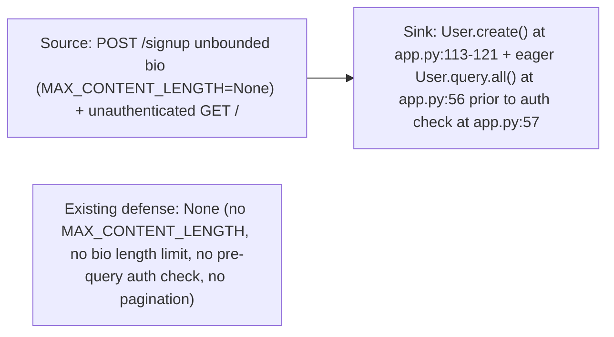

**Evidence:** config.py:6-38 + app.py:29,53-65,113-121

### BALLS-002 — Fail-Open User.limited Privilege Bypass via Non-Atomic Signup

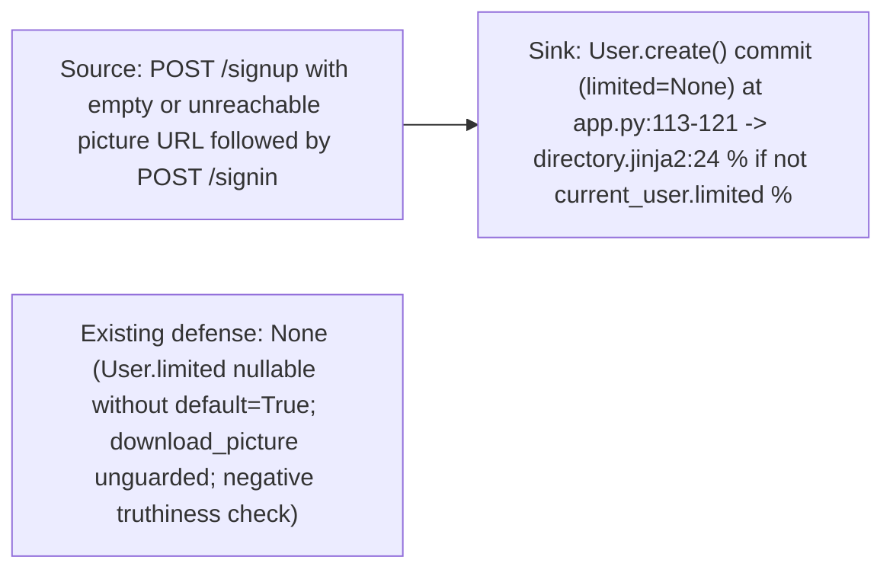

**Evidence:** app.py:31,37-41,113-135 -> pictures.py:10 -> app.py:68-91 -> directory.jinja2:24-26

### BALLS-003 — Unrestricted File Read and Path Traversal via catch_all send_file(path)

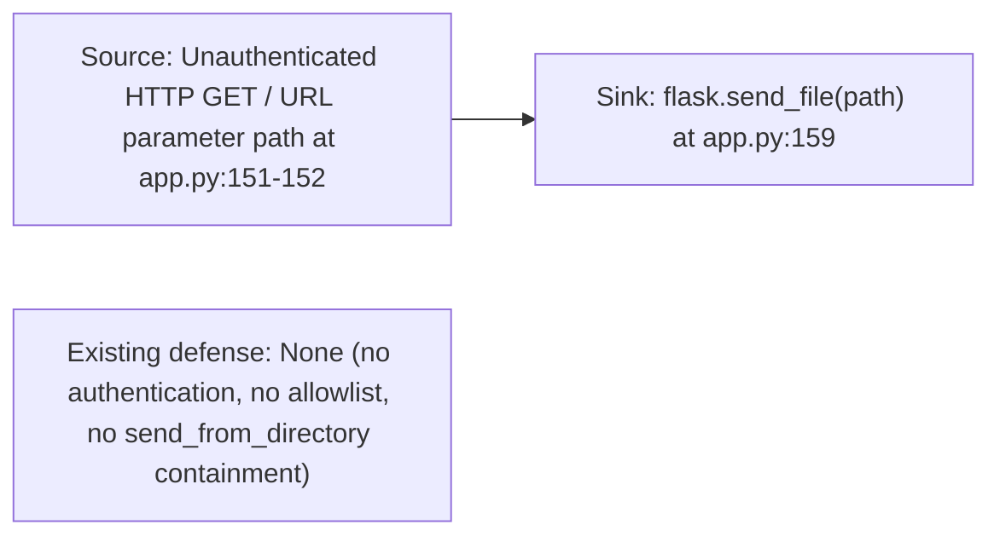

**Evidence:** app.py:19,151-159 + config.py:10,12 (Flask==0.12.2 send_file resolves relative to app.root_path)

### BALLS-004 — Hardcoded Flask SECRET_KEY Enabling Session Cookie Forgery

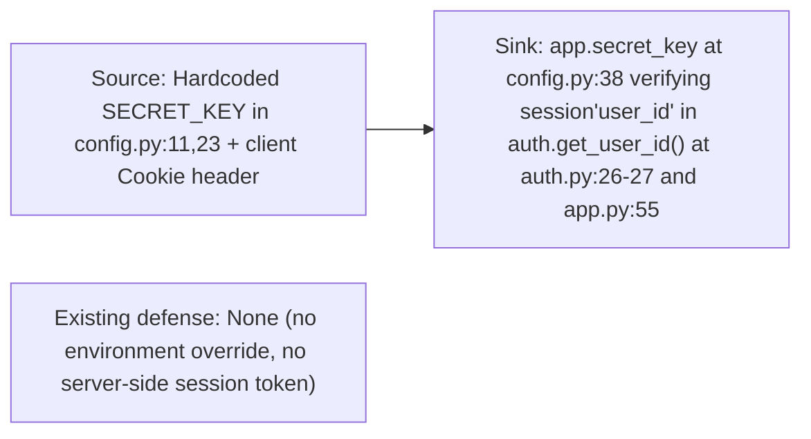

**Evidence:** run.sh:2 -> config.py:11,23,34-38 -> auth.py:26-27 -> app.py:55

### BALLS-005 — Stored Cross-Site Scripting (XSS) in Directory Template

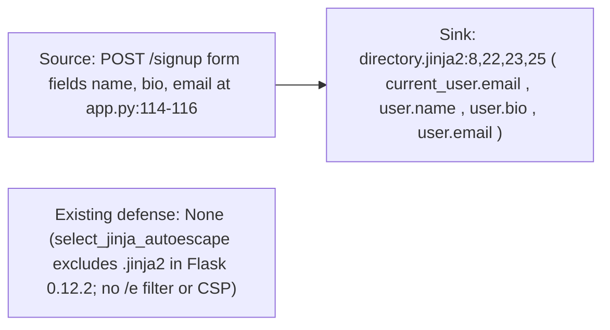

**Evidence:** app.py:19,58-63,113-121 -> directory.jinja2:8,22-25 (Flask==0.12.2)

### BALLS-006 — Unauthenticated Full-Read Server-Side Request Forgery (SSRF)

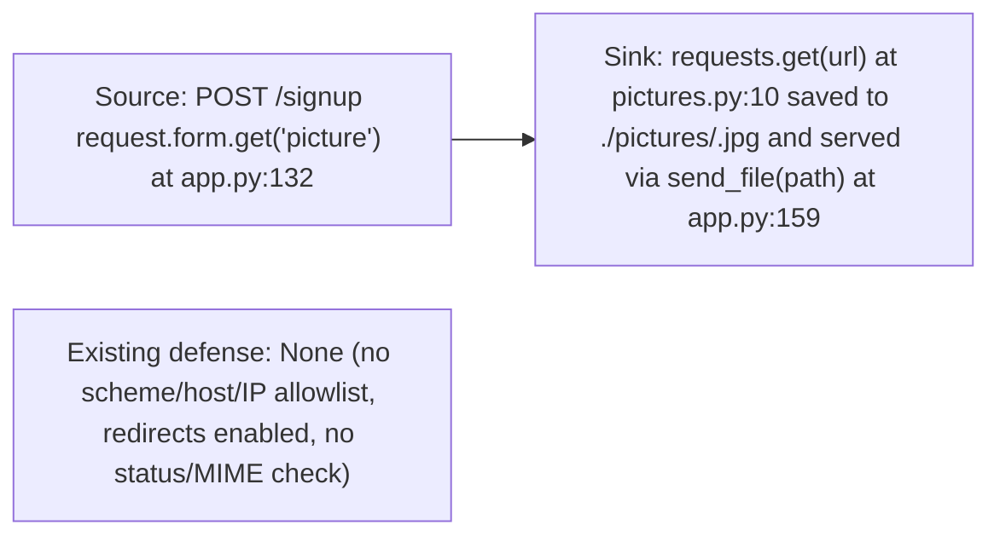

**Evidence:** app.py:131-134 -> pictures.py:8-14 -> directory.jinja2:20 -> app.py:151-159

### BALLS-007 — Unbounded Outbound Timeout, Memory Buffering, and Disk Exhaustion

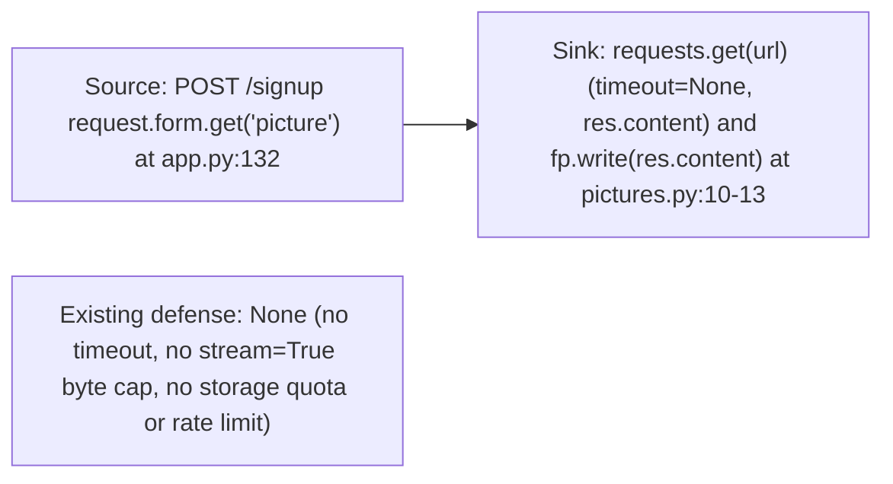

**Evidence:** app.py:131-134 -> pictures.py:10-13

### BALLS-008 — Cross-Site Triggerable Reflected XSS in Sign-In Error Flash

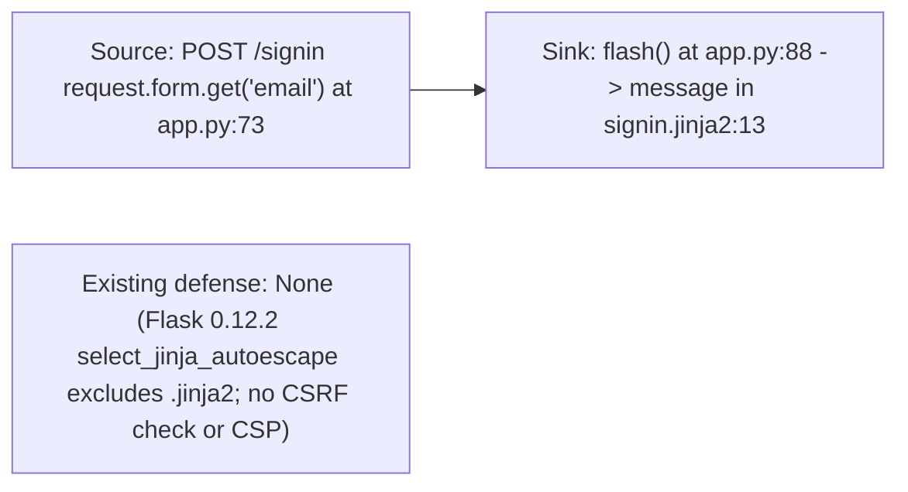

**Evidence:** app.py:73,75,88,92-97 -> signin.jinja2:9-17 (Flask==0.12.2)

### BALLS-009 — Open Unverified Self-Registration Exposing Employee Directory Profiles

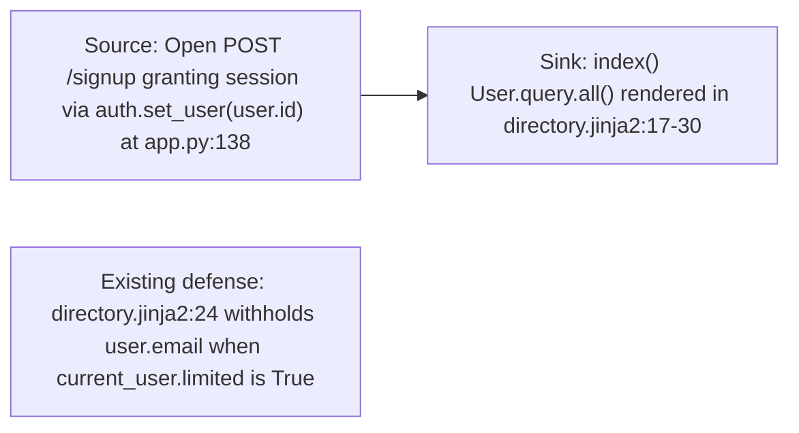

**Evidence:** config.py:9 (unused DOMAIN) + app.py:53-65,107-139 + directory.jinja2:17-30

### BALLS-010 — Cross-Site Request Forgery on Authentication and State-Changing GET Signout

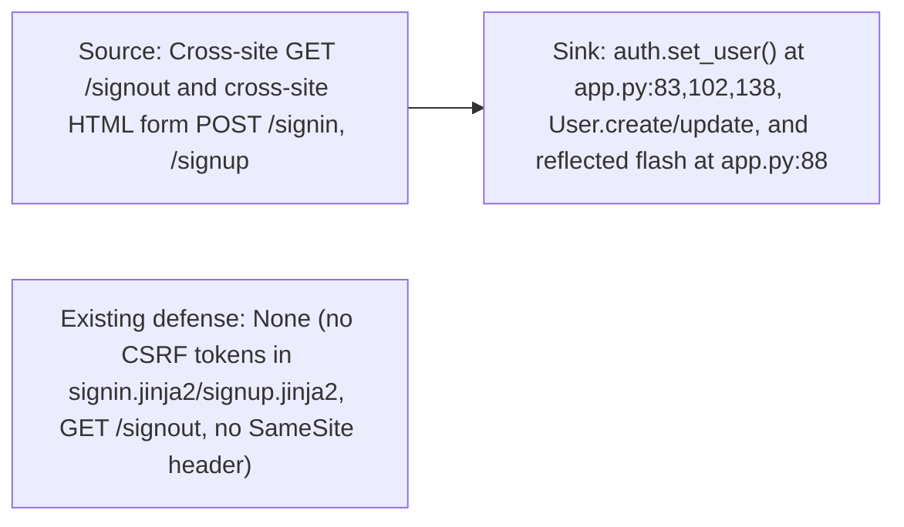

**Evidence:** app.py:68-148 + signin.jinja2:6 + signup.jinja2:6 + directory.jinja2:10

### BALLS-011 — Missing Rate Limiting and Brute-Force Protection on Authentication Routes

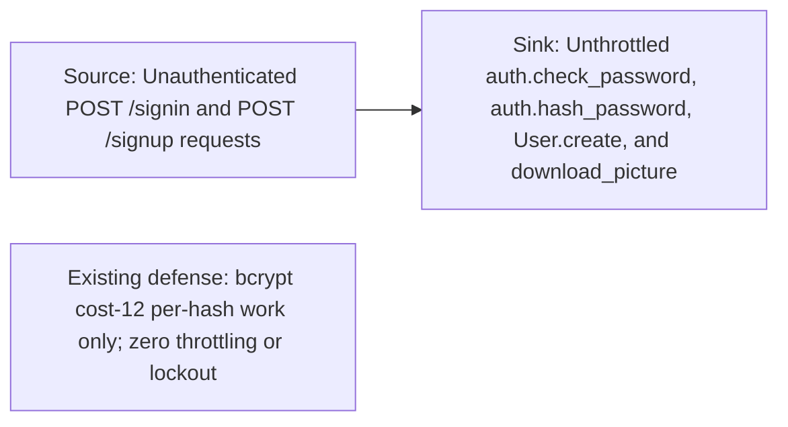

**Evidence:** app.py:68-149 + requirements.txt:1-4 (no rate limiter or attempt tracking)

### BALLS-012 — Account Enumeration via Distinct Error Messages and Work Asymmetry

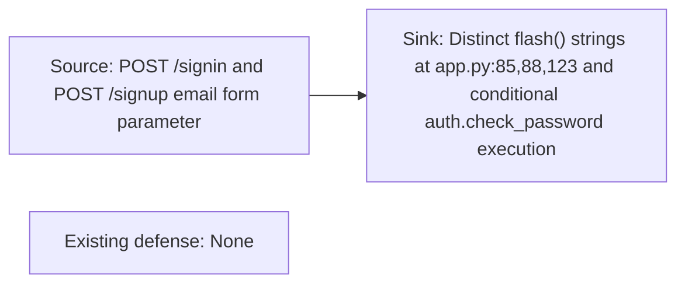

**Evidence:** app.py:75-88,122-123 -> signin.jinja2:9-17, signup.jinja2:9-17

### BALLS-013 — Plaintext Credentials and Request Parameters Logged in after_request

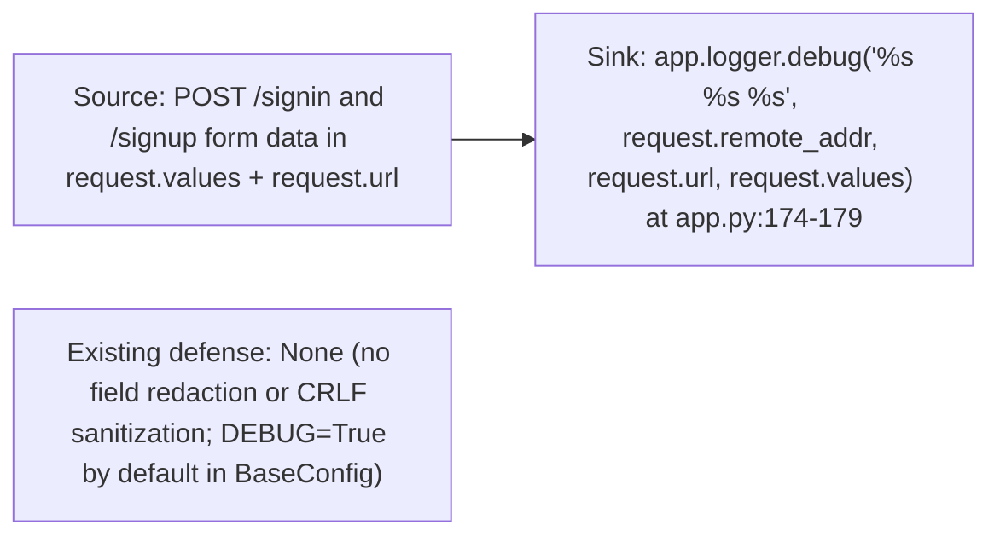

**Evidence:** run.sh:2 -> config.py:8,34-37 -> app.py:73-74,114-118,171-180

### BALLS-014 — Missing Server-Side Password Policy, ASCII Crash, and 72-Byte Bcrypt Truncation

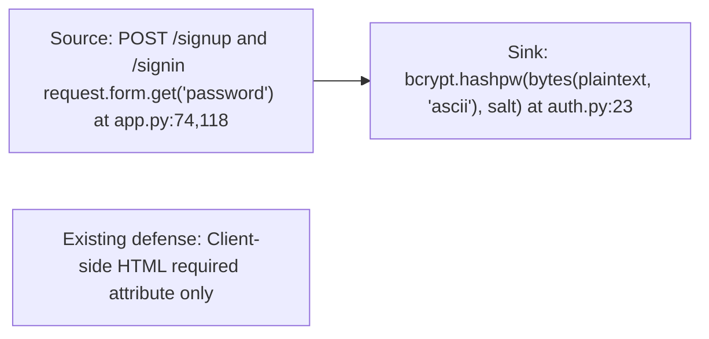

**Evidence:** app.py:74,118 -> auth.py:18-23 + requirements.txt:1 (bcrypt==3.2.0)

### BALLS-015 — Missing Secure/SameSite Session Cookie Attributes and Server-Side Logout Revocation

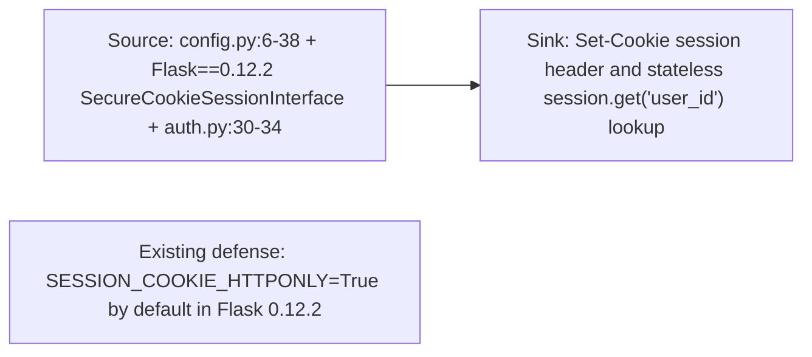

**Evidence:** config.py:6-38 + requirements.txt:2 + auth.py:26-34 + app.py:100-104

### BALLS-016 — Hardcoded Global BCRYPT_SALT Reused Across All Users

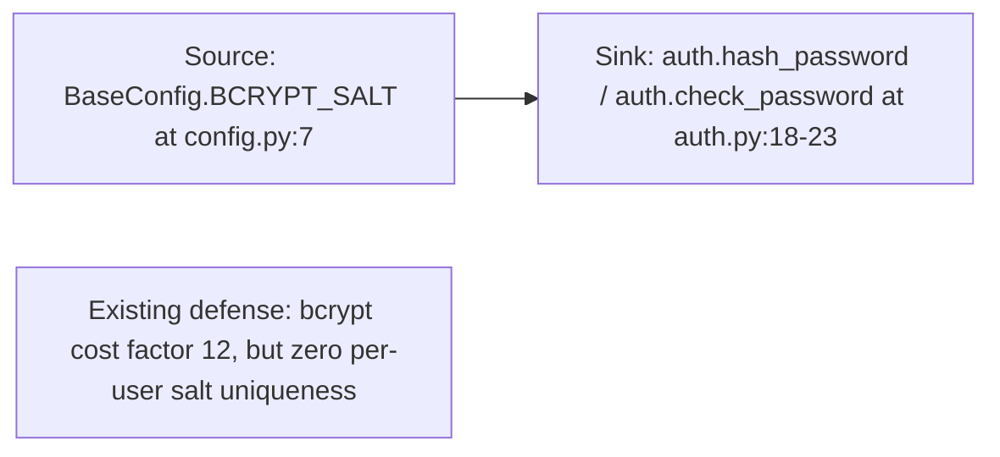

**Evidence:** config.py:7,16-38 -> app.py:78-82,117-120 -> auth.py:18-23

### BALLS-017 — Outdated/EOL Dependencies with Reachable requests Advisories and Missing Lockfile

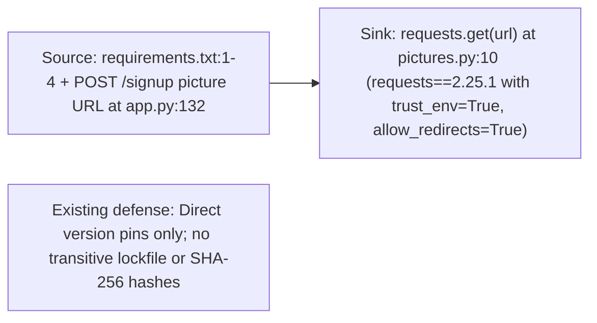

**Evidence:** requirements.txt:2,4 -> app.py:131-134 -> pictures.py:10

### BALLS-018 — Internal API Path/Query Injection and Cleartext HTTP in Employee Lookup

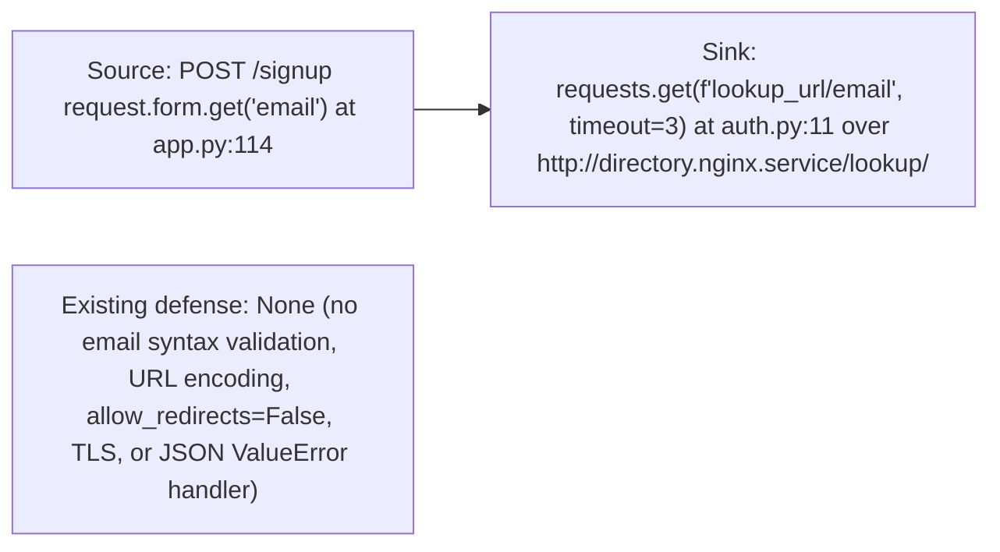

**Evidence:** app.py:114,127-130 -> auth.py:8-15 + config.py:17,22

### BALLS-019 — Insufficient Security Audit Logging for Authentication and Lifecycle Events

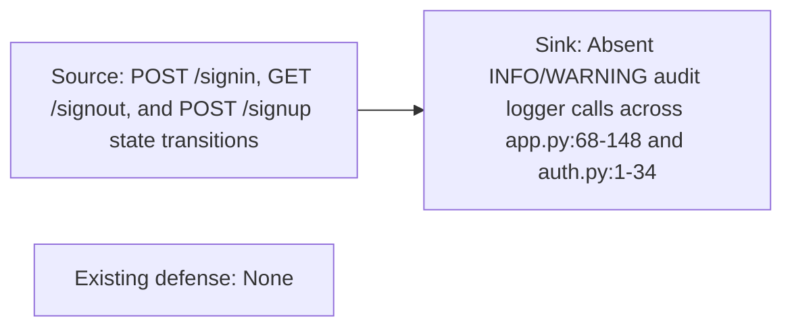

**Evidence:** app.py:68-148,171-180 + config.py:8,21

### BALLS-020 — Missing HTTP Security Response Headers (Framing, Nosniff, Cache-Control)

```mermaid
flowchart LR
  src["Source: All HTTP responses returned by Flask routes in app.py"] --> sink["Sink: Browser caching of authenticated /, MIME handling on send_file(path), and cross-origin framing of /signin and /signup"]
  defense["Existing defense: Modern browser SameSite=Lax and image/jpeg MIME defaults mitigate worst-case impact"]
```

**Evidence:** app.py:53-180 + pictures.py:8-14

### BALLS-021 — Missing Subresource Integrity on EOL Third-Party jQuery CDN Script

```mermaid
flowchart LR
  src["Source: https://ajax.googleapis.com/ajax/libs/jquery/1.12.4/jquery.min.js at base.jinja2:11"] --> sink["Sink: Browser <script> execution across /, /signin, and /signup"]
  defense["Existing defense: HTTPS transport only; no SRI digest or CSP script-src"]
```

**Evidence:** base.jinja2:6,11-12 + directory.jinja2:1 + signin.jinja2:1 + signup.jinja2:1

### BALLS-022 — Active Debug Flag by Default in BaseConfig

```mermaid
flowchart LR
  src["Source: run.sh omitting FLASK_ENV -> BaseConfig.DEBUG = True at config.py:8"] --> sink["Sink: app.config'DEBUG' = True via configure(app) at config.py:34-37"]
  defense["Existing defense: flask run in Flask 0.12.2 keeps Werkzeug use_debugger=False unless FLASK_DEBUG/--debugger is set"]
```

**Evidence:** run.sh:2 -> config.py:8,27,34-37

---

## Unresolved Candidates

All 35 candidate hypotheses recorded in candidates.json reached final disposition prior to report generation: 21 CONFIRMED, 1 LIKELY (BALLS-018, pending external FLASK_ENV and upstream directory.nginx.service behavior), and 13 MERGED duplicates, leaving 0 unresolved PENDING or NEEDS_VALIDATION leads.

These leads are not included in the verified finding totals or overall risk rating. Each needs the environment, service, or deployment evidence listed below.

_No unresolved candidates were supplied._

### Candidate Disposition Summary

| Disposition | Count |
|---|---:|
| CONFIRMED | 21 |
| LIKELY | 1 |
| MERGED | 13 |

---

## Remediation Priorities

Fix highest-leverage root causes first: (1) delete catch_all send_file(path) and isolate database.db and static/picture serving; (2) externalize and rotate SECRET_KEY, set BaseConfig.DEBUG = False, and strip request.values from after_request logging; (3) enable Jinja2 autoescaping on .jinja2 templates, add CSRF tokens (converting /signout to POST), and upgrade Flask/requests with a hash-pinned lockfile; (4) make signup atomic with User.limited non-nullable default=True, enforce domain/email verification, rate limiting, and per-user bcrypt.gensalt()/checkpw(); and (5) block non-public IPs, redirects, and unbounded timeouts/sizes in download_picture.

### Next priority — High
- **BALLS-001 — Unauthenticated Pre-Auth Full-Table Load and Unbounded Bio Storage Amplification** (`app.py:53-65`): Verify authentication before querying User in index(), add server-side pagination, set MAX_CONTENT_LENGTH in BaseConfig, and enforce character length bounds on bio/email/name.
- **BALLS-002 — Fail-Open User.limited Privilege Bypass via Non-Atomic Signup** (`app.py:113-135`): Declare User.limited as nullable=False, default=True, resolve check_limited() and handle download_picture() errors before committing User in a single atomic transaction, and check current_user.limited is false explicitly in directory.jinja2.
- **BALLS-003 — Unrestricted File Read and Path Traversal via catch_all send_file(path)** (`app.py:151-159`): Delete catch_all send_file(path); serve explicit static assets (style.css, favicon.ico) and confine user pictures to PICTURES_DIR via send_from_directory with authentication.
- **BALLS-004 — Hardcoded Flask SECRET_KEY Enabling Session Cookie Forgery** (`config.py:11-38`): Remove all hardcoded SECRET_KEY literals from config.py, require SECRET_KEY from an environment variable or secret manager at startup (failing closed when absent), and rotate compromised keys.
- **BALLS-005 — Stored Cross-Site Scripting (XSS) in Directory Template** (`directory.jinja2:8-26`): Override select_jinja_autoescape to include .jinja2 (or rename templates to .html and upgrade Flask), validate email format server-side, and enforce a strict Content-Security-Policy header.
- **BALLS-006 — Unauthenticated Full-Read Server-Side Request Forgery (SSRF)** (`pictures.py:8-14`): Validate URL scheme/hostname, resolve DNS and block non-public IPv4/IPv6 ranges with connection IP pinning, disable automatic redirects, enforce timeouts/byte caps, and validate/re-encode image content before saving.
- **BALLS-007 — Unbounded Outbound Timeout, Memory Buffering, and Disk Exhaustion** (`pictures.py:8-14`): Set explicit connect/read/wall-clock timeouts on requests.get, enable stream=True with strict cumulative byte caps and storage quotas, unlink partial files on error, and rate-limit /signup.
- **BALLS-008 — Cross-Site Triggerable Reflected XSS in Sign-In Error Flash** (`signin.jinja2:9-17`): Enable Jinja2 autoescaping for .jinja2 templates (or rename to .html), replace the email-reflecting error with a generic 'Invalid email or password' message, add CSRF protection, and configure CSP.

### Planned priority — Medium
- **BALLS-009 — Open Unverified Self-Registration Exposing Employee Directory Profiles** (`app.py:53-65`): Enforce DOMAIN restrictions and out-of-band email verification on /signup before granting sessions, and restrict directory listing for unverified/limited accounts.
- **BALLS-010 — Cross-Site Request Forgery on Authentication and State-Changing GET Signout** (`app.py:68-148`): Enforce synchronizer CSRF tokens (e.g., Flask-WTF CSRFProtect) on all POST routes, change /signout from GET to CSRF-protected POST, and add SameSite=Lax to session cookies.
- **BALLS-011 — Missing Rate Limiting and Brute-Force Protection on Authentication Routes** (`app.py:68-149`): Add per-IP and per-account rate limiting (e.g., Flask-Limiter with shared Redis storage) and short-window exponential backoff on /signin and /signup.
- **BALLS-012 — Account Enumeration via Distinct Error Messages and Work Asymmetry** (`app.py:68-124`): Return a single generic 'Invalid email or password' message on /signin, execute a dummy bcrypt check when user is None, and decouple /signup duplicate-email feedback via out-of-band email verification.
- **BALLS-013 — Plaintext Credentials and Request Parameters Logged in after_request** (`app.py:171-180`): Remove request.values and query strings from @app.after_request logging (log only method, sanitized path, and status code), sanitize CRLF characters, and set BaseConfig.DEBUG = False.
- **BALLS-014 — Missing Server-Side Password Policy, ASCII Crash, and 72-Byte Bcrypt Truncation** (`auth.py:22-23`): Validate non-empty string passwords of 12-72 UTF-8 bytes (rejecting NUL bytes) server-side in auth.py and signup(), and handle validation errors cleanly.
- **BALLS-015 — Missing Secure/SameSite Session Cookie Attributes and Server-Side Logout Revocation** (`config.py:6-38`): Upgrade Flask, set SESSION_COOKIE_SECURE=True, SESSION_COOKIE_HTTPONLY=True, and SESSION_COOKIE_SAMESITE='Lax', bound PERMANENT_SESSION_LIFETIME, and validate a server-side session_version token rotated on signout.
- **BALLS-016 — Hardcoded Global BCRYPT_SALT Reused Across All Users** (`config.py:7`): Remove BCRYPT_SALT from config.py, generate a fresh per-user salt via bcrypt.gensalt(rounds=12) on signup/reset, and verify logins with constant-time bcrypt.checkpw().
- **BALLS-017 — Outdated/EOL Dependencies with Reachable requests Advisories and Missing Lockfile** (`requirements.txt:1-4`): Upgrade to maintained releases (Flask>=3.0, Flask-SQLAlchemy>=3.1, requests>=2.32.4, bcrypt>=4.2), generate a hash-pinned transitive lockfile, and set session.trust_env = False on outbound HTTP clients.
- **BALLS-018 — Internal API Path/Query Injection and Cleartext HTTP in Employee Lookup** (`auth.py:8-15`): Validate email format strictly, percent-encode email with urllib.parse.quote(email, safe=''), set allow_redirects=False, catch ValueError and verify boolean schema, and use HTTPS for EMPLOYEE_API_URL.

### Hardening priority — Low
- **BALLS-019 — Insufficient Security Audit Logging for Authentication and Lifecycle Events** (`app.py:68-148`): Add structured INFO/WARNING security event logging (stripping CR/LF control characters and never logging passwords) across signin, signout, and signup.
- **BALLS-020 — Missing HTTP Security Response Headers (Framing, Nosniff, Cache-Control)** (`app.py:171-180`): Set X-Frame-Options: DENY, Content-Security-Policy: frame-ancestors 'none', X-Content-Type-Options: nosniff, and Cache-Control: no-store on dynamic routes in @app.after_request.
- **BALLS-021 — Missing Subresource Integrity on EOL Third-Party jQuery CDN Script** (`base.jinja2:11`): Upgrade to jQuery 3.7.1 with verified SRI integrity and crossorigin='anonymous' attributes (or remove unused JS scripts / vendor locally) and add CSP.
- **BALLS-022 — Active Debug Flag by Default in BaseConfig** (`config.py:8-37`): Set BaseConfig.DEBUG = False so all environments fail closed with debug disabled unless explicitly opted in locally.

---

## Appendix

### A. Component Architecture Summary

| Component | Type | Files / paths | Verified findings | Highest severity |
|---|---|---|---:|---|
| web-app | web-service | app.py, base.jinja2, directory.jinja2, signin.jinja2, signup.jinja2, style.css | 12 | High |
| auth | library | auth.py | 3 | Medium |
| pictures | library | pictures.py | 2 | High |
| config-supply-chain | configuration | config.py, run.sh, requirements.txt | 5 | High |

### B. Scan Metadata

- **Scan ID:** `20261117-vulnapp-ebcc0ee5`
- **Target:** `/Users/mkunz/Documents/antigravity/gist-ebcc0ee597dd4c2bf924f7ee2a751a27`
- **Raw findings:** 22; **reported findings:** 22; **unresolved candidates:** 0; **candidate ledger records:** 35.
- **CodeGraph:** {"version": "1.6.2", "state": "indexed", "files": 4, "nodes": 49, "edges": 70}.
- **Execution constraints:** {}.
- **Coverage assignments:** 13; **independent verifier assignments:** 22; **direct model API calls:** 0.

### C. CWE Reference

| CWE | Name | Reference |
|---|---|---|
| CWE-1104 | Use of Unmaintained Third-Party Components | [MITRE](https://cwe.mitre.org/data/definitions/1104.html) |
| CWE-204 | Observable Response Discrepancy | [MITRE](https://cwe.mitre.org/data/definitions/204.html) |
| CWE-22 | Improper Limitation of a Pathname to a Restricted Directory ('Path Traversal') | [MITRE](https://cwe.mitre.org/data/definitions/22.html) |
| CWE-284 | Improper Access Control | [MITRE](https://cwe.mitre.org/data/definitions/284.html) |
| CWE-307 | Improper Restriction of Excessive Authentication Attempts | [MITRE](https://cwe.mitre.org/data/definitions/307.html) |
| CWE-321 | Use of Hard-coded Cryptographic Key | [MITRE](https://cwe.mitre.org/data/definitions/321.html) |
| CWE-352 | Cross-Site Request Forgery (CSRF) | [MITRE](https://cwe.mitre.org/data/definitions/352.html) |
| CWE-400 | Uncontrolled Resource Consumption | [MITRE](https://cwe.mitre.org/data/definitions/400.html) |
| CWE-489 | Active Debug Code | [MITRE](https://cwe.mitre.org/data/definitions/489.html) |
| CWE-494 | Download of Code Without Integrity Check | [MITRE](https://cwe.mitre.org/data/definitions/494.html) |
| CWE-521 | Weak Password Requirements | [MITRE](https://cwe.mitre.org/data/definitions/521.html) |
| CWE-532 | Insertion of Sensitive Information into Log File | [MITRE](https://cwe.mitre.org/data/definitions/532.html) |
| CWE-614 | Sensitive Cookie in HTTPS Session Without 'Secure' Attribute | [MITRE](https://cwe.mitre.org/data/definitions/614.html) |
| CWE-636 | Not Failing Securely ('Fail Open') | [MITRE](https://cwe.mitre.org/data/definitions/636.html) |
| CWE-693 | Protection Mechanism Failure | [MITRE](https://cwe.mitre.org/data/definitions/693.html) |
| CWE-760 | Use of a One-Way Hash with a Predictable Salt | [MITRE](https://cwe.mitre.org/data/definitions/760.html) |
| CWE-778 | Insufficient Logging | [MITRE](https://cwe.mitre.org/data/definitions/778.html) |
| CWE-79 | Improper Neutralization of Input During Web Page Generation ('Cross-site Scripting') | [MITRE](https://cwe.mitre.org/data/definitions/79.html) |
| CWE-918 | Server-Side Request Forgery (SSRF) | [MITRE](https://cwe.mitre.org/data/definitions/918.html) |

### D. Glossary

- **Confirmed:** source evidence and attack conditions were independently verified.
- **Likely / Possible:** evidence supports the issue, but one or more material conditions remain uncertain.
- **Needs validation:** a plausible lead remains outside verified totals pending deployment, service, or runtime facts.
- **Attack vector:** where the attacker begins (for example, Internet, authenticated, internal network, or local access).
- **Exploit chain:** a reviewed sequence of findings where one step materially enables the next.
- **CWE:** Common Weakness Enumeration identifier for the underlying weakness.

### E. Full Component Map (JSON)

```json
{
  "schema": "balls.architecture.v1",
  "scan": "20261117-vulnapp-ebcc0ee5",
  "target": "/Users/mkunz/Documents/antigravity/gist-ebcc0ee597dd4c2bf924f7ee2a751a27",
  "stack": [
    "Python 3",
    "Flask 0.12.2 (Jinja2 templates, Werkzeug session cookies)",
    "Flask-SQLAlchemy 2.5.1 (SQLite sqlite:///database.db)",
    "bcrypt 3.2.0",
    "requests 2.25.1",
    "Bootstrap 4.5.2 & jQuery 1.12.4 (CDN)"
  ],
  "codegraph": {
    "version": "1.6.2",
    "state": "indexed",
    "files": 4,
    "nodes": 49,
    "edges": 70
  },
  "components": [
    {
      "name": "web-app",
      "type": "web-service",
      "language": "Python / Jinja2",
      "description": "Flask routes, SQLAlchemy User model, Jinja2 templates, catch-all file handler, and request logging middleware.",
      "paths": [
        "app.py",
        "base.jinja2",
        "directory.jinja2",
        "signin.jinja2",
        "signup.jinja2",
        "style.css"
      ],
      "entry_points": [
        "GET / (index)",
        "GET, POST /signin (signin)",
        "GET /signout (signout)",
        "GET, POST /signup (signup)",
        "GET /<path:path> (catch_all)"
      ],
      "trust_boundaries": [
        "Untrusted HTTP requests (form parameters, URL paths, session cookies) into Flask route handlers and after_request logger",
        "Browser DOM rendering of Jinja2 templates and external CDN scripts"
      ]
    },
    {
      "name": "auth",
      "type": "library",
      "language": "Python",
      "description": "Password hashing/verification, Flask session helpers, and outbound employee directory privilege check.",
      "paths": [
        "auth.py"
      ],
      "entry_points": [
        "auth.check_limited(email, lookup_url)",
        "auth.check_password(plaintext, password_hash, salt)",
        "auth.hash_password(plaintext, salt)",
        "auth.get_user_id()",
        "auth.set_user(user_id)"
      ],
      "trust_boundaries": [
        "Signed Flask cookie session storing user_id",
        "Outbound HTTP GET from check_limited to internal employee lookup API"
      ]
    },
    {
      "name": "pictures",
      "type": "library",
      "language": "Python",
      "description": "Remote profile picture fetcher writing downloaded bytes into PICTURES_DIR.",
      "paths": [
        "pictures.py"
      ],
      "entry_points": [
        "pictures.download_picture(url, pictures_dir)"
      ],
      "trust_boundaries": [
        "Outbound HTTP GET to user-supplied picture URL",
        "Local filesystem writes under PICTURES_DIR (./pictures/<uuid>.jpg)"
      ]
    },
    {
      "name": "config-supply-chain",
      "type": "configuration",
      "language": "Python / Shell",
      "description": "Environment-driven Flask config classes, secret keys, bcrypt salt, launch script, and dependency manifest.",
      "paths": [
        "config.py",
        "run.sh",
        "requirements.txt"
      ],
      "entry_points": [
        "config.configure(app)",
        "run.sh (FLASK_APP=app.py flask run)"
      ],
      "trust_boundaries": [
        "FLASK_ENV environment variable selecting BaseConfig vs LocalConfig vs ProductionConfig",
        "Third-party Python packages and CDN JavaScript assets"
      ]
    }
  ],
  "interaction_nodes": [
    {
      "id": "browser",
      "label": "Untrusted Client Browser"
    },
    {
      "id": "webapp",
      "label": "Flask Web App (app.py + Jinja2)"
    },
    {
      "id": "auth",
      "label": "Auth & Session Helper (auth.py)"
    },
    {
      "id": "pictures",
      "label": "Picture Downloader (pictures.py)"
    },
    {
      "id": "config",
      "label": "App Config (config.py)"
    },
    {
      "id": "sqlite",
      "label": "SQLite DB (database.db)"
    },
    {
      "id": "emp_api",
      "label": "Employee Directory Service"
    },
    {
      "id": "ext_url",
      "label": "Arbitrary Remote URL"
    },
    {
      "id": "fs",
      "label": "Local Filesystem"
    }
  ],
  "interactions": [
    {
      "from": "browser",
      "to": "webapp",
      "label": "HTTP GET/POST + signed session cookie"
    },
    {
      "from": "config",
      "to": "webapp",
      "label": "SECRET_KEY, DEBUG, BCRYPT_SALT, URLs"
    },
    {
      "from": "webapp",
      "to": "sqlite",
      "label": "SQLAlchemy User read/write"
    },
    {
      "from": "webapp",
      "to": "auth",
      "label": "hash/check password, session, check_limited"
    },
    {
      "from": "auth",
      "to": "emp_api",
      "label": "HTTP GET lookup_url/email"
    },
    {
      "from": "webapp",
      "to": "pictures",
      "label": "download_picture(form.picture)"
    },
    {
      "from": "pictures",
      "to": "ext_url",
      "label": "requests.get(url)"
    },
    {
      "from": "pictures",
      "to": "fs",
      "label": "write ./pictures/<uuid>.jpg"
    },
    {
      "from": "webapp",
      "to": "fs",
      "label": "send_file(path) via /<path:path>"
    }
  ],
  "out_of_scope": [
    "Implementation of the external Employee Directory HTTP service (directory.nginx.service).",
    "Dynamic runtime testing, live server execution, and dependency installation.",
    "Host/network firewall, reverse proxy, and TLS termination outside the repository."
  ]
}
```

### F. Reference Claim Comparison

_No reference-claim comparison was supplied._
