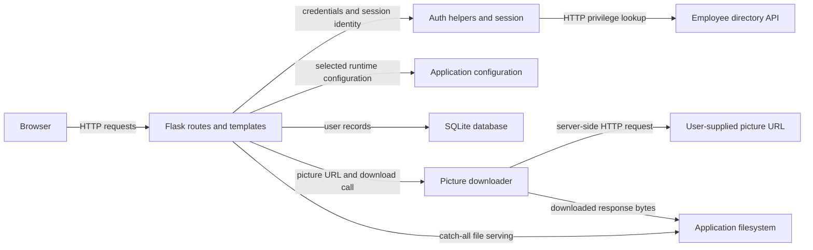
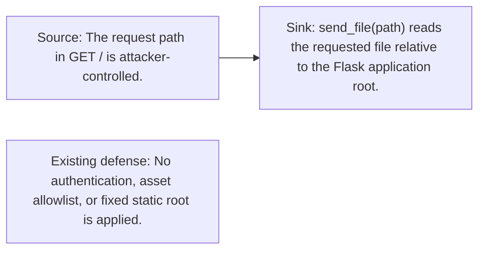
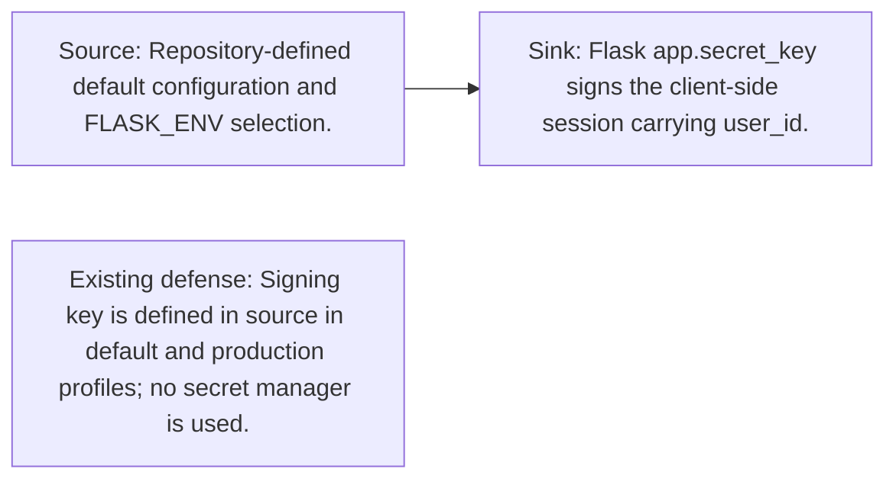
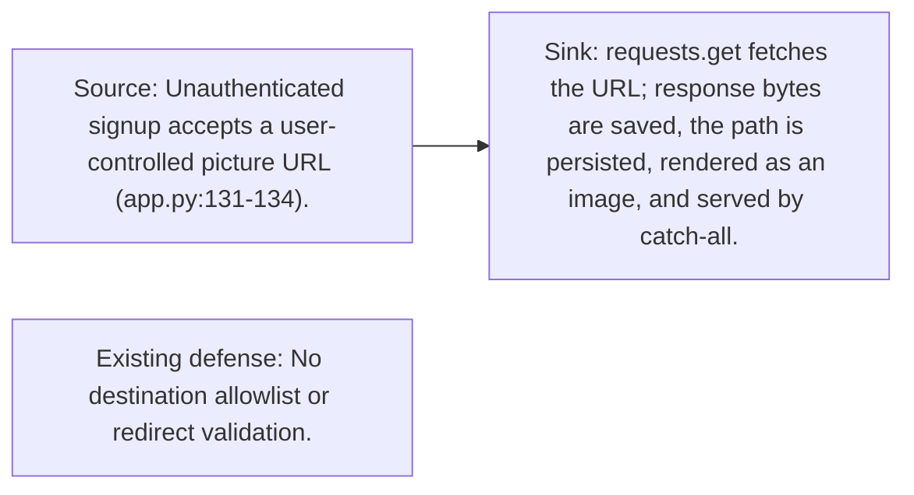
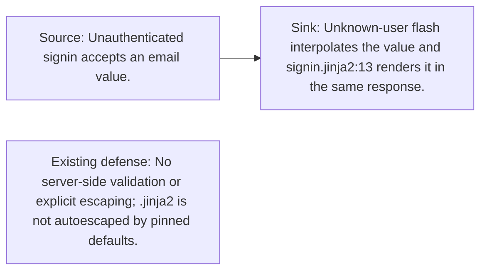
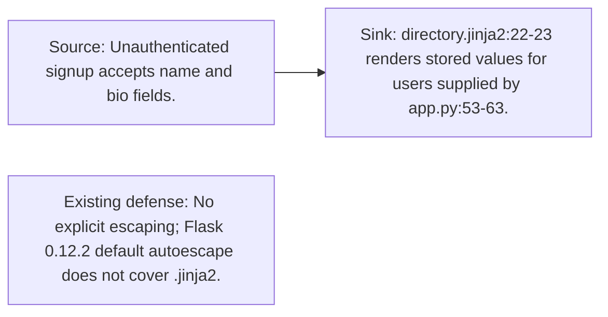
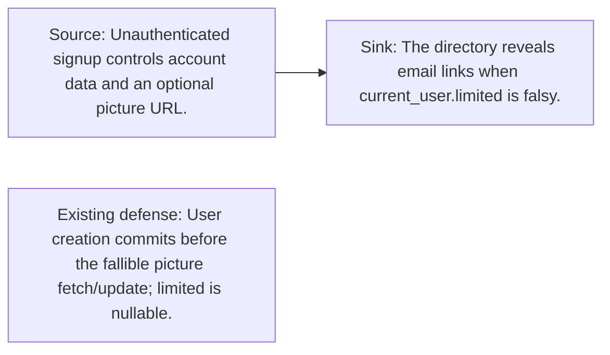
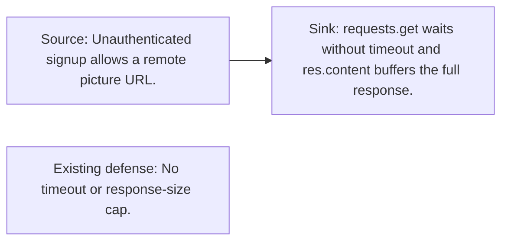
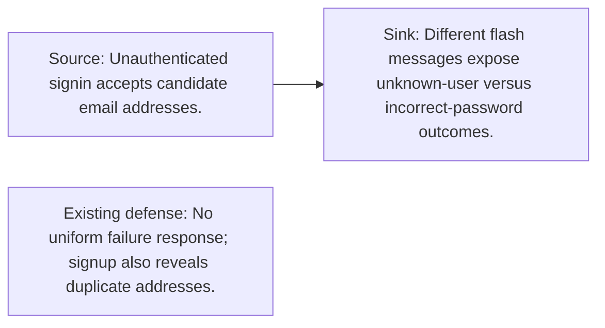
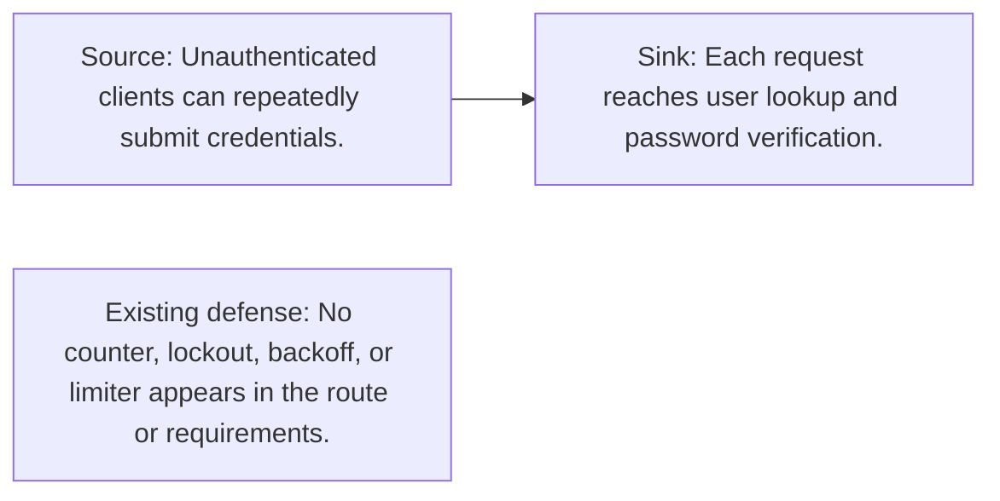

# BALLS Security Assessment Report — vulnapp

**Project:** vulnapp  
**Target:** /Users/mkunz/Documents/ChatGPT/balls/BALLS/sample/vulnapp  
**Generated:** 2026-11-17T01:16:32.484623+00:00  
**Scan ID:** 20261117T011049Z  
**Overall risk rating:** High

---

## Executive Summary

This bounded source-only quick scan assessed vulnapp, a Flask 0.12.2 employee-directory application. It prioritized the reachable web and picture-handling paths, reviewing authentication and authorization, templates, file serving, configuration secrets, and outbound picture requests. It is narrower than the full scan and does not represent a comprehensive review of every category.

The quick scan promoted 9 findings: 3 High, 4 Medium, and 2 Low; 7 are Confirmed and 2 Likely. The highest-priority issues are unauthenticated access to files under the application root, source-defined session signing keys, template XSS, and SSRF through signup pictures with response readback. A signup failure can also leave the account’s directory restriction unset.

First remove generic file serving, rotate and externalize session keys, enable template autoescape, and limit picture fetch destinations and response size. The two Likely findings concern resource exhaustion and the lack of an application-defined signin throttle; operational impact depends on runtime capacity and external controls. The scan did not run app code, dependencies, tests, or reproduction commands.

### Key Statistics

| Metric | Value |
|---|---:|
| Components analyzed | 4 |
| Component/category work units | 16 |
| Raw hunter findings | 9 |
| Candidate ledger records | 9 |
| Reported findings after review | 9 |
| Needs-validation candidates | 0 |
| False positives dismissed | 0 |
| Suppressed findings | 0 |
| Exploit chains | 0 |

**Verification confidence:** High: 7, Medium: 2  
**Council verdicts:** CONFIRMED: 7, LIKELY: 2

### Highest-Priority Findings

- **BALLS-001 — Unauthenticated Application-Root File Disclosure** (`app.py:151-159`): Unauthenticated clients can read app-root files accessible to the process. Access outside the application root depends on request normalization and is not claimed.
- **BALLS-002 — Hardcoded Flask Session Signing Key** (`config.py:11`): Session forgery can impersonate a user if the attacker identifies a valid user ID. The app has no administrator role, so admin access or host compromise is not established.
- **BALLS-003 — Server-Side Request Forgery through Picture URL** (`pictures.py:8-14`): The application can request HTTP destinations reachable from its host and disclose their response bodies to the registering user. Specific internal services or sensitive data are not established.

---

## Methodology

Three focused gpt-6-luna Codex hunters reviewed auth/authz/business logic, XSS/injection, and picture SSRF/outbound HTTP. The coordinator reviewed configuration and file serving. Three separate fresh verifiers challenged the file disclosure, session key, and SSRF findings. No model API was used. This quick pass intentionally skipped comprehensive category coverage; see the coverage artifact for reviewed and unreviewed units.

| Stage | Work performed | Recorded coverage |
|---|---|---|
| Reconnaissance | Repository structure, stack, and local code graph recorded. | 4 files; 49 graph nodes; graph status complete. |
| Component review | The coordinator and category hunters reviewed the selected components. | 0 component reviewers; 4 registered components. |
| Category hunting | Focused component-scoped category passes were run. | 0 initial broad groups; 3 component-scoped hunter assignments; 16 total units. |
| Independent verification | Independent verifiers checked reachability, defenses, and impact. | 3 verifier assignments. |
| Model execution | Codex-native reviewers and hunters used the signed-in session. | Direct model API calls: 0; observed concurrency: 3 of configured 3. |
| Report generation | Findings, IDs, counts, source excerpts, indexes, diagrams, and appendices were assembled from scan artifacts. | Deterministic SQLite-backed renderer. |

CodeGraph 1.6.2 indexed the four Python files; it does not index the Jinja templates, which were read directly. Route methods and form behavior were also checked against source because the graph route listing omitted POST methods.

### Components Analyzed

| Component | Type | Files / paths | Verified findings | Highest severity |
|---|---|---|---:|---|
| web-app | web application | app.py, *.jinja2 | 6 | High |
| auth | authentication library | auth.py | 0 | None |
| config | configuration | config.py | 1 | High |
| pictures | outbound HTTP utility | pictures.py | 2 | High |

### Vulnerability Categories Assessed

| Category | Components reviewed | Unit status |
|---|---:|---|
| authentication-abuse | 1 | finding |
| authn | 2 | reviewed |
| authz | 1 | finding |
| business-logic | 1 | finding |
| config | 1 | reviewed |
| cors-csrf | 1 | not-reviewed |
| crypto | 1 | reviewed-limited |
| data-exposure | 1 | finding |
| injection | 1 | reviewed-limited |
| outbound-http-trust | 1 | finding |
| path-traversal | 1 | finding |
| resource-exhaustion | 1 | likely-finding |
| secrets | 1 | finding |
| ssrf | 1 | finding |
| xss | 1 | finding |

### Component-by-Category Coverage

**Coverage status counts:** finding: 9, likely-finding: 1, not-reviewed: 1, reviewed: 3, reviewed-limited: 2

**Execution and limits:** model=gpt-6-luna; modelApiUsed=False; plannedTaskCount=4; maxObservedConcurrentSubagents=3; maxConcurrentLimitObserved=3; quickScan=True; completedTaskCount=6; focusedComponentReviewers=0; categoryHunterAssignments=3; independentVerifierAgents=3; directModelApiCalls=0; configuredMaxConcurrentSubagents=3

| Unit | Component | Category | Status | Review assignment | Evidence note |
|---|---|---|---|---|---|
| web-app::authn | web-app | authn | reviewed |  | Signin, session identity, and logout paths skimmed; no separate session-fixation issue established. |
| web-app::authz | web-app | authz | finding |  | Signup partial-state directory restriction issue confirmed. |
| web-app::business-logic | web-app | business-logic | finding |  | Signup commits before fallible external picture work; same authz issue, no duplicate. |
| web-app::path-traversal | web-app | path-traversal | finding |  | Direct application-root file disclosure confirmed; traversal beyond root not claimed. |
| web-app::data-exposure | web-app | data-exposure | finding |  | Catch-all route discloses app-root files to unauthenticated requests. |
| web-app::xss | web-app | xss | finding |  | Stored and reflected template XSS source paths checked. |
| web-app::injection | web-app | injection | reviewed-limited |  | No SQL/OS injection sink found in this quick pass; full injection audit skipped. |
| web-app::cors-csrf | web-app | cors-csrf | not-reviewed |  | Full browser CSRF review was outside this quick scan. |
| web-app::authentication-abuse | web-app | authentication-abuse | finding |  | Account enumeration found; no repository-defined signin throttle. |
| auth::crypto | auth | crypto | reviewed-limited |  | Password hashing skimmed; shared salt not included in the bounded high-priority quick findings. |
| auth::authn | auth | authn | reviewed |  | Signin/session flow skimmed; no independent session fixation issue identified. |
| config::secrets | config | secrets | finding |  | Default and production source-defined session signing keys confirmed; values redacted. |
| config::config | config | config | reviewed |  | Checked run.sh and FLASK_ENV default selection; no broader configuration audit. |
| pictures::ssrf | pictures | ssrf | finding |  | Arbitrary picture URL fetch and response readback confirmed. |
| pictures::outbound-http-trust | pictures | outbound-http-trust | finding |  | No host/redirect validation in picture fetch. |
| pictures::resource-exhaustion | pictures | resource-exhaustion | likely-finding |  | No timeout or response size bound; practical service impact depends on runtime capacity. |

**Assignments**

| Assignment | Component | Role | Status | Unit IDs |
|---|---|---|---|---|
| quick-web-authz | web-app | category-hunter | completed |  |
| quick-web-xss | web-app | category-hunter | completed |  |
| quick-pictures-ssrf | pictures | category-hunter | completed |  |
| coordinator-config-files | config/web-app | coordinator-review | completed |  |

### Raw and Validated Finding Counts

| Pipeline stage | Count | Meaning |
|---|---:|---|
| Raw findings | 9 | Candidate reports entered by hunters before deterministic deduplication. |
| Candidate ledger records | 9 | Hypotheses and verified/merged dispositions retained for audit. |
| Promoted findings | 9 | Independently dispositioned rows included in the report. |
| Confirmed | 7 | Independently supported findings promoted to the report. |
| Likely | 2 | Promoted with one stated unresolved assumption. |
| Possible | 0 | Unpromoted leads retained in the candidate ledger. |
| Needs validation | 0 | Separate leads excluded from verified totals. |
| False positives | 0 | Rejected by verification. |
| Final unique findings | 9 | Verified findings after deduplication. |

### Limitations

- Static source review only; target code and dependencies were not executed or installed.
- CodeGraph was installed during follow-up; earlier assignments used direct source inspection and later resource-exhaustion hunters used graph queries.
- External employee-directory behavior, deployment logging, proxy controls, and runtime credentials are not established by the source.
- Confirmed findings and needs-validation candidates are reported separately.

---

## Scope

This quick pass covered Flask routes and templates, authentication/session behavior, configuration secrets, and picture URL fetching. CodeGraph indexed four Python files; Jinja templates were read directly. Full CSRF/browser testing, logging, race conditions, deserialization, broad injection, and complete direct/transitive dependency advisory review were skipped.

### Technology Stack

- Python
- Flask 0.12.2
- Flask-SQLAlchemy
- Jinja2
- requests 2.25.1

### Component Interaction Map



### Component Details

| Component | Assessment summary |
|---|---|
| web-app | The web routes and templates contain stored and reflected XSS, partial signup authorization state, account enumeration, and a missing application-level signin limit. The root route also exposes files under the application directory; full CSRF testing was skipped. |
| auth | The quick pass reviewed signin, session assignment, and account enumeration, but did not audit all password, logging, or crypto categories. No separate session-fixation issue was established. |
| config | The checked-in default and production profiles both define session signing keys. The launcher selects the default profile when FLASK_ENV is unset; secret values are redacted from the report. |
| pictures | Signup fetches a user-supplied URL and stores the complete response for later retrieval. This confirms response-bearing SSRF; service availability impact from unbounded downloads remains Likely. |

### web-app

**Entry points**
- GET /
- POST /signin
- GET /signout
- POST /signup
- GET /<path:path>

**Data stores**
- SQLite via Flask-SQLAlchemy
- Flask signed-cookie session
- picture files under configured directory

**External services**
- Employee directory lookup
- User-supplied picture URL fetch

**Trust boundaries**
- Unauthenticated HTTP input to session/account state
- Application server to employee directory and arbitrary URL destination
- Application process to filesystem

**Security controls reviewed**
- Authentication and session signing
- Directory limited flag
- Template escaping
- Catch-all file access
- Atomic signup and picture-fetch bounds

### auth

**Entry points**
- check_limited
- check_password
- hash_password
- get_user_id
- set_user

**Data stores**
- Flask session

**External services**
- Employee directory HTTP API

**Trust boundaries**
- Submitted email to internal API URL
- Signed cookie to account identity

**Security controls reviewed**
- Password encoding and hashing
- Session identity trust
- Directory lookup URL construction

### config

**Entry points**
- configure(app)

**Data stores**
- Configuration literals

**External services**
- Configured HTTP employee directory

**Trust boundaries**
- Repository-defined settings to the default run.sh/flask launch path
- Environment-selected profile only when FLASK_ENV is set

**Security controls reviewed**
- Effective default debug behavior
- Source-defined keys
- HTTP transport settings
- Cookie/header controls
- Dependency pins and lockfile availability

### pictures

**Entry points**
- download_picture(url, pictures_dir)

**Data stores**
- Picture files

**External services**
- User-controlled HTTP(S) URL

**Trust boundaries**
- Untrusted URL to server-side network request and filesystem write

**Security controls reviewed**
- Destination policy
- Redirect handling
- Timeout and response-size cap
- Content validation

### Out of Scope

- Employee directory service implementation and its authorization contract.
- Production proxy, TLS termination, firewall/egress, WAF, and logger configuration.
- Runtime .netrc credentials and other host secrets.
- Dynamic testing, fuzzing, or exploit execution; target code and dependencies were not run.
- Full direct and transitive dependency advisory inventory; requirements were read without installing or resolving packages.
- Full route-by-route CSRF review and browser cookie testing.
- Full logging, race-condition, deserialization, injection, and dependency advisory sweeps.
- Dynamic testing, runtime configuration validation, and deployment network/capacity review.

---

## Findings Summary

The scan found 9 issues across web-app, config, and pictures. Unauthenticated app-root file disclosure and source-defined session signing keys undermine file confidentiality and session integrity; XSS and picture URL SSRF expose browser and server trust boundaries. The signup partial-state bug weakens a directory visibility check. Availability findings remain Likely because runtime capacity and any external throttling are unknown.

### Finding Index

| ID | Severity | Attack Vector | Type | Component | File | Lines | Confidence |
|----|----------|--------------|------|-----------|------|-------|------------|
| [BALLS-001](#balls-001) | High | Remote | Unauthenticated Application-Root File Disclosure | web-app | `app.py` | 151-159 | High |
| [BALLS-002](#balls-002) | High | Remote | Hardcoded Flask Session Signing Key | config | `config.py` | 11 | High |
| [BALLS-003](#balls-003) | High | Remote | Server-Side Request Forgery through Picture URL | pictures | `pictures.py` | 8-14 | High |
| [BALLS-004](#balls-004) | Medium | Remote | Reflected Cross-Site Scripting in Signin Error | web-app | `app.py` | 73-89 | High |
| [BALLS-005](#balls-005) | Medium | Remote | Stored Cross-Site Scripting in Directory Profiles | web-app | `app.py` | 113-121 | High |
| [BALLS-006](#balls-006) | Medium | Remote | Signup Failure Leaves Directory Restriction Unset | web-app | `app.py` | 113-138 | High |
| [BALLS-007](#balls-007) | Medium | Remote | Unbounded Remote Picture Download | pictures | `pictures.py` | 8-13 | Medium |
| [BALLS-008](#balls-008) | Low | Remote | Signin Account Enumeration | web-app | `app.py` | 84-89 | High |
| [BALLS-009](#balls-009) | Low | Remote | No Repository-Defined Signin Attempt Limit | web-app | `app.py` | 68-97 | Medium |

### By Severity

| Severity | Confirmed | Likely | Possible | Total |
|---|---:|---:|---:|---:|
| High | 3 | 0 | 0 | **3** |
| Medium | 3 | 1 | 0 | **4** |
| Low | 1 | 1 | 0 | **2** |
| **Total** | 7 | 2 | 0 | **9** |

### By Attack Vector

| Attack vector | Findings | IDs |
|---|---:|---|
| Remote | 9 | BALLS-001, BALLS-002, BALLS-003, BALLS-004, BALLS-005, BALLS-006, BALLS-007, BALLS-008, BALLS-009 |

### By Component

| Component | Findings | IDs |
|---|---:|---|
| web-app | 6 | BALLS-001, BALLS-004, BALLS-005, BALLS-006, BALLS-008, BALLS-009 |
| pictures | 2 | BALLS-003, BALLS-007 |
| config | 1 | BALLS-002 |

### By CWE Category

| CWE | Findings | IDs |
|---|---:|---|
| CWE-79 — Improper Neutralization of Input During Web Page Generation | 2 | BALLS-004, BALLS-005 |
| CWE-200 — Exposure of Sensitive Information to an Unauthorized Actor | 1 | BALLS-001 |
| CWE-203 — Observable Discrepancy | 1 | BALLS-008 |
| CWE-307 — Improper Restriction of Excessive Authentication Attempts | 1 | BALLS-009 |
| CWE-321 — Use of Hard-coded Cryptographic Key | 1 | BALLS-002 |
| CWE-400 — Uncontrolled Resource Consumption | 1 | BALLS-007 |
| CWE-841 — Improper Enforcement of Behavioral Workflow | 1 | BALLS-006 |
| CWE-918 — Server-Side Request Forgery | 1 | BALLS-003 |

---

## Detailed Findings

### High Findings

### BALLS-001

**Unauthenticated Application-Root File Disclosure (High)**

- **Severity:** High  ·  **Confidence:** High  ·  **Council:** CONFIRMED
- **Attack vector:** Remote
- **Component:** web-app
- **CWE:** [CWE-200](https://cwe.mitre.org/data/definitions/200.html) — Exposure of Sensitive Information to an Unauthorized Actor
- **Location:** `app.py`:151-159

#### Finding Summary

The request path in GET /<path:path> is attacker-controlled. send_file(path) reads the requested file relative to the Flask application root. The catch-all route accepts arbitrary paths and passes them to Flask 0.12.2 send_file. Relative paths resolve from app.root_path. Direct requests for files already under the application root, such as configuration/source files, do not require parent-directory traversal. See the [pinned Flask 0.12.2 send_file implementation](https://raw.githubusercontent.com/pallets/flask/0.12.2/flask/helpers.py#L393-L469).

#### Technical Evidence

**Vulnerable code (before)**

```
151  @app.route("/<path:path>")
152  def catch_all(path: str):
153      """
154      Serve static assets like favicion.ico
155  
156      :param path: asset path
157      :return: file
158      """
159      return send_file(path)
```

**Data flow**

- Source: The request path in GET /<path:path> is attacker-controlled.
- Sink: send_file(path) reads the requested file relative to the Flask application root.
- Sanitization: No authentication, asset allowlist, or fixed static root is applied.
- Proof: The catch-all route accepts arbitrary paths and passes them to Flask 0.12.2 send_file. Relative paths resolve from app.root_path. Direct requests for files already under the application root, such as configuration/source files, do not require parent-directory traversal.

#### Attack Path and Preconditions

**Attack scenario**

The catch-all route accepts arbitrary paths and passes them to Flask 0.12.2 send_file. Relative paths resolve from app.root_path. Direct requests for files already under the application root, such as configuration/source files, do not require parent-directory traversal.

#### Reproduction Steps

**Preconditions**

A disposable local instance and test-only values; set BASE_URL to the loopback instance.

1. Make one bounded request against a disposable local instance using test-only values.

```sh
curl -i "${BASE_URL:-http://127.0.0.1:5000}/config.py"
```

**Expected result:** Unauthenticated clients can read app-root files accessible to the process. Access outside the application root depends on request normalization and is not claimed.

**Limitations:** Examples are illustrative and were not run. External network, browser, and worker behavior remain unknown where stated.

_Run reproduction steps only against an authorized test instance._

#### Security Impact and Limits

**Impact**

Unauthenticated clients can read app-root files accessible to the process. Access outside the application root depends on request normalization and is not claimed.

#### Independent Assessment

**Council perspectives**

- Attacker: Unauthenticated remote requester controls the described path, form value, or URL.
- Defender: Reviewed repository-local controls and bounded impact to the reachable source flow; no hypothetical external override is assumed.
- Auditor: Cross-checked source and relevant pinned framework behavior. Separate fresh verifier checked this high-impact path.

#### Example Fixed Code (After)

```python
from flask import send_from_directory

# Store public assets in a dedicated directory.
@app.route("/<path:path>")
def assets(path):
    return send_from_directory(app.static_folder, path)
```

**Notes:** Move only intended public assets into the configured static directory; remove the generic catch-all.
#### Recommended Remediation

**Remediation steps**

1. Remove the generic catch-all and serve only intended assets from a dedicated fixed directory using send_from_directory.
2. Move only intended public assets into the configured static directory; remove the generic catch-all.

#### Standards and References

- **CWE:** [CWE-200 — Exposure of Sensitive Information to an Unauthorized Actor](https://cwe.mitre.org/data/definitions/200.html)

### BALLS-002

**Hardcoded Flask Session Signing Key (High)**

- **Severity:** High  ·  **Confidence:** High  ·  **Council:** CONFIRMED
- **Attack vector:** Remote
- **Component:** config
- **CWE:** [CWE-321](https://cwe.mitre.org/data/definitions/321.html) — Use of Hard-coded Cryptographic Key
- **Location:** `config.py`:11

#### Finding Summary

Repository-defined default configuration and FLASK_ENV selection. Flask app.secret_key signs the client-side session carrying user_id. The checked-in launcher leaves FLASK_ENV unset, so configuration selects BaseConfig, which contains a source-defined key. The app assigns it to app.secret_key; auth.set_user writes user_id into Flask’s signed session. Anyone with source or config-file access can forge session contents.

#### Technical Evidence

**Vulnerable code (before)**

```
11      SECRET_KEY = "[REDACTED]"
```

**Data flow**

- Source: Repository-defined default configuration and FLASK_ENV selection.
- Sink: Flask app.secret_key signs the client-side session carrying user_id.
- Sanitization: Signing key is defined in source in default and production profiles; no secret manager is used.
- Proof: The checked-in launcher leaves FLASK_ENV unset, so configuration selects BaseConfig, which contains a source-defined key. The app assigns it to app.secret_key; auth.set_user writes user_id into Flask’s signed session. Anyone with source or config-file access can forge session contents.

#### Attack Path and Preconditions

**Attack scenario**

The checked-in launcher leaves FLASK_ENV unset, so configuration selects BaseConfig, which contains a source-defined key. The app assigns it to app.secret_key; auth.set_user writes user_id into Flask’s signed session. Anyone with source or config-file access can forge session contents.

#### Reproduction Steps

**Preconditions**

A disposable local instance and test-only values; set BASE_URL to the loopback instance.

1. Use a local test account and inspect the behavior described; do not target a production service.

**Expected result:** Session forgery can impersonate a user if the attacker identifies a valid user ID. The app has no administrator role, so admin access or host compromise is not established.

**Limitations:** Examples are illustrative and were not run. External network, browser, and worker behavior remain unknown where stated.

_Run reproduction steps only against an authorized test instance._

#### Security Impact and Limits

**Impact**

Session forgery can impersonate a user if the attacker identifies a valid user ID. The app has no administrator role, so admin access or host compromise is not established.

#### Independent Assessment

**Council perspectives**

- Attacker: Unauthenticated remote requester controls the described path, form value, or URL.
- Defender: Reviewed repository-local controls and bounded impact to the reachable source flow; no hypothetical external override is assumed.
- Auditor: Cross-checked source and relevant pinned framework behavior. Separate fresh verifier checked this high-impact path.

#### Example Fixed Code (After)

```python
import os
app.config["SECRET_KEY"] = os.environ["FLASK_SECRET_KEY"]
```

**Notes:** Load a random key from protected secret storage and fail startup if missing; rotate existing source keys.
#### Recommended Remediation

**Remediation steps**

1. Load a random high-entropy key from protected secret storage, fail startup if absent, and rotate all source-defined keys.
2. Load a random key from protected secret storage and fail startup if missing; rotate existing source keys.

#### Standards and References

- **CWE:** [CWE-321 — Use of Hard-coded Cryptographic Key](https://cwe.mitre.org/data/definitions/321.html)
- **OWASP:** [OWASP Top 10:2025 A04 — Cryptographic Failures](https://top10.owasp.org/2025/A04_2025-Cryptographic_Failures/)
- **OWASP:** [OWASP Secrets Management Cheat Sheet](https://cheatsheetseries.owasp.org/cheatsheets/Secrets_Management_Cheat_Sheet.html)
- **OWASP:** [OWASP Session Management Cheat Sheet](https://cheatsheetseries.owasp.org/cheatsheets/Session_Management_Cheat_Sheet.html)

### BALLS-003

**Server-Side Request Forgery through Picture URL (High)**

- **Severity:** High  ·  **Confidence:** High  ·  **Council:** CONFIRMED
- **Attack vector:** Remote
- **Component:** pictures
- **CWE:** [CWE-918](https://cwe.mitre.org/data/definitions/918.html) — Server-Side Request Forgery
- **Location:** `pictures.py`:8-14

#### Finding Summary

Unauthenticated signup accepts a user-controlled picture URL (app.py:131-134). requests.get fetches the URL; response bytes are saved, the path is persisted, rendered as an image, and served by catch-all. The signup URL reaches requests.get directly. The full response is stored under a generated path and returned to the new account in directory HTML; the catch-all serves that path, allowing response readback. Requests follows redirects by default. Flask 0.12.2 autoescape suffix behavior is documented in its [source](https://raw.githubusercontent.com/pallets/flask/0.12.2/flask/app.py#L667-L675).

#### Technical Evidence

**Vulnerable code (before)**

```
 8  def download_picture(url: Optional[str], pictures_dir: str):
 9      Path(pictures_dir).mkdir(exist_ok=True)
10      res = requests.get(url)
11      filename = Path(pictures_dir) / f"{uuid4()}.jpg"
12      with open(filename, "wb") as fp:
13          fp.write(res.content)
14      return str(filename)
```

**Data flow**

- Source: Unauthenticated signup accepts a user-controlled picture URL (app.py:131-134).
- Sink: requests.get fetches the URL; response bytes are saved, the path is persisted, rendered as an image, and served by catch-all.
- Sanitization: No destination allowlist or redirect validation.
- Proof: The signup URL reaches requests.get directly. The full response is stored under a generated path and returned to the new account in directory HTML; the catch-all serves that path, allowing response readback. Requests follows redirects by default.

#### Attack Path and Preconditions

**Attack scenario**

The signup URL reaches requests.get directly. The full response is stored under a generated path and returned to the new account in directory HTML; the catch-all serves that path, allowing response readback. Requests follows redirects by default.

#### Reproduction Steps

**Preconditions**

A disposable local instance and test-only values; set BASE_URL to the loopback instance.

1. Make one bounded request against a disposable local instance using test-only values.

```sh
curl -i -X POST "${BASE_URL:-http://127.0.0.1:5000}/signin" --data-urlencode "email=<script>alert(document.domain)</script>" --data-urlencode "password=TEST_ONLY"
```

**Expected result:** The application can request HTTP destinations reachable from its host and disclose their response bodies to the registering user. Specific internal services or sensitive data are not established.

2. Open the signin response in a browser against the disposable local instance to confirm execution; curl only shows response markup.

**Expected result:** The application can request HTTP destinations reachable from its host and disclose their response bodies to the registering user. Specific internal services or sensitive data are not established.

**Limitations:** Examples are illustrative and were not run. External network, browser, and worker behavior remain unknown where stated.

_Run reproduction steps only against an authorized test instance._

#### Security Impact and Limits

**Impact**

The application can request HTTP destinations reachable from its host and disclose their response bodies to the registering user. Specific internal services or sensitive data are not established.

#### Independent Assessment

**Council perspectives**

- Attacker: Unauthenticated remote requester controls the described path, form value, or URL.
- Defender: Reviewed repository-local controls and bounded impact to the reachable source flow; no hypothetical external override is assumed.
- Auditor: Cross-checked source and relevant pinned framework behavior. Separate fresh verifier checked this high-impact path.

#### Example Fixed Code (After)

```python
app.jinja_env.autoescape = True
```

**Notes:** Enable before templates are loaded or rename .jinja2 templates to an autoescaped extension; validate URL schemes separately.
#### Recommended Remediation

**Remediation steps**

1. Prefer uploads or a strict host allowlist; validate every redirect and resolved IP, set timeouts, and enforce response byte/type limits.
2. Enable before templates are loaded or rename .jinja2 templates to an autoescaped extension; validate URL schemes separately.

#### Standards and References

- **CWE:** [CWE-918 — Server-Side Request Forgery](https://cwe.mitre.org/data/definitions/918.html)
- **OWASP:** [OWASP Top 10:2025 A01 — Broken Access Control (includes SSRF)](https://top10.owasp.org/2025/A01_2025-Broken_Access_Control/)
- **OWASP:** [OWASP SSRF Prevention Cheat Sheet](https://cheatsheetseries.owasp.org/cheatsheets/Server_Side_Request_Forgery_Prevention_Cheat_Sheet.html)

### Medium Findings

### BALLS-004

**Reflected Cross-Site Scripting in Signin Error (Medium)**

- **Severity:** Medium  ·  **Confidence:** High  ·  **Council:** CONFIRMED
- **Attack vector:** Remote
- **Component:** web-app
- **CWE:** [CWE-79](https://cwe.mitre.org/data/definitions/79.html) — Improper Neutralization of Input During Web Page Generation
- **Location:** `app.py`:73-89

#### Finding Summary

Unauthenticated signin accepts an email value. Unknown-user flash interpolates the value and signin.jinja2:13 renders it in the same response. For an unknown account, signin builds a flash message containing the submitted email and renders the signin template. The template prints the message unescaped; the pinned Flask default excludes .jinja2. Flask 0.12.2 autoescape suffix behavior is documented in its [source](https://raw.githubusercontent.com/pallets/flask/0.12.2/flask/app.py#L667-L675).

#### Technical Evidence

**Vulnerable code (before)**

```
73          email = request.form.get("email")
74          password = request.form.get("password")
75          user = User.query.filter_by(email=email).first()
76  
77          if user:
78              if auth.check_password(
79                  password,
80                  user.password_hash,
81                  app.config.get("BCRYPT_SALT"),
82              ):
83                  auth.set_user(user.id)
84              else:
85                  flash(f"Incorrect password")
86                  user = None
87          else:
88              flash(f"User with {email} does not exist")
89  
```

**Data flow**

- Source: Unauthenticated signin accepts an email value.
- Sink: Unknown-user flash interpolates the value and signin.jinja2:13 renders it in the same response.
- Sanitization: No server-side validation or explicit escaping; .jinja2 is not autoescaped by pinned defaults.
- Proof: For an unknown account, signin builds a flash message containing the submitted email and renders the signin template. The template prints the message unescaped; the pinned Flask default excludes .jinja2.

#### Attack Path and Preconditions

**Attack scenario**

For an unknown account, signin builds a flash message containing the submitted email and renders the signin template. The template prints the message unescaped; the pinned Flask default excludes .jinja2.

#### Reproduction Steps

**Preconditions**

A disposable local instance and test-only values; set BASE_URL to the loopback instance.

1. Make one bounded request against a disposable local instance using test-only values.

```sh
curl -i -c /tmp/balls-xss-cookie -X POST "${BASE_URL:-http://127.0.0.1:5000}/signup" --data-urlencode "email=xss-test@example.invalid" --data-urlencode "name=<script>alert(document.domain)</script>" --data-urlencode "password=TEST_ONLY" --data-urlencode "picture=http://127.0.0.1:5000/favicon.ico"
```

**Expected result:** A crafted request can cause script execution in the sign-in origin if a victim submits or follows it.

2. Open the directory in a separate signed-in test browser; curl does not execute the stored marker.

**Expected result:** A crafted request can cause script execution in the sign-in origin if a victim submits or follows it.

**Limitations:** Examples are illustrative and were not run. External network, browser, and worker behavior remain unknown where stated.

_Run reproduction steps only against an authorized test instance._

#### Security Impact and Limits

**Impact**

A crafted request can cause script execution in the sign-in origin if a victim submits or follows it.

#### Independent Assessment

**Council perspectives**

- Attacker: Unauthenticated remote requester controls the described path, form value, or URL.
- Defender: Reviewed repository-local controls and bounded impact to the reachable source flow; no hypothetical external override is assumed.
- Auditor: Focused hunter and coordinator direct source checks; no separate fresh verifier was available for every quick finding.

#### Example Fixed Code (After)

```python
app.jinja_env.autoescape = True
```

**Notes:** Also escape flash content and use a generic authentication failure message.
#### Recommended Remediation

**Remediation steps**

1. Escape flash content, use a generic authentication error, and enable template autoescape.
2. Also escape flash content and use a generic authentication failure message.

#### Standards and References

- **CWE:** [CWE-79 — Improper Neutralization of Input During Web Page Generation](https://cwe.mitre.org/data/definitions/79.html)
- **OWASP:** [OWASP Top 10:2025 A05 — Injection](https://top10.owasp.org/2025/A05_2025-Injection/)
- **OWASP:** [OWASP Cross Site Scripting Prevention Cheat Sheet](https://cheatsheetseries.owasp.org/cheatsheets/Cross_Site_Scripting_Prevention_Cheat_Sheet.html)
- **OWASP WSTG:** [WSTG-INPV-01 — Reflected Cross-Site Scripting](https://wstg.owasp.org/stable/4-Web_Application_Security_Testing/07-Input_Validation_Testing/01-Testing_for_Reflected_Cross_Site_Scripting/)

### BALLS-005

**Stored Cross-Site Scripting in Directory Profiles (Medium)**

- **Severity:** Medium  ·  **Confidence:** High  ·  **Council:** CONFIRMED
- **Attack vector:** Remote
- **Component:** web-app
- **CWE:** [CWE-79](https://cwe.mitre.org/data/definitions/79.html) — Improper Neutralization of Input During Web Page Generation
- **Location:** `app.py`:113-121

#### Finding Summary

Unauthenticated signup accepts name and bio fields. directory.jinja2:22-23 renders stored values for users supplied by app.py:53-63. Signup persists attacker-controlled name and bio; the directory later renders both. Flask 0.12.2 autoescapes selected HTML/XML suffixes but not .jinja2, and the template has no explicit escape. Requests follows redirects by default and has no timeout unless supplied ([Requests API](https://requests.readthedocs.io/en/latest/api/index.html)).

#### Technical Evidence

**Vulnerable code (before)**

```
113              user = User.create(
114                  email=request.form.get("email"),
115                  bio=request.form.get("bio"),
116                  name=request.form.get("name"),
117                  password_hash=auth.hash_password(
118                      request.form.get("password"),
119                      app.config.get("BCRYPT_SALT"),
120                  ),
121              )
```

**Data flow**

- Source: Unauthenticated signup accepts name and bio fields.
- Sink: directory.jinja2:22-23 renders stored values for users supplied by app.py:53-63.
- Sanitization: No explicit escaping; Flask 0.12.2 default autoescape does not cover .jinja2.
- Proof: Signup persists attacker-controlled name and bio; the directory later renders both. Flask 0.12.2 autoescapes selected HTML/XML suffixes but not .jinja2, and the template has no explicit escape.

#### Attack Path and Preconditions

**Attack scenario**

Signup persists attacker-controlled name and bio; the directory later renders both. Flask 0.12.2 autoescapes selected HTML/XML suffixes but not .jinja2, and the template has no explicit escape.

#### Reproduction Steps

**Preconditions**

A disposable local instance and test-only values; set BASE_URL to the loopback instance.

1. Make one bounded request against a disposable local instance using test-only values.

```sh
curl -i -c /tmp/balls-cookie -X POST "${BASE_URL:-http://127.0.0.1:5000}/signup" --data-urlencode "email=ssrf-test@example.invalid" --data-urlencode "name=SSRF test" --data-urlencode "password=TEST_ONLY" --data-urlencode "picture=http://127.0.0.1:9001/marker.txt"
```

**Expected result:** A profile payload can execute in the app origin when another signed-in user views the directory. Impact is bounded to that viewer’s app session.

2. Use a local marker HTTP server and fetch the resulting generated picture path from the same local app.

**Expected result:** A profile payload can execute in the app origin when another signed-in user views the directory. Impact is bounded to that viewer’s app session.

**Limitations:** Examples are illustrative and were not run. External network, browser, and worker behavior remain unknown where stated.

_Run reproduction steps only against an authorized test instance._

#### Security Impact and Limits

**Impact**

A profile payload can execute in the app origin when another signed-in user views the directory. Impact is bounded to that viewer’s app session.

#### Independent Assessment

**Council perspectives**

- Attacker: Unauthenticated remote requester controls the described path, form value, or URL.
- Defender: Reviewed repository-local controls and bounded impact to the reachable source flow; no hypothetical external override is assumed.
- Auditor: Focused hunter and coordinator direct source checks; no separate fresh verifier was available for every quick finding.

#### Example Fixed Code (After)

```python
from urllib.parse import urlsplit
import requests
ALLOWED_HOSTS = {"images.example.test"}
def fetch_picture(url):
    parts = urlsplit(url)
    if parts.scheme != "https" or parts.hostname not in ALLOWED_HOSTS:
        raise ValueError("unsupported picture URL")
    return requests.get(url, timeout=(2, 5), allow_redirects=False, stream=True)
```

**Notes:** Validate resolved addresses and cap bytes while streaming. Prefer direct uploads if arbitrary remote URLs are unnecessary.
#### Recommended Remediation

**Remediation steps**

1. Enable autoescape for .jinja2 or rename templates to .html; keep context-aware escaping for attributes and URLs.
2. Validate resolved addresses and cap bytes while streaming. Prefer direct uploads if arbitrary remote URLs are unnecessary.

#### Standards and References

- **CWE:** [CWE-79 — Improper Neutralization of Input During Web Page Generation](https://cwe.mitre.org/data/definitions/79.html)
- **OWASP:** [OWASP Top 10:2025 A05 — Injection](https://top10.owasp.org/2025/A05_2025-Injection/)
- **OWASP:** [OWASP Cross Site Scripting Prevention Cheat Sheet](https://cheatsheetseries.owasp.org/cheatsheets/Cross_Site_Scripting_Prevention_Cheat_Sheet.html)
- **OWASP WSTG:** [WSTG-INPV-02 — Stored Cross-Site Scripting](https://wstg.owasp.org/stable/4-Web_Application_Security_Testing/07-Input_Validation_Testing/02-Testing_for_Stored_Cross_Site_Scripting/)

### BALLS-006

**Signup Failure Leaves Directory Restriction Unset (Medium)**

- **Severity:** Medium  ·  **Confidence:** High  ·  **Council:** CONFIRMED
- **Attack vector:** Remote
- **Component:** web-app
- **CWE:** [CWE-841](https://cwe.mitre.org/data/definitions/841.html) — Improper Enforcement of Behavioral Workflow
- **Location:** `app.py`:113-138

#### Finding Summary

Unauthenticated signup controls account data and an optional picture URL. The directory reveals email links when current_user.limited is falsy. User.create commits the row before the picture download is evaluated. If fetching fails, user.update is skipped and limited remains NULL; later signin succeeds and the template treats NULL as unrestricted.

#### Technical Evidence

**Vulnerable code (before)**

```
113              user = User.create(
114                  email=request.form.get("email"),
115                  bio=request.form.get("bio"),
116                  name=request.form.get("name"),
117                  password_hash=auth.hash_password(
118                      request.form.get("password"),
119                      app.config.get("BCRYPT_SALT"),
120                  ),
121              )
122          except IntegrityError:
123              flash("Email already exists")
124          else:
125              # Run longer operations next
126              user.update(
127                  limited=auth.check_limited(
128                      user.email,
129                      lookup_url=app.config.get("EMPLOYEE_API_URL"),
130                  ),
131                  picture=download_picture(
132                      request.form.get("picture"),
133                      pictures_dir=app.config.get("PICTURES_DIR"),
134                  ),
135              )
136  
137              # Set user
138              auth.set_user(user.id)
```

**Data flow**

- Source: Unauthenticated signup controls account data and an optional picture URL.
- Sink: The directory reveals email links when current_user.limited is falsy.
- Sanitization: User creation commits before the fallible picture fetch/update; limited is nullable.
- Proof: User.create commits the row before the picture download is evaluated. If fetching fails, user.update is skipped and limited remains NULL; later signin succeeds and the template treats NULL as unrestricted.

#### Attack Path and Preconditions

**Attack scenario**

User.create commits the row before the picture download is evaluated. If fetching fails, user.update is skipped and limited remains NULL; later signin succeeds and the template treats NULL as unrestricted.

#### Reproduction Steps

**Preconditions**

A disposable local instance and test-only values; set BASE_URL to the loopback instance.

1. Use one controlled local slow or bounded large response; do not run a stress test.

**Expected result:** A new user can view the less-restricted email links in the directory. No administrator access is established.

**Limitations:** Examples are illustrative and were not run. External network, browser, and worker behavior remain unknown where stated.

_Run reproduction steps only against an authorized test instance._

#### Security Impact and Limits

**Impact**

A new user can view the less-restricted email links in the directory. No administrator access is established.

#### Independent Assessment

**Council perspectives**

- Attacker: Unauthenticated remote requester controls the described path, form value, or URL.
- Defender: Reviewed repository-local controls and bounded impact to the reachable source flow; no hypothetical external override is assumed.
- Auditor: Focused hunter and coordinator direct source checks; no separate fresh verifier was available for every quick finding.

#### Example Fixed Code (After)

```python
with requests.get(url, timeout=(2, 5), stream=True) as response:
    response.raise_for_status()
    total = 0
    for chunk in response.iter_content(8192):
        total += len(chunk)
        if total > 2_000_000:
            raise ValueError("picture too large")
        write_chunk(chunk)
```

**Notes:** Validate image type and dimensions and select a strict product-appropriate cap.
#### Recommended Remediation

**Remediation steps**

1. Set a restrictive non-null default in the initial insert and make signup transactional or complete fallible work before commit.
2. Validate image type and dimensions and select a strict product-appropriate cap.

#### Standards and References

- **CWE:** [CWE-841 — Improper Enforcement of Behavioral Workflow](https://cwe.mitre.org/data/definitions/841.html)

### BALLS-007

**Unbounded Remote Picture Download (Medium)**

- **Severity:** Medium  ·  **Confidence:** Medium  ·  **Council:** LIKELY
- **Attack vector:** Remote
- **Component:** pictures
- **CWE:** [CWE-400](https://cwe.mitre.org/data/definitions/400.html) — Uncontrolled Resource Consumption
- **Location:** `pictures.py`:8-13

#### Finding Summary

Unauthenticated signup allows a remote picture URL. requests.get waits without timeout and res.content buffers the full response. The remote request has no timeout and the complete body is loaded into memory before writing. Slow or very large responses can occupy request workers or consume memory.

#### Technical Evidence

**Vulnerable code (before)**

```
 8  def download_picture(url: Optional[str], pictures_dir: str):
 9      Path(pictures_dir).mkdir(exist_ok=True)
10      res = requests.get(url)
11      filename = Path(pictures_dir) / f"{uuid4()}.jpg"
12      with open(filename, "wb") as fp:
13          fp.write(res.content)
```

**Data flow**

- Source: Unauthenticated signup allows a remote picture URL.
- Sink: requests.get waits without timeout and res.content buffers the full response.
- Sanitization: No timeout or response-size cap.
- Proof: The remote request has no timeout and the complete body is loaded into memory before writing. Slow or very large responses can occupy request workers or consume memory.

#### Attack Path and Preconditions

**Attack scenario**

The remote request has no timeout and the complete body is loaded into memory before writing. Slow or very large responses can occupy request workers or consume memory.

#### Reproduction Steps

**Preconditions**

A disposable local instance and test-only values; set BASE_URL to the loopback instance.

1. Make one bounded request against a disposable local instance using test-only values.

```sh
curl -i -X POST "${BASE_URL:-http://127.0.0.1:5000}/signup" --data-urlencode "email=partial-test@example.invalid" --data-urlencode "name=Partial test" --data-urlencode "password=TEST_ONLY" --data-urlencode "picture="
```

**Expected result:** Availability effects depend on worker count, memory limits, and reachable response endpoints. No outage was demonstrated.

**Limitations:** Examples are illustrative and were not run. External network, browser, and worker behavior remain unknown where stated.

_Run reproduction steps only against an authorized test instance._

#### Security Impact and Limits

**Impact**

Availability effects depend on worker count, memory limits, and reachable response endpoints. No outage was demonstrated.

#### Independent Assessment

**Council perspectives**

- Attacker: Unauthenticated remote requester controls the described path, form value, or URL.
- Defender: Reviewed repository-local controls and bounded impact to the reachable source flow; no hypothetical external override is assumed.
- Auditor: Focused hunter and coordinator direct source checks; no separate fresh verifier was available for every quick finding.

#### Example Fixed Code (After)

```python
limited = auth.check_limited(email, app.config.get("EMPLOYEE_API_URL"))
picture = download_picture(request.form.get("picture"), app.config["PICTURES_DIR"])
user = User.create(email=email, name=name, password_hash=password_hash, limited=True)
user.update(limited=limited, picture=picture)
```

**Notes:** Make the field non-null and use rollback-capable transaction handling so failures cannot leave partial authorization state.
#### Recommended Remediation

**Remediation steps**

1. Set connect/read timeouts, stream with a strict byte cap, and validate image dimensions and type.
2. Make the field non-null and use rollback-capable transaction handling so failures cannot leave partial authorization state.

#### Standards and References

- **CWE:** [CWE-400 — Uncontrolled Resource Consumption](https://cwe.mitre.org/data/definitions/400.html)
- **OWASP:** [OWASP Top 10:2025 X01 — Lack of Application Resilience (additional risk)](https://top10.owasp.org/2025/X01_2025-Next_Steps/)
- **OWASP:** [OWASP Denial of Service Cheat Sheet](https://cheatsheetseries.owasp.org/cheatsheets/Denial_of_Service_Cheat_Sheet.html)

### Low Findings

### BALLS-008

**Signin Account Enumeration (Low)**

- **Severity:** Low  ·  **Confidence:** High  ·  **Council:** CONFIRMED
- **Attack vector:** Remote
- **Component:** web-app
- **CWE:** [CWE-203](https://cwe.mitre.org/data/definitions/203.html) — Observable Discrepancy
- **Location:** `app.py`:84-89

#### Finding Summary

Unauthenticated signin accepts candidate email addresses. Different flash messages expose unknown-user versus incorrect-password outcomes. The signin route returns different visible messages for an unknown account and an incorrect password; duplicate signup has a separate response.

#### Technical Evidence

**Vulnerable code (before)**

```
84              else:
85                  flash(f"Incorrect password")
86                  user = None
87          else:
88              flash(f"User with {email} does not exist")
89  
```

**Data flow**

- Source: Unauthenticated signin accepts candidate email addresses.
- Sink: Different flash messages expose unknown-user versus incorrect-password outcomes.
- Sanitization: No uniform failure response; signup also reveals duplicate addresses.
- Proof: The signin route returns different visible messages for an unknown account and an incorrect password; duplicate signup has a separate response.

#### Attack Path and Preconditions

**Attack scenario**

The signin route returns different visible messages for an unknown account and an incorrect password; duplicate signup has a separate response.

#### Reproduction Steps

**Preconditions**

A disposable local instance and test-only values; set BASE_URL to the loopback instance.

1. Make one bounded request against a disposable local instance using test-only values.

```sh
curl -i -X POST "${BASE_URL:-http://127.0.0.1:5000}/signin" --data-urlencode "email=known@example.invalid" --data-urlencode "password=WRONG_TEST"
```

**Expected result:** Discloses whether an address is registered for targeting; it does not reveal credentials.

2. Compare the response once with an unused test address; use only disposable local data.

**Expected result:** Discloses whether an address is registered for targeting; it does not reveal credentials.

**Limitations:** Examples are illustrative and were not run. External network, browser, and worker behavior remain unknown where stated.

_Run reproduction steps only against an authorized test instance._

#### Security Impact and Limits

**Impact**

Discloses whether an address is registered for targeting; it does not reveal credentials.

#### Independent Assessment

**Council perspectives**

- Attacker: Unauthenticated remote requester controls the described path, form value, or URL.
- Defender: Reviewed repository-local controls and bounded impact to the reachable source flow; no hypothetical external override is assumed.
- Auditor: Focused hunter and coordinator direct source checks; no separate fresh verifier was available for every quick finding.

#### Example Fixed Code (After)

```python
if not user or not auth.check_password(password, user.password_hash, salt):
    flash("Invalid email or password")
    user = None
```

**Notes:** Use the same response for all signin failures and do not confirm duplicate addresses at signup.
#### Recommended Remediation

**Remediation steps**

1. Use the same response for signin failures and avoid immediate duplicate-account confirmation.
2. Use the same response for all signin failures and do not confirm duplicate addresses at signup.

#### Standards and References

- **CWE:** [CWE-203 — Observable Discrepancy](https://cwe.mitre.org/data/definitions/203.html)

### BALLS-009

**No Repository-Defined Signin Attempt Limit (Low)**

- **Severity:** Low  ·  **Confidence:** Medium  ·  **Council:** LIKELY
- **Attack vector:** Remote
- **Component:** web-app
- **CWE:** [CWE-307](https://cwe.mitre.org/data/definitions/307.html) — Improper Restriction of Excessive Authentication Attempts
- **Location:** `app.py`:68-97

#### Finding Summary

Unauthenticated clients can repeatedly submit credentials. Each request reaches user lookup and password verification. The complete signin route has no application-level attempt limit. Bcrypt slows checks but does not cap attempts.

#### Technical Evidence

**Vulnerable code (before)**

```
68  @app.route("/signin", methods=["GET", "POST"])
69  def signin():
70      user = None
71      if request.method == "POST":
72          # Check user
73          email = request.form.get("email")
74          password = request.form.get("password")
75          user = User.query.filter_by(email=email).first()
76  
77          if user:
78              if auth.check_password(
79                  password,
80                  user.password_hash,
81                  app.config.get("BCRYPT_SALT"),
82              ):
83                  auth.set_user(user.id)
84              else:
85                  flash(f"Incorrect password")
86                  user = None
87          else:
88              flash(f"User with {email} does not exist")
89  
90      if user:
91          return redirect("/")
92      return render_template(
93          "./signin.jinja2",
94          title="Sign In",
95          alt_action="signup",
96          alt_label="Sign Up",
97      )
```

**Data flow**

- Source: Unauthenticated clients can repeatedly submit credentials.
- Sink: Each request reaches user lookup and password verification.
- Sanitization: No counter, lockout, backoff, or limiter appears in the route or requirements.
- Proof: The complete signin route has no application-level attempt limit. Bcrypt slows checks but does not cap attempts.

#### Attack Path and Preconditions

**Attack scenario**

The complete signin route has no application-level attempt limit. Bcrypt slows checks but does not cap attempts.

#### Reproduction Steps

**Preconditions**

A disposable local instance and test-only values; set BASE_URL to the loopback instance.

1. Make one bounded request against a disposable local instance using test-only values.

```sh
curl -i -X POST "${BASE_URL:-http://127.0.0.1:5000}/signin" --data-urlencode "email=test@example.invalid" --data-urlencode "password=WRONG_TEST"
```

**Expected result:** Online guessing exposure depends on external rate limits and runtime policy; no account compromise or specific rate is claimed.

2. One request demonstrates the normal failure response but cannot measure external throttles.

**Expected result:** Online guessing exposure depends on external rate limits and runtime policy; no account compromise or specific rate is claimed.

**Limitations:** Examples are illustrative and were not run. External network, browser, and worker behavior remain unknown where stated.

_Run reproduction steps only against an authorized test instance._

#### Security Impact and Limits

**Impact**

Online guessing exposure depends on external rate limits and runtime policy; no account compromise or specific rate is claimed.

#### Independent Assessment

**Council perspectives**

- Attacker: Unauthenticated remote requester controls the described path, form value, or URL.
- Defender: Reviewed repository-local controls and bounded impact to the reachable source flow; no hypothetical external override is assumed.
- Auditor: Focused hunter and coordinator direct source checks; no separate fresh verifier was available for every quick finding.

#### Example Fixed Code (After)

```python
from flask_limiter import Limiter
from flask_limiter.util import get_remote_address
limiter = Limiter(app=app, key_func=get_remote_address, default_limits=[])

@app.route("/signin", methods=["GET", "POST"])
@limiter.limit("5 per minute")
def signin():
    ...
```

**Notes:** Use shared storage in multi-worker deployments and correctly configure trusted proxy address handling.
#### Recommended Remediation

**Remediation steps**

1. Add per-account and source throttling with progressive delays and monitor repeated failures.
2. Use shared storage in multi-worker deployments and correctly configure trusted proxy address handling.

#### Standards and References

- **CWE:** [CWE-307 — Improper Restriction of Excessive Authentication Attempts](https://cwe.mitre.org/data/definitions/307.html)

---

## Exploit Chains

No separate multi-finding exploit chain is counted. File disclosure and source-defined signing keys could combine if an attacker also identifies an existing user ID, but that identity-discovery step was not established in this quick pass.

_No multi-finding exploit chains were identified._

---

## Key Data Flows

### BALLS-001 — Unauthenticated Application-Root File Disclosure



**Evidence:** The catch-all route accepts arbitrary paths and passes them to Flask 0.12.2 send_file. Relative paths resolve from app.root_path. Direct requests for files already under the application root, such as configuration/source files, do not require parent-directory traversal.

### BALLS-002 — Hardcoded Flask Session Signing Key



**Evidence:** The checked-in launcher leaves FLASK_ENV unset, so configuration selects BaseConfig, which contains a source-defined key. The app assigns it to app.secret_key; auth.set_user writes user_id into Flask’s signed session. Anyone with source or config-file access can forge session contents.

### BALLS-003 — Server-Side Request Forgery through Picture URL



**Evidence:** The signup URL reaches requests.get directly. The full response is stored under a generated path and returned to the new account in directory HTML; the catch-all serves that path, allowing response readback. Requests follows redirects by default.

### BALLS-004 — Reflected Cross-Site Scripting in Signin Error



**Evidence:** For an unknown account, signin builds a flash message containing the submitted email and renders the signin template. The template prints the message unescaped; the pinned Flask default excludes .jinja2.

### BALLS-005 — Stored Cross-Site Scripting in Directory Profiles



**Evidence:** Signup persists attacker-controlled name and bio; the directory later renders both. Flask 0.12.2 autoescapes selected HTML/XML suffixes but not .jinja2, and the template has no explicit escape.

### BALLS-006 — Signup Failure Leaves Directory Restriction Unset



**Evidence:** User.create commits the row before the picture download is evaluated. If fetching fails, user.update is skipped and limited remains NULL; later signin succeeds and the template treats NULL as unrestricted.

### BALLS-007 — Unbounded Remote Picture Download



**Evidence:** The remote request has no timeout and the complete body is loaded into memory before writing. Slow or very large responses can occupy request workers or consume memory.

### BALLS-008 — Signin Account Enumeration



**Evidence:** The signin route returns different visible messages for an unknown account and an incorrect password; duplicate signup has a separate response.

### BALLS-009 — No Repository-Defined Signin Attempt Limit



**Evidence:** The complete signin route has no application-level attempt limit. Bcrypt slows checks but does not cap attempts.

---

## Unresolved Candidates

All 9 quick-scan candidates were dispositioned and linked to findings. Two remain Likely: unbounded picture downloads and no repository-defined signin throttle. Their practical service impact depends on runtime capacity or external controls.

These leads are not included in the verified finding totals or overall risk rating. Each needs the environment, service, or deployment evidence listed below.

_No unresolved candidates were supplied._

### Candidate Disposition Summary

| Disposition | Count |
|---|---:|
| CONFIRMED | 7 |
| LIKELY | 2 |

---

## Remediation Priorities

Remove the catch-all file route and replace source-defined signing keys first. Then enable template autoescape and constrain picture retrieval to approved destinations with redirect validation, timeouts, and a streamed byte cap. Make signup authorization state non-null and atomic, normalize signin errors, and add a repository-defined signin limit.

### Next priority — High
- **BALLS-001 — Unauthenticated Application-Root File Disclosure** (`app.py:151-159`): Remove the generic catch-all and serve only intended assets from a dedicated fixed directory using send_from_directory.
- **BALLS-002 — Hardcoded Flask Session Signing Key** (`config.py:11`): Load a random high-entropy key from protected secret storage, fail startup if absent, and rotate all source-defined keys.
- **BALLS-003 — Server-Side Request Forgery through Picture URL** (`pictures.py:8-14`): Prefer uploads or a strict host allowlist; validate every redirect and resolved IP, set timeouts, and enforce response byte/type limits.

### Planned priority — Medium
- **BALLS-004 — Reflected Cross-Site Scripting in Signin Error** (`app.py:73-89`): Escape flash content, use a generic authentication error, and enable template autoescape.
- **BALLS-005 — Stored Cross-Site Scripting in Directory Profiles** (`app.py:113-121`): Enable autoescape for .jinja2 or rename templates to .html; keep context-aware escaping for attributes and URLs.
- **BALLS-006 — Signup Failure Leaves Directory Restriction Unset** (`app.py:113-138`): Set a restrictive non-null default in the initial insert and make signup transactional or complete fallible work before commit.
- **BALLS-007 — Unbounded Remote Picture Download** (`pictures.py:8-13`): Set connect/read timeouts, stream with a strict byte cap, and validate image dimensions and type.

### Hardening priority — Low
- **BALLS-008 — Signin Account Enumeration** (`app.py:84-89`): Use the same response for signin failures and avoid immediate duplicate-account confirmation.
- **BALLS-009 — No Repository-Defined Signin Attempt Limit** (`app.py:68-97`): Add per-account and source throttling with progressive delays and monitor repeated failures.

---

## Appendix

### A. Component Architecture Summary

| Component | Type | Files / paths | Verified findings | Highest severity |
|---|---|---|---:|---|
| web-app | web application | app.py, *.jinja2 | 6 | High |
| auth | authentication library | auth.py | 0 | None |
| config | configuration | config.py | 1 | High |
| pictures | outbound HTTP utility | pictures.py | 2 | High |

### B. Scan Metadata

- **Scan ID:** `20261117T011049Z`
- **Target:** `/Users/mkunz/Documents/ChatGPT/balls/BALLS/sample/vulnapp`
- **Raw findings:** 9; **reported findings:** 9; **unresolved candidates:** 0; **candidate ledger records:** 9.
- **CodeGraph:** {"version": "1.6.2", "files": 4, "nodes": 49, "edges": 70, "state": "complete", "followupNote": "CodeGraph 1.6.2 indexed the four Python files; it does not index the Jinja templates, which were read directly. Route methods and form behavior were also checked against source because the graph route listing omitted POST methods.", "agent_cli_version": "1.6.2", "agent_cli_available": true}.
- **Execution constraints:** {"target_code_executed": false, "dependencies_installed": false}.
- **Coverage assignments:** 4; **independent verifier assignments:** 3; **direct model API calls:** 0.

### C. CWE Reference

| CWE | Name | Reference |
|---|---|---|
| CWE-200 | Exposure of Sensitive Information to an Unauthorized Actor | [MITRE](https://cwe.mitre.org/data/definitions/200.html) |
| CWE-203 | Observable Discrepancy | [MITRE](https://cwe.mitre.org/data/definitions/203.html) |
| CWE-307 | Improper Restriction of Excessive Authentication Attempts | [MITRE](https://cwe.mitre.org/data/definitions/307.html) |
| CWE-321 | Use of Hard-coded Cryptographic Key | [MITRE](https://cwe.mitre.org/data/definitions/321.html) |
| CWE-400 | Uncontrolled Resource Consumption | [MITRE](https://cwe.mitre.org/data/definitions/400.html) |
| CWE-79 | Improper Neutralization of Input During Web Page Generation | [MITRE](https://cwe.mitre.org/data/definitions/79.html) |
| CWE-841 | Improper Enforcement of Behavioral Workflow | [MITRE](https://cwe.mitre.org/data/definitions/841.html) |
| CWE-918 | Server-Side Request Forgery | [MITRE](https://cwe.mitre.org/data/definitions/918.html) |

### D. Glossary

- **Confirmed:** source evidence and attack conditions were independently verified.
- **Likely / Possible:** evidence supports the issue, but one or more material conditions remain uncertain.
- **Needs validation:** a plausible lead remains outside verified totals pending deployment, service, or runtime facts.
- **Attack vector:** where the attacker begins (for example, Internet, authenticated, internal network, or local access).
- **Exploit chain:** a reviewed sequence of findings where one step materially enables the next.
- **CWE:** Common Weakness Enumeration identifier for the underlying weakness.

### E. Full Component Map (JSON)

```json
{
  "schema": "balls.architecture.v1",
  "scan": "20261117T011049Z",
  "target": "/Users/mkunz/Documents/ChatGPT/balls/BALLS/sample/vulnapp",
  "stack": [
    "Python",
    "Flask 0.12.2",
    "Flask-SQLAlchemy",
    "Jinja2",
    "requests 2.25.1"
  ],
  "components": [
    {
      "name": "web-app",
      "type": "web application",
      "paths": [
        "app.py",
        "*.jinja2"
      ],
      "description": "Flask routes, templates, and user lifecycle.",
      "entry_points": [
        "GET /",
        "POST /signin",
        "GET /signout",
        "POST /signup",
        "GET /<path:path>"
      ],
      "data_stores": [
        "SQLite via Flask-SQLAlchemy",
        "Flask signed-cookie session",
        "picture files under configured directory"
      ],
      "external_services": [
        "Employee directory lookup",
        "User-supplied picture URL fetch"
      ],
      "trust_boundaries": [
        "Unauthenticated HTTP input to session/account state",
        "Application server to employee directory and arbitrary URL destination",
        "Application process to filesystem"
      ],
      "security_controls_to_review": [
        "Authentication and session signing",
        "Directory limited flag",
        "Template escaping",
        "Catch-all file access",
        "Atomic signup and picture-fetch bounds"
      ]
    },
    {
      "name": "auth",
      "type": "authentication library",
      "paths": [
        "auth.py"
      ],
      "description": "Password hashing, employee lookup, and session identity helpers.",
      "entry_points": [
        "check_limited",
        "check_password",
        "hash_password",
        "get_user_id",
        "set_user"
      ],
      "data_stores": [
        "Flask session"
      ],
      "external_services": [
        "Employee directory HTTP API"
      ],
      "trust_boundaries": [
        "Submitted email to internal API URL",
        "Signed cookie to account identity"
      ],
      "security_controls_to_review": [
        "Password encoding and hashing",
        "Session identity trust",
        "Directory lookup URL construction"
      ]
    },
    {
      "name": "config",
      "type": "configuration",
      "paths": [
        "config.py"
      ],
      "description": "Repository defaults and profiles, FLASK_ENV selection, run.sh launch path, signing keys, and dependency pins.",
      "entry_points": [
        "configure(app)"
      ],
      "data_stores": [
        "Configuration literals"
      ],
      "external_services": [
        "Configured HTTP employee directory"
      ],
      "trust_boundaries": [
        "Repository-defined settings to the default run.sh/flask launch path",
        "Environment-selected profile only when FLASK_ENV is set"
      ],
      "security_controls_to_review": [
        "Effective default debug behavior",
        "Source-defined keys",
        "HTTP transport settings",
        "Cookie/header controls",
        "Dependency pins and lockfile availability"
      ]
    },
    {
      "name": "pictures",
      "type": "outbound HTTP utility",
      "paths": [
        "pictures.py"
      ],
      "description": "Downloads user-provided profile pictures and writes response bytes to disk.",
      "entry_points": [
        "download_picture(url, pictures_dir)"
      ],
      "data_stores": [
        "Picture files"
      ],
      "external_services": [
        "User-controlled HTTP(S) URL"
      ],
      "trust_boundaries": [
        "Untrusted URL to server-side network request and filesystem write"
      ],
      "security_controls_to_review": [
        "Destination policy",
        "Redirect handling",
        "Timeout and response-size cap",
        "Content validation"
      ]
    }
  ],
  "codegraph": {
    "version": "1.6.2",
    "files": 4,
    "nodes": 49,
    "edges": 70,
    "state": "complete",
    "followupNote": "CodeGraph 1.6.2 indexed the four Python files; it does not index the Jinja templates, which were read directly. Route methods and form behavior were also checked against source because the graph route listing omitted POST methods.",
    "agent_cli_version": "1.6.2",
    "agent_cli_available": true
  },
  "execution_constraints": {
    "target_code_executed": false,
    "dependencies_installed": false
  },
  "interaction_nodes": [
    {
      "id": "browser",
      "label": "Browser"
    },
    {
      "id": "web_app",
      "label": "Flask routes and templates"
    },
    {
      "id": "auth",
      "label": "Auth helpers and session"
    },
    {
      "id": "config",
      "label": "Application configuration"
    },
    {
      "id": "pictures",
      "label": "Picture downloader"
    },
    {
      "id": "sqlite",
      "label": "SQLite database"
    },
    {
      "id": "filesystem",
      "label": "Application filesystem"
    },
    {
      "id": "employee_api",
      "label": "Employee directory API"
    },
    {
      "id": "user_url",
      "label": "User-supplied picture URL"
    }
  ],
  "interactions": [
    {
      "from": "browser",
      "to": "web_app",
      "label": "HTTP requests"
    },
    {
      "from": "web_app",
      "to": "auth",
      "label": "credentials and session identity"
    },
    {
      "from": "web_app",
      "to": "config",
      "label": "selected runtime configuration"
    },
    {
      "from": "web_app",
      "to": "sqlite",
      "label": "user records"
    },
    {
      "from": "web_app",
      "to": "pictures",
      "label": "picture URL and download call"
    },
    {
      "from": "web_app",
      "to": "filesystem",
      "label": "catch-all file serving"
    },
    {
      "from": "auth",
      "to": "employee_api",
      "label": "HTTP privilege lookup"
    },
    {
      "from": "pictures",
      "to": "user_url",
      "label": "server-side HTTP request"
    },
    {
      "from": "pictures",
      "to": "filesystem",
      "label": "downloaded response bytes"
    }
  ],
  "out_of_scope": [
    "Employee directory service implementation and its authorization contract.",
    "Production proxy, TLS termination, firewall/egress, WAF, and logger configuration.",
    "Runtime .netrc credentials and other host secrets.",
    "Dynamic testing, fuzzing, or exploit execution; target code and dependencies were not run.",
    "Full direct and transitive dependency advisory inventory; requirements were read without installing or resolving packages.",
    "Full route-by-route CSRF review and browser cookie testing.",
    "Full logging, race-condition, deserialization, injection, and dependency advisory sweeps.",
    "Dynamic testing, runtime configuration validation, and deployment network/capacity review."
  ],
  "notes": {
    "codegraph": "The local graph indexes four Python files; templates are reviewed directly.",
    "repository_configuration": "run.sh sets FLASK_APP but does not set FLASK_ENV. config.py selects BaseConfig when FLASK_ENV is absent; source-defined defaults are assessed as supplied.",
    "dependencies": "requirements.txt pins four direct dependencies; no lockfile or resolved transitive dependency graph is present. No packages were installed. The pinned Flask version was checked for framework behavior and one historical advisory whose affected JSON parser path is not used by this application.",
    "scope": "Read-only source assessment. Do not execute the app, target code, dependencies, or reproduction steps.",
    "quick_scan": "Bounded scan prioritized auth/authz, XSS, file exposure, secrets/configuration, and picture URL fetching. It is less comprehensive than the full scan; unreviewed categories are listed in coverage."
  },
  "quick_scan": true
}
```

### F. Reference Claim Comparison

_No reference-claim comparison was supplied._
