# BALLS Security Assessment Report — vulnapp

**Project:** vulnapp  
**Target:** /Users/mkunz/Documents/ChatGPT/balls/BALLS/sample/vulnapp  
**Generated:** 2026-11-17T00:58:50.757365+00:00  
**Scan ID:** 20261117T004159Z  
**Overall risk rating:** High

---

## Executive Summary

A static source security assessment was conducted against vulnapp, a Flask employee-directory application using Flask 0.12.2. The review covered four components—web routes and templates, authentication helpers, configuration, and picture handling—across 38 component/category units. CodeGraph supported the Python flow review; the Jinja templates were checked directly because they are outside its index. The recorded overall risk rating is High.

The scan promoted 13 findings: 3 High, 4 Medium, and 6 Low; 7 are Confirmed and 6 are Likely. The highest-impact issues are an unauthenticated catch-all file route, a source-defined Flask session key, stored and reflected script injection because `.jinja2` templates are not autoescaped by the pinned Flask defaults, and server-side fetching of attacker-selected picture URLs with response readback. Signup can also commit a user before a later failure leaves its directory restriction unset.

Prioritize removing generic file serving, rotating and externalizing the session key, enabling template autoescape, and restricting picture retrieval with destination checks and strict response bounds. Then make signup authorization state fail closed and atomic, normalize authentication responses, and add CSRF and signin throttling protections. Likely findings retain assumptions about browser behavior, network reachability, or runtime capacity. This was static review: the app, dependencies, tests, and reproduction steps were not executed or installed.

### Key Statistics

| Metric | Value |
|---|---:|
| Components analyzed | 4 |
| Component/category work units | 38 |
| Raw hunter findings | 13 |
| Candidate ledger records | 0 |
| Reported findings after review | 13 |
| Needs-validation candidates | 0 |
| False positives dismissed | 0 |
| Suppressed findings | 0 |
| Exploit chains | 0 |

**Verification confidence:** High: 8, Medium: 5  
**Council verdicts:** CONFIRMED: 7, LIKELY: 6

### Highest-Priority Findings

- **BALLS-001 — Path Traversal and Arbitrary File Read** (`app.py:151-159`): Unauthenticated clients can read files accessible to the process outside the intended asset set, including source/config and the local database when present. Filesystem permissions bound access.
- **BALLS-002 — Hardcoded Session Signing Key** (`config.py:11-12`): Authentication bypass and access to data available to the chosen user.
- **BALLS-003 — Server-Side Request Forgery via Picture URL** (`pictures.py:8-14`): The app can be induced to request internal destinations and disclose response bodies to the registering attacker. Exact reachable targets and sensitive content depend on host network reachability; no cloud credential theft is asserted.

---

## Methodology

The scan used the signed-in Codex session with gpt-6-luna subagents and no model API calls. Four component reviewers and five focused category hunters covered routes, auth, configuration, pictures, XSS, authorization, authentication abuse, business exceptions, and CSRF. The coordinator re-read source and checked pinned Flask 0.12.2 behavior. No separate fresh verifier agents ran because subagent thread capacity was exhausted; this limitation is recorded in coverage. No target code, tests, or dependencies were run or installed.

| Stage | Work performed | Recorded coverage |
|---|---|---|
| Reconnaissance | Repository structure, stack, and local code graph recorded. | 4 files; 49 graph nodes; graph status complete. |
| Component review | Focused reviewers traced one component at a time. | 4 component reviewers; 4 registered components. |
| Category hunting | Focused component-scoped category passes were run. | 0 initial broad groups; 5 component-scoped hunter assignments; 38 total units. |
| Independent verification | No separate fresh verifier agents ran; the coordinator rechecked source evidence. | 0 verifier assignments. |
| Model execution | Codex-native reviewers and hunters used the signed-in session. | Direct model API calls: 0; observed concurrency: 3 of configured 3. |
| Report generation | Findings, IDs, counts, source excerpts, indexes, diagrams, and appendices were assembled from scan artifacts. | Deterministic SQLite-backed renderer. |

CodeGraph 1.6.2 indexed the four Python files; it does not index the Jinja templates, which were read directly. Route methods and form behavior were also checked against source because the graph route listing omitted POST methods.

### Components Analyzed

| Component | Type | Files / paths | Verified findings | Highest severity |
|---|---|---|---:|---|
| web-app | web application | app.py, *.jinja2 | 12 | High |
| auth | authentication library | auth.py | 0 | None |
| config | configuration | config.py | 0 | None |
| pictures | outbound HTTP utility | pictures.py | 1 | Medium |

### Vulnerability Categories Assessed

| Category | Components reviewed | Unit status |
|---|---:|---|
| api-security | 1 | not-applicable |
| authentication-abuse | 1 | finding |
| authn | 2 | finding, reviewed-no-finding |
| authz | 2 | finding, merged |
| business-logic | 1 | finding |
| config | 1 | finding |
| cors-csrf | 1 | likely-findings |
| crypto | 2 | finding |
| data-exposure | 3 | finding, reviewed-no-finding |
| deserialization | 1 | not-applicable |
| exceptional-conditions | 1 | merged |
| file-upload | 2 | not-applicable |
| injection | 3 | finding, reviewed-no-finding |
| logging | 2 | reviewed-no-finding |
| outbound-http-trust | 3 | finding, likely-finding, reviewed-limited |
| path-traversal | 2 | finding, reviewed-no-finding |
| race-condition | 3 | reviewed-no-finding |
| resource-exhaustion | 2 | likely-finding, likely-findings |
| secrets | 2 | finding, merged |
| ssrf | 1 | likely-finding |
| supply-chain | 1 | reviewed-limited |
| xss | 1 | finding |

### Component-by-Category Coverage

**Coverage status counts:** finding: 14, likely-finding: 3, likely-findings: 2, merged: 3, not-applicable: 4, reviewed-limited: 2, reviewed-no-finding: 10

**Execution and limits:** plannedTaskCount=10; completedTaskCount=10; maxObservedConcurrentSubagents=3; elapsedSeconds={}; model=gpt-6-luna; modelApiUsed=False; maxConcurrentLimitObserved=3; timingsApproximate=True; focusedComponentReviewers=4; categoryHunterAssignments=5; independentVerifierAgents=0; directModelApiCalls=0; configuredMaxConcurrentSubagents=3; initialGroupedHunterAssignments=0

| Unit | Component | Category | Status | Review assignment | Evidence note |
|---|---|---|---|---|---|
| web-app::api-security | web-app | api-security | not-applicable | web-xss-injection | No JSON/REST API routes or API-specific auth controls; browser HTML forms only. |
| web-app::authn | web-app | authn | finding | web-authn-csrf | Signin, signup, session, and logout paths reviewed; key forgery is separately tracked under config secrets. |
| web-app::authz | web-app | authz | finding | web-authz-api | Limited-user authorization path reviewed; NULL partial state produces the signup finding. |
| web-app::business-logic | web-app | business-logic | finding | web-abuse-business | Signup persist-before-side-effects invariant reviewed; partial account state is tracked. |
| web-app::cors-csrf | web-app | cors-csrf | likely-findings | web-authn-csrf | Form methods, tokens, session changes, and GET logout reviewed; browser cookie behavior remains untested. |
| web-app::data-exposure | web-app | data-exposure | finding | web-path-data | Catch-all file serving and directory data visibility reviewed. |
| web-app::deserialization | web-app | deserialization | not-applicable | web-exception-resource | No application route parses attacker-controlled serialized objects or JSON. |
| web-app::file-upload | web-app | file-upload | not-applicable | coordinator-review | No multipart/file-upload endpoint; URL-based image retrieval assessed under SSRF. |
| web-app::injection | web-app | injection | finding | web-xss-injection | Template injection sinks reviewed; stored and reflected XSS confirmed. |
| web-app::logging | web-app | logging | reviewed-no-finding | web-exception-resource | Request values reach a debug call, but runtime logger emission and exposure are not established by the checked-in path; no log disclosure promoted. |
| web-app::path-traversal | web-app | path-traversal | finding | web-path-data | User path flows to Flask 0.12.2 send_file without containment. |
| web-app::race-condition | web-app | race-condition | reviewed-no-finding | coordinator-review | No independent race primitive established; signup partial-commit issue is tracked as business logic. |
| web-app::resource-exhaustion | web-app | resource-exhaustion | likely-findings | web-exception-resource | Unauthenticated full-table query and unbounded remote image body/timeout identified; runtime impact bounded as Likely. |
| web-app::xss | web-app | xss | finding | web-xss-injection | Direct template review plus pinned Flask autoescape behavior confirmed stored and reflected XSS. |
| auth::authn | auth | authn | reviewed-no-finding | auth-crypto | Signin and session identity flow reviewed; no separate session fixation flaw established. |
| auth::authz | auth | authz | merged | auth-outbound | check_limited and limited-state behavior reviewed; issue is represented by web-app signup partial-state finding. |
| auth::crypto | auth | crypto | finding | auth-crypto | Single configured bcrypt salt reused for all password hashes. |
| auth::data-exposure | auth | data-exposure | reviewed-no-finding | auth-logging | Auth helpers do not independently expose secrets; user data exposure is tracked at web route. |
| auth::injection | auth | injection | reviewed-no-finding | auth-outbound | No SQL, shell, or template sink in auth helper source. |
| auth::logging | auth | logging | reviewed-no-finding | auth-logging | Auth helper does not log credentials; after-request logging behavior is covered in web-app logging unit. |
| auth::race-condition | auth | race-condition | reviewed-no-finding | auth-logging | No concurrent state mutation in helpers beyond shared session behavior. |
| auth::secrets | auth | secrets | merged | auth-logging | Signing key and bcrypt salt are defined under config component and tracked there/web-app. |
| config::config | config | config | finding | config-defaults | Default profile and checked-in launch path traced; BaseConfig selected when FLASK_ENV is absent. |
| config::crypto | config | crypto | finding | config-defaults | Source-defined Flask key and shared bcrypt salt reviewed. |
| config::secrets | config | secrets | finding | config-defaults | Hardcoded session signing key is a confirmed source-defined weakness; key value is redacted in report. |
| config::supply-chain | config | supply-chain | reviewed-limited | config-supply-chain | Direct requirement pins checked without installation. Flask 0.12.2 is affected by a historical malformed-JSON DoS advisory, but the app has no JSON parsing route; full transitive resolution and advisory inventory were not performed. |
| pictures::data-exposure | pictures | data-exposure | finding | pictures-resource | Fetched response bytes are persisted and served back via the user picture path; SSRF output impact is bounded by reachability. |
| pictures::file-upload | pictures | file-upload | not-applicable | coordinator-review | No local file upload field or multipart handler; profile image is fetched from URL. |
| pictures::injection | pictures | injection | reviewed-no-finding | pictures-resource | Downloaded body is served as a .jpg path; no independent executable content path established from the source. |
| pictures::path-traversal | pictures | path-traversal | reviewed-no-finding | pictures-resource | Filename uses UUID and configured directory; user does not control the write path. |
| pictures::race-condition | pictures | race-condition | reviewed-no-finding | pictures-resource | UUID filenames reduce collision risk; no additional concurrent write issue established. |
| pictures::resource-exhaustion | pictures | resource-exhaustion | likely-finding | pictures-resource | No requests timeout and full response body is buffered without byte limit. |
| pictures::ssrf | pictures | ssrf | likely-finding | pictures-ssrf | User-supplied URL reaches requests.get; response is stored and rendered back to the registering account. |
| web-app::authentication-abuse | web-app | authentication-abuse | finding | web-abuse-business | Distinct authentication failure responses and absence of repository-defined signin throttle reviewed. |
| web-app::exceptional-conditions | web-app | exceptional-conditions | merged | web-exception-resource | Signup exception partial state is tracked under business logic. DEBUG=True does not establish an interactive debugger via checked-in run.sh. |
| web-app::outbound-http-trust | web-app | outbound-http-trust | finding | coordinator-review | Image URL trust boundary analyzed; internal response readback is bounded by reachable destinations. |
| auth::outbound-http-trust | auth | outbound-http-trust | reviewed-limited | auth-outbound | Employee lookup URL construction and HTTP profiles reviewed; default config has no lookup URL, while selected profiles use HTTP. Service reachability/authorization contract unknown; no standalone finding promoted. |
| pictures::outbound-http-trust | pictures | outbound-http-trust | likely-finding | pictures-ssrf | Direct URL fetch follows untrusted redirects; allowlist and destination policy absent. |

**Assignments**

| Assignment | Component | Role | Status | Unit IDs |
|---|---|---|---|---|
| review-web-app | web-app | component-reviewer | completed |  |
| review-auth | auth | component-reviewer | completed |  |
| review-config | config | component-reviewer | completed |  |
| review-pictures | pictures | component-reviewer | completed |  |
| hunt-web-xss | web-app | category-hunter | completed |  |
| hunt-web-authz | web-app | category-hunter | completed |  |
| hunt-web-authentication | web-app | category-hunter | completed |  |
| hunt-web-csrf | web-app | category-hunter | completed |  |
| hunt-web-business-exceptions | web-app | category-hunter | completed |  |
| coordinator-review | all | coverage-critic-and-source-verifier | completed-with-limits |  |

### Raw and Validated Finding Counts

| Pipeline stage | Count | Meaning |
|---|---:|---|
| Raw findings | 13 | Candidate reports entered by hunters before deterministic deduplication. |
| Candidate ledger records | 0 | Hypotheses and verified/merged dispositions retained for audit. |
| Promoted findings | 13 | Independently dispositioned rows included in the report. |
| Confirmed | 7 | Independently supported findings promoted to the report. |
| Likely | 6 | Promoted with one stated unresolved assumption. |
| Possible | 0 | Unpromoted leads retained in the candidate ledger. |
| Needs validation | 0 | Separate leads excluded from verified totals. |
| False positives | 0 | Rejected by verification. |
| Final unique findings | 13 | Verified findings after deduplication. |

### Limitations

- Static source review only; target code and dependencies were not executed or installed.
- CodeGraph was installed during follow-up; earlier assignments used direct source inspection and later resource-exhaustion hunters used graph queries.
- External employee-directory behavior, deployment logging, proxy controls, and runtime credentials are not established by the source.
- Confirmed findings and needs-validation candidates are reported separately.

---

## Scope

The target is the checked-in vulnapp source tree: Flask routes and Jinja templates, auth helpers, configuration, SQLite model declarations, and picture retrieval/storage. CodeGraph was used for Python call relationships; templates, route methods, and forms were checked directly. External proxy behavior, filesystem permissions beyond source evidence, employee-service behavior, deployment egress, and actual worker capacity were not assessed.

### Technology Stack

- Python
- Flask 0.12.2
- Flask-SQLAlchemy
- Jinja2
- requests 2.25.1

### Component Interaction Map

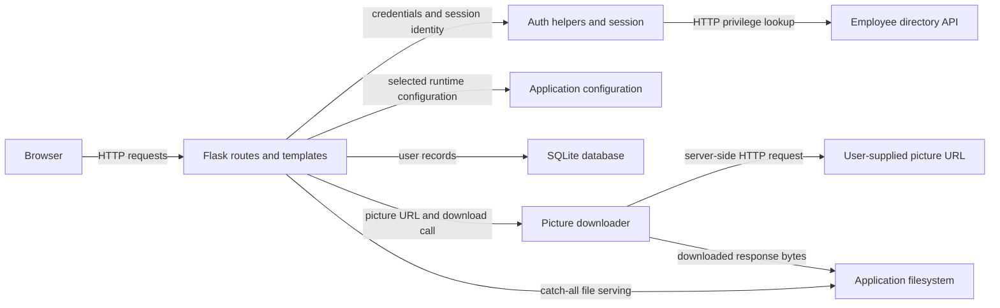

### Component Details

| Component | Assessment summary |
|---|---|
| web-app | The route and template component contains the file disclosure, two XSS paths, partial signup authorization state, account enumeration, CSRF, and public resource-consumption findings. HTML forms and templates were reviewed directly; no REST/JSON API or untrusted deserialization route was found. |
| auth | Authentication helpers use bcrypt but reuse a fixed salt and perform an employee lookup over HTTP in selected profiles. No separate session-fixation issue was established; the shared salt and signup authorization-state behavior are reported in their main components. |
| config | The default profile contains a source-defined session key and shared bcrypt salt, and the checked-in launcher selects that profile when FLASK_ENV is absent. Direct dependency pins were reviewed without installation; transitive resolution was not available. |
| pictures | The downloader fetches a user-provided URL and buffers the full response for display. This supports Likely response-bearing SSRF and availability findings; exact reachable hosts and service capacity depend on runtime conditions. |

### web-app

**Entry points**
- GET /
- POST /signin
- GET /signout
- POST /signup
- GET /<path:path>

**Data stores**
- SQLite via Flask-SQLAlchemy
- Flask signed-cookie session
- picture files under configured directory

**External services**
- Employee directory lookup
- User-supplied picture URL fetch

**Trust boundaries**
- Unauthenticated HTTP input to session/account state
- Application server to employee directory and arbitrary URL destination
- Application process to filesystem

**Security controls reviewed**
- Authentication and session signing
- Directory limited flag
- Template escaping
- Catch-all file access
- Atomic signup and picture-fetch bounds

### auth

**Entry points**
- check_limited
- check_password
- hash_password
- get_user_id
- set_user

**Data stores**
- Flask session

**External services**
- Employee directory HTTP API

**Trust boundaries**
- Submitted email to internal API URL
- Signed cookie to account identity

**Security controls reviewed**
- Password encoding and hashing
- Session identity trust
- Directory lookup URL construction

### config

**Entry points**
- configure(app)

**Data stores**
- Configuration literals

**External services**
- Configured HTTP employee directory

**Trust boundaries**
- Repository-defined settings to the default run.sh/flask launch path
- Environment-selected profile only when FLASK_ENV is set

**Security controls reviewed**
- Effective default debug behavior
- Source-defined keys
- HTTP transport settings
- Cookie/header controls
- Dependency pins and lockfile availability

### pictures

**Entry points**
- download_picture(url, pictures_dir)

**Data stores**
- Picture files

**External services**
- User-controlled HTTP(S) URL

**Trust boundaries**
- Untrusted URL to server-side network request and filesystem write

**Security controls reviewed**
- Destination policy
- Redirect handling
- Timeout and response-size cap
- Content validation

### Out of Scope

- Employee directory service implementation and its authorization contract.
- Production proxy, TLS termination, firewall/egress, WAF, and logger configuration.
- Runtime .netrc credentials and other host secrets.
- Dynamic testing, fuzzing, or exploit execution; target code and dependencies were not run.
- Full direct and transitive dependency advisory inventory; requirements were read without installing or resolving packages.

---

## Findings Summary

The 13 findings center on the web app and picture downloader. The recurring causes are untrusted paths passed to file serving, user-controlled text rendered without autoescape, source-defined authentication material, state changes committed before fallible network work, and unbounded public operations. Seven findings are Confirmed from source and pinned framework behavior; six are Likely because practical impact depends on browser policy, reachable destinations, or runtime capacity. No multi-finding exploit chain is counted as validated.

### Finding Index

| ID | Severity | Attack Vector | Type | Component | File | Lines | Confidence |
|----|----------|--------------|------|-----------|------|-------|------------|
| [BALLS-001](#balls-001) | High | Remote | Path Traversal and Arbitrary File Read | web-app | `app.py` | 151-159 | High |
| [BALLS-002](#balls-002) | High | Remote | Hardcoded Session Signing Key | web-app | `config.py` | 11-12 | High |
| [BALLS-003](#balls-003) | High | Remote | Server-Side Request Forgery via Picture URL | web-app | `pictures.py` | 8-14 | High |
| [BALLS-004](#balls-004) | Medium | Remote | Reflected Cross-Site Scripting | web-app | `app.py` | 84-89 | High |
| [BALLS-005](#balls-005) | Medium | Remote | Stored Cross-Site Scripting | web-app | `app.py` | 113-121 | High |
| [BALLS-006](#balls-006) | Medium | Remote | Signup Partial-State Authorization Bypass | web-app | `app.py` | 113-138 | High |
| [BALLS-007](#balls-007) | Medium | Remote | Unbounded Remote Picture Download | pictures | `pictures.py` | 8-14 | Medium |
| [BALLS-008](#balls-008) | Low | Remote | Account Enumeration | web-app | `app.py` | 84-89 | High |
| [BALLS-009](#balls-009) | Low | Local data exposure | Predictable Shared Password Hash Salt | web-app | `auth.py` | 22-23 | High |
| [BALLS-010](#balls-010) | Low | Remote | Unauthenticated Requests Load the Entire Directory | web-app | `app.py` | 53-65 | Medium |
| [BALLS-011](#balls-011) | Low | Remote | Cross-Site Request Forgery: Login CSRF | web-app | `app.py` | 68-97 | Medium |
| [BALLS-012](#balls-012) | Low | Remote | Signin Has No Repository-Defined Attempt Throttle | web-app | `app.py` | 68-97 | Medium |
| [BALLS-013](#balls-013) | Low | Remote | Cross-Site Request Forgery: Forced Logout | web-app | `app.py` | 100-104 | Medium |

### By Severity

| Severity | Confirmed | Likely | Possible | Total |
|---|---:|---:|---:|---:|
| High | 2 | 1 | 0 | **3** |
| Medium | 3 | 1 | 0 | **4** |
| Low | 2 | 4 | 0 | **6** |
| **Total** | 7 | 6 | 0 | **13** |

### By Attack Vector

| Attack vector | Findings | IDs |
|---|---:|---|
| Remote | 12 | BALLS-001, BALLS-002, BALLS-003, BALLS-004, BALLS-005, BALLS-006, BALLS-007, BALLS-008, BALLS-010, BALLS-011, BALLS-012, BALLS-013 |
| Local data exposure | 1 | BALLS-009 |

### By Component

| Component | Findings | IDs |
|---|---:|---|
| web-app | 12 | BALLS-001, BALLS-002, BALLS-003, BALLS-004, BALLS-005, BALLS-006, BALLS-008, BALLS-009, BALLS-010, BALLS-011, BALLS-012, BALLS-013 |
| pictures | 1 | BALLS-007 |

### By CWE Category

| CWE | Findings | IDs |
|---|---:|---|
| CWE-352 — Cross-Site Request Forgery (CSRF) | 2 | BALLS-011, BALLS-013 |
| CWE-400 — Uncontrolled Resource Consumption | 2 | BALLS-007, BALLS-010 |
| CWE-79 — Improper Neutralization of Input During Web Page Generation | 2 | BALLS-004, BALLS-005 |
| CWE-203 — Observable Discrepancy | 1 | BALLS-008 |
| CWE-22 — Improper Limitation of a Pathname to a Restricted Directory | 1 | BALLS-001 |
| CWE-307 — Improper Restriction of Excessive Authentication Attempts | 1 | BALLS-012 |
| CWE-321 — Use of Hard-coded Cryptographic Key | 1 | BALLS-002 |
| CWE-760 — Use of a One-Way Hash with a Predictable Salt | 1 | BALLS-009 |
| CWE-841 — Improper Enforcement of Behavioral Workflow | 1 | BALLS-006 |
| CWE-918 — Server-Side Request Forgery | 1 | BALLS-003 |

---

## Detailed Findings

### High Findings

### BALLS-001

**Path Traversal and Arbitrary File Read (High)**

- **Severity:** High  ·  **Confidence:** High  ·  **Council:** CONFIRMED
- **Attack vector:** Remote
- **Component:** web-app
- **CWE:** [CWE-22](https://cwe.mitre.org/data/definitions/22.html) — Improper Limitation of a Pathname to a Restricted Directory
- **Location:** `app.py`:151-159

#### Finding Summary

An unauthenticated path parameter reaches the catch-all route. send_file(path) opens the supplied relative path; Flask 0.12.2 joins it to root_path without traversal containment. The catch-all route passes attacker-controlled path directly to send_file. Flask 0.12.2 documents relative paths are relative to Flask.root_path and its implementation joins root_path with the provided path. Parent components can escape the app root, subject to process filesystem permissions. Source/config and the local database are in the repository/runtime tree. Framework behavior was checked against the [Flask 0.12.2 source](https://raw.githubusercontent.com/pallets/flask/0.12.2/flask/helpers.py#L393-L469).

#### Technical Evidence

**Vulnerable code (before)**

```
151  @app.route("/<path:path>")
152  def catch_all(path: str):
153      """
154      Serve static assets like favicion.ico
155  
156      :param path: asset path
157      :return: file
158      """
159      return send_file(path)
```

**Data flow**

- Source: An unauthenticated path parameter reaches the catch-all route.
- Sink: send_file(path) opens the supplied relative path; Flask 0.12.2 joins it to root_path without traversal containment.
- Sanitization: No allowlist, safe_join, or send_from_directory containment.
- Proof: The catch-all route passes attacker-controlled path directly to send_file. Flask 0.12.2 documents relative paths are relative to Flask.root_path and its implementation joins root_path with the provided path. Parent components can escape the app root, subject to process filesystem permissions. Source/config and the local database are in the repository/runtime tree.

#### Attack Path and Preconditions

**Attack scenario**

The catch-all route passes attacker-controlled path directly to send_file. Flask 0.12.2 documents relative paths are relative to Flask.root_path and its implementation joins root_path with the provided path. Parent components can escape the app root, subject to process filesystem permissions. Source/config and the local database are in the repository/runtime tree.

#### Reproduction Steps

**Preconditions**

Use only a disposable local instance, local helper services, and test-only values. Do not target a production or third-party service.

1. Make one bounded request against a disposable local test instance.

```sh
curl -i "${BASE_URL:-http://127.0.0.1:5000}/config.py"
```

**Expected result:** Unauthenticated clients can read files accessible to the process outside the intended asset set, including source/config and the local database when present. Filesystem permissions bound access.

**Limitations:** The commands are illustrative and were not run. Runtime network, browser, and capacity assumptions are stated in this finding.

_Run reproduction steps only against an authorized test instance._

#### Security Impact and Limits

**Impact**

Unauthenticated clients can read files accessible to the process outside the intended asset set, including source/config and the local database when present. Filesystem permissions bound access.

#### Independent Assessment

**Council perspectives**

- Attacker: Attacker controls the input described in the source flow and can reach the exposed route.
- Defender: Reviewed repository-local guards, configuration, framework behavior, and the strongest counterargument; none blocks the path. Impact remains bounded as described.
- Auditor: Rechecked each cited line and the pinned framework behavior where relevant; no target or dependency code was executed.

#### Example Fixed Code (After)

```python
from flask import send_from_directory

# Move public files under a dedicated static directory.
@app.route("/<path:path>")
def assets(path):
    return send_from_directory(app.static_folder, path)
```

**Notes:** The static directory must contain only intended public assets; remove the generic file-serving route.
#### Recommended Remediation

**Remediation steps**

1. Use explicit static routes and send_from_directory with a fixed trusted directory; keep secrets and database outside served paths.
2. The static directory must contain only intended public assets; remove the generic file-serving route.

#### Standards and References

- **CWE:** [CWE-22 — Improper Limitation of a Pathname to a Restricted Directory](https://cwe.mitre.org/data/definitions/22.html)
- **OWASP:** [OWASP Top 10:2025 A01 — Broken Access Control](https://top10.owasp.org/2025/A01_2025-Broken_Access_Control/)
- **OWASP:** [OWASP WSTG-ATHZ-01 — Directory Traversal / File Include](https://wstg.owasp.org/stable/4-Web_Application_Security_Testing/05-Authorization_Testing/01-Testing_Directory_Traversal_File_Include/)
- **OWASP:** [OWASP Path Traversal Prevention Cheat Sheet](https://cheatsheetseries.owasp.org/cheatsheets/Path_Traversal_Prevention_Cheat_Sheet.html)

### BALLS-002

**Hardcoded Session Signing Key (High)**

- **Severity:** High  ·  **Confidence:** High  ·  **Council:** CONFIRMED
- **Attack vector:** Remote
- **Component:** web-app
- **CWE:** [CWE-321](https://cwe.mitre.org/data/definitions/321.html) — Use of Hard-coded Cryptographic Key
- **Location:** `config.py`:11-12

#### Finding Summary

The checked-in BaseConfig provides a constant SECRET_KEY and is selected when FLASK_ENV is unset. Flask signs the client-side session containing user_id. An attacker with source access can sign chosen session contents. Setting user_id to an existing account ID makes / render the directory as that account. This bypasses session integrity; the app defines no admin role.

#### Technical Evidence

**Vulnerable code (before)**

```
11      SECRET_KEY = "[REDACTED]"
12      SQLALCHEMY_DATABASE_URI = "sqlite:///database.db"
```

**Data flow**

- Source: The checked-in BaseConfig provides a constant SECRET_KEY and is selected when FLASK_ENV is unset.
- Sink: Flask signs the client-side session containing user_id.
- Sanitization: No environment-backed key loading or rotation is present in the repository default.
- Proof: An attacker with source access can sign chosen session contents. Setting user_id to an existing account ID makes / render the directory as that account. This bypasses session integrity; the app defines no admin role.

#### Attack Path and Preconditions

**Attack scenario**

Forge the signed session user_id for an existing account and request /.

#### Reproduction Steps

**Preconditions**

Use only a disposable local instance, local helper services, and test-only values. Do not target a production or third-party service.

1. Make one bounded request against a disposable local test instance.

```sh
flask-unsign --sign --cookie "{'user_id': TEST_USER_ID}" --secret "$LOCAL_TEST_SECRET"
```

**Expected result:** Authentication bypass and access to data available to the chosen user.

**Limitations:** The commands are illustrative and were not run. Runtime network, browser, and capacity assumptions are stated in this finding.

_Run reproduction steps only against an authorized test instance._

#### Security Impact and Limits

**Impact**

Authentication bypass and access to data available to the chosen user.

#### Independent Assessment

**Council perspectives**

- Attacker: An attacker with source access can sign chosen session contents; a forged user_id targets an existing account.
- Defender: The app has no admin role; impact is bounded to permissions and directory data available to that user.
- Auditor: Rechecked default config selection, app.secret_key assignment, and Flask session use.

#### Example Fixed Code (After)

```python
import os
app.config["SECRET_KEY"] = os.environ["FLASK_SECRET_KEY"]
```

**Notes:** Set this through protected secret storage; fail startup when absent and rotate the exposed key.
#### Recommended Remediation

**Remediation steps**

1. Load a random secret from protected runtime storage, fail startup if absent, and rotate the exposed key.
2. Set this through protected secret storage; fail startup when absent and rotate the exposed key.

#### Standards and References

- **CWE:** [CWE-321 — Use of Hard-coded Cryptographic Key](https://cwe.mitre.org/data/definitions/321.html)
- **OWASP:** [OWASP Top 10:2025 A04 — Cryptographic Failures](https://top10.owasp.org/2025/A04_2025-Cryptographic_Failures/)
- **OWASP:** [OWASP Secrets Management Cheat Sheet](https://cheatsheetseries.owasp.org/cheatsheets/Secrets_Management_Cheat_Sheet.html)
- **OWASP:** [OWASP Session Management Cheat Sheet](https://cheatsheetseries.owasp.org/cheatsheets/Session_Management_Cheat_Sheet.html)

### BALLS-003

**Server-Side Request Forgery via Picture URL (High)**

- **Severity:** High  ·  **Confidence:** High  ·  **Council:** LIKELY
- **Attack vector:** Remote
- **Component:** web-app
- **CWE:** [CWE-918](https://cwe.mitre.org/data/definitions/918.html) — Server-Side Request Forgery
- **Location:** `pictures.py`:8-14

#### Finding Summary

Unauthenticated signup accepts an arbitrary picture URL. requests.get(url) fetches it; response bytes are saved and path rendered as an image in directory.jinja2:20. The user controls the picture URL during signup. download_picture passes it to requests.get, stores returned bytes at a generated path, and signup persists that path. The directory renders it as img src and the catch-all serves the saved file. An attacker can induce requests to destinations reachable from the host and read response bytes through the stored picture path, bounded by network/process access.

#### Technical Evidence

**Vulnerable code (before)**

```
 8  def download_picture(url: Optional[str], pictures_dir: str):
 9      Path(pictures_dir).mkdir(exist_ok=True)
10      res = requests.get(url)
11      filename = Path(pictures_dir) / f"{uuid4()}.jpg"
12      with open(filename, "wb") as fp:
13          fp.write(res.content)
14      return str(filename)
```

**Data flow**

- Source: Unauthenticated signup accepts an arbitrary picture URL.
- Sink: requests.get(url) fetches it; response bytes are saved and path rendered as an image in directory.jinja2:20.
- Sanitization: No scheme/host/IP allowlist, redirect validation, timeout, or destination policy.
- Proof: The user controls the picture URL during signup. download_picture passes it to requests.get, stores returned bytes at a generated path, and signup persists that path. The directory renders it as img src and the catch-all serves the saved file. An attacker can induce requests to destinations reachable from the host and read response bytes through the stored picture path, bounded by network/process access.

#### Attack Path and Preconditions

**Attack scenario**

The user controls the picture URL during signup. download_picture passes it to requests.get, stores returned bytes at a generated path, and signup persists that path. The directory renders it as img src and the catch-all serves the saved file. An attacker can induce requests to destinations reachable from the host and read response bytes through the stored picture path, bounded by network/process access.

#### Reproduction Steps

**Preconditions**

Use only a disposable local instance, local helper services, and test-only values. Do not target a production or third-party service.

1. Make one bounded request against a disposable local test instance.

```sh
curl -i -c /tmp/balls-cookie -X POST "${BASE_URL:-http://127.0.0.1:5000}/signup" --data-urlencode "email=ssrf-test@example.invalid" --data-urlencode "name=SSRF test" --data-urlencode "password=TEST_ONLY" --data-urlencode "picture=http://127.0.0.1:9001/marker.txt"
```

**Expected result:** The app can be induced to request internal destinations and disclose response bodies to the registering attacker. Exact reachable targets and sensitive content depend on host network reachability; no cloud credential theft is asserted.

**Limitations:** The commands are illustrative and were not run. Runtime network, browser, and capacity assumptions are stated in this finding.

_Run reproduction steps only against an authorized test instance._

#### Security Impact and Limits

**Impact**

The app can be induced to request internal destinations and disclose response bodies to the registering attacker. Exact reachable targets and sensitive content depend on host network reachability; no cloud credential theft is asserted.

#### Independent Assessment

**Council perspectives**

- Attacker: Attacker controls the input described in the source flow and can reach the exposed route.
- Defender: Reviewed repository-local guards, configuration, framework behavior, and the strongest counterargument; none blocks the path. Impact remains bounded as described.
- Auditor: Rechecked each cited line and the pinned framework behavior where relevant; no target or dependency code was executed.

#### Example Fixed Code (After)

```python
from urllib.parse import urlsplit
import requests
ALLOWED_HOSTS = {"images.example.test"}
def fetch_picture(url):
    parts = urlsplit(url)
    if parts.scheme != "https" or parts.hostname not in ALLOWED_HOSTS:
        raise ValueError("unsupported picture URL")
    return requests.get(url, timeout=(2, 5), allow_redirects=False, stream=True)
```

**Notes:** Also validate resolved IP addresses and cap streamed bytes. Prefer uploads if arbitrary remote images are not required.
#### Recommended Remediation

**Remediation steps**

1. Accept uploads or allowlisted hosts; validate redirects and resolved IPs against private/loopback/link-local ranges, enforce egress policy, and validate type/size.
2. Also validate resolved IP addresses and cap streamed bytes. Prefer uploads if arbitrary remote images are not required.

#### Standards and References

- **CWE:** [CWE-918 — Server-Side Request Forgery](https://cwe.mitre.org/data/definitions/918.html)
- **OWASP:** [OWASP Top 10:2025 A01 — Broken Access Control (includes SSRF)](https://top10.owasp.org/2025/A01_2025-Broken_Access_Control/)
- **OWASP:** [OWASP SSRF Prevention Cheat Sheet](https://cheatsheetseries.owasp.org/cheatsheets/Server_Side_Request_Forgery_Prevention_Cheat_Sheet.html)

### Medium Findings

### BALLS-004

**Reflected Cross-Site Scripting (Medium)**

- **Severity:** Medium  ·  **Confidence:** High  ·  **Council:** CONFIRMED
- **Attack vector:** Remote
- **Component:** web-app
- **CWE:** [CWE-79](https://cwe.mitre.org/data/definitions/79.html) — Improper Neutralization of Input During Web Page Generation
- **Location:** `app.py`:84-89

#### Finding Summary

Unauthenticated signin accepts a submitted email value. Unknown-user flash message is rendered at signin.jinja2:13. For an unknown user, app.py interpolates submitted email into a flash message and renders the signin template in the same response. The template prints message without an escape filter. Flask 0.12.2 does not autoescape .jinja2 by default, so direct POST markup can execute. Framework behavior was checked against the [Flask 0.12.2 source](https://raw.githubusercontent.com/pallets/flask/0.12.2/flask/app.py#L667-L675).

#### Technical Evidence

**Vulnerable code (before)**

```
84              else:
85                  flash(f"Incorrect password")
86                  user = None
87          else:
88              flash(f"User with {email} does not exist")
89  
```

**Data flow**

- Source: Unauthenticated signin accepts a submitted email value.
- Sink: Unknown-user flash message is rendered at signin.jinja2:13.
- Sanitization: No server-side syntax validation or explicit escaping; .jinja2 is excluded from Flask 0.12.2 default autoescape.
- Proof: For an unknown user, app.py interpolates submitted email into a flash message and renders the signin template in the same response. The template prints message without an escape filter. Flask 0.12.2 does not autoescape .jinja2 by default, so direct POST markup can execute.

#### Attack Path and Preconditions

**Attack scenario**

For an unknown user, app.py interpolates submitted email into a flash message and renders the signin template in the same response. The template prints message without an escape filter. Flask 0.12.2 does not autoescape .jinja2 by default, so direct POST markup can execute.

#### Reproduction Steps

**Preconditions**

Use only a disposable local instance, local helper services, and test-only values. Do not target a production or third-party service.

1. Make one bounded request against a disposable local test instance.

```sh
curl -i -X POST "${BASE_URL:-http://127.0.0.1:5000}/signin" --data-urlencode "email=<script>alert(document.domain)</script>" --data-urlencode "password=TEST_ONLY"
```

**Expected result:** An attacker can induce script execution in the sign-in origin for a victim who follows a crafted request; impact is limited to that browser origin.

2. Use a browser only against a local disposable instance to confirm whether the returned marker executes.

**Expected result:** An attacker can induce script execution in the sign-in origin for a victim who follows a crafted request; impact is limited to that browser origin.

**Limitations:** The commands are illustrative and were not run. Runtime network, browser, and capacity assumptions are stated in this finding.

_Run reproduction steps only against an authorized test instance._

#### Security Impact and Limits

**Impact**

An attacker can induce script execution in the sign-in origin for a victim who follows a crafted request; impact is limited to that browser origin.

#### Independent Assessment

**Council perspectives**

- Attacker: Attacker controls the input described in the source flow and can reach the exposed route.
- Defender: Reviewed repository-local guards, configuration, framework behavior, and the strongest counterargument; none blocks the path. Impact remains bounded as described.
- Auditor: Rechecked each cited line and the pinned framework behavior where relevant; no target or dependency code was executed.

#### Example Fixed Code (After)

```python
app.jinja_env.autoescape = True
```

**Notes:** Enable this before loading templates or rename them to an autoescaped extension; keep generic auth errors.
#### Recommended Remediation

**Remediation steps**

1. Escape flash messages and use a generic unknown-user response; enable autoescape for the template extension.
2. Enable this before loading templates or rename them to an autoescaped extension; keep generic auth errors.

#### Standards and References

- **CWE:** [CWE-79 — Improper Neutralization of Input During Web Page Generation](https://cwe.mitre.org/data/definitions/79.html)
- **OWASP:** [OWASP Top 10:2025 A05 — Injection](https://top10.owasp.org/2025/A05_2025-Injection/)
- **OWASP:** [OWASP Cross Site Scripting Prevention Cheat Sheet](https://cheatsheetseries.owasp.org/cheatsheets/Cross_Site_Scripting_Prevention_Cheat_Sheet.html)
- **OWASP WSTG:** [WSTG-INPV-01 — Reflected Cross-Site Scripting](https://wstg.owasp.org/stable/4-Web_Application_Security_Testing/07-Input_Validation_Testing/01-Testing_for_Reflected_Cross_Site_Scripting/)

### BALLS-005

**Stored Cross-Site Scripting (Medium)**

- **Severity:** Medium  ·  **Confidence:** High  ·  **Council:** CONFIRMED
- **Attack vector:** Remote
- **Component:** web-app
- **CWE:** [CWE-79](https://cwe.mitre.org/data/definitions/79.html) — Improper Neutralization of Input During Web Page Generation
- **Location:** `app.py`:113-121

#### Finding Summary

Unauthenticated signup accepts and persists attacker-controlled name and bio. directory.jinja2:22-23 renders those fields; app.py:53-63 supplies all users. Signup persists name and bio and the directory renders them as template variables. Flask 0.12.2 autoescapes .html/.htm/.xml/.xhtml but not .jinja2; no custom autoescape or |e filter exists. A stored payload is interpreted by directory viewers. Framework behavior was checked against the [Flask 0.12.2 source](https://raw.githubusercontent.com/pallets/flask/0.12.2/flask/app.py#L667-L675).

#### Technical Evidence

**Vulnerable code (before)**

```
113              user = User.create(
114                  email=request.form.get("email"),
115                  bio=request.form.get("bio"),
116                  name=request.form.get("name"),
117                  password_hash=auth.hash_password(
118                      request.form.get("password"),
119                      app.config.get("BCRYPT_SALT"),
120                  ),
121              )
```

**Data flow**

- Source: Unauthenticated signup accepts and persists attacker-controlled name and bio.
- Sink: directory.jinja2:22-23 renders those fields; app.py:53-63 supplies all users.
- Sanitization: No explicit escaping. Flask 0.12.2 default autoescape suffixes omit .jinja2.
- Proof: Signup persists name and bio and the directory renders them as template variables. Flask 0.12.2 autoescapes .html/.htm/.xml/.xhtml but not .jinja2; no custom autoescape or |e filter exists. A stored payload is interpreted by directory viewers.

#### Attack Path and Preconditions

**Attack scenario**

Signup persists name and bio and the directory renders them as template variables. Flask 0.12.2 autoescapes .html/.htm/.xml/.xhtml but not .jinja2; no custom autoescape or |e filter exists. A stored payload is interpreted by directory viewers.

#### Reproduction Steps

**Preconditions**

Use only a disposable local instance, local helper services, and test-only values. Do not target a production or third-party service.

1. Make one bounded request against a disposable local test instance.

```sh
curl -i -c /tmp/balls-xss-cookie -X POST "${BASE_URL:-http://127.0.0.1:5000}/signup" --data-urlencode "email=xss-test@example.invalid" --data-urlencode "password=TEST_ONLY" --data-urlencode "name=<script>alert(document.domain)</script>" --data-urlencode "picture=http://127.0.0.1:5000/favicon.ico"
```

**Expected result:** Script executes in the app origin for users who view the directory, allowing actions and data access within that viewer session. It does not inherently bypass HttpOnly cookies or compromise the server.

2. Open the directory in a separate signed-in test browser; curl shows source but does not execute script.

**Expected result:** Script executes in the app origin for users who view the directory, allowing actions and data access within that viewer session. It does not inherently bypass HttpOnly cookies or compromise the server.

**Limitations:** The commands are illustrative and were not run. Runtime network, browser, and capacity assumptions are stated in this finding.

_Run reproduction steps only against an authorized test instance._

#### Security Impact and Limits

**Impact**

Script executes in the app origin for users who view the directory, allowing actions and data access within that viewer session. It does not inherently bypass HttpOnly cookies or compromise the server.

#### Independent Assessment

**Council perspectives**

- Attacker: Attacker controls the input described in the source flow and can reach the exposed route.
- Defender: Reviewed repository-local guards, configuration, framework behavior, and the strongest counterargument; none blocks the path. Impact remains bounded as described.
- Auditor: Rechecked each cited line and the pinned framework behavior where relevant; no target or dependency code was executed.

#### Example Fixed Code (After)

```python
app.jinja_env.autoescape = True
```

**Notes:** Enable autoescape before loading templates; validate URL schemes separately for URL-valued attributes.
#### Recommended Remediation

**Remediation steps**

1. Enable autoescape for .jinja2 or rename templates to .html; explicitly escape untrusted text and use context-appropriate rendering.
2. Enable autoescape before loading templates; validate URL schemes separately for URL-valued attributes.

#### Standards and References

- **CWE:** [CWE-79 — Improper Neutralization of Input During Web Page Generation](https://cwe.mitre.org/data/definitions/79.html)
- **OWASP:** [OWASP Top 10:2025 A05 — Injection](https://top10.owasp.org/2025/A05_2025-Injection/)
- **OWASP:** [OWASP Cross Site Scripting Prevention Cheat Sheet](https://cheatsheetseries.owasp.org/cheatsheets/Cross_Site_Scripting_Prevention_Cheat_Sheet.html)
- **OWASP WSTG:** [WSTG-INPV-02 — Stored Cross-Site Scripting](https://wstg.owasp.org/stable/4-Web_Application_Security_Testing/07-Input_Validation_Testing/02-Testing_for_Stored_Cross_Site_Scripting/)

### BALLS-006

**Signup Partial-State Authorization Bypass (Medium)**

- **Severity:** Medium  ·  **Confidence:** High  ·  **Council:** CONFIRMED
- **Attack vector:** Remote
- **Component:** web-app
- **CWE:** [CWE-841](https://cwe.mitre.org/data/definitions/841.html) — Improper Enforcement of Behavioral Workflow
- **Location:** `app.py`:113-138

#### Finding Summary

Unauthenticated signup controls account fields and optional picture URL. directory.jinja2:24-26 discloses emails when current_user.limited is falsy; User.limited is nullable. User.create commits limited=NULL before signup evaluates check_limited and download_picture. Keyword values are evaluated before update is called; empty picture URL can make requests.get fail, leaving the row committed but flag unset. Later signin succeeds and NULL is falsy in the directory visibility check, revealing email links.

#### Technical Evidence

**Vulnerable code (before)**

```
113              user = User.create(
114                  email=request.form.get("email"),
115                  bio=request.form.get("bio"),
116                  name=request.form.get("name"),
117                  password_hash=auth.hash_password(
118                      request.form.get("password"),
119                      app.config.get("BCRYPT_SALT"),
120                  ),
121              )
122          except IntegrityError:
123              flash("Email already exists")
124          else:
125              # Run longer operations next
126              user.update(
127                  limited=auth.check_limited(
128                      user.email,
129                      lookup_url=app.config.get("EMPLOYEE_API_URL"),
130                  ),
131                  picture=download_picture(
132                      request.form.get("picture"),
133                      pictures_dir=app.config.get("PICTURES_DIR"),
134                  ),
135              )
136  
137              # Set user
138              auth.set_user(user.id)
```

**Data flow**

- Source: Unauthenticated signup controls account fields and optional picture URL.
- Sink: directory.jinja2:24-26 discloses emails when current_user.limited is falsy; User.limited is nullable.
- Sanitization: No restrictive initial value; user commit occurs before fallible lookups and update.
- Proof: User.create commits limited=NULL before signup evaluates check_limited and download_picture. Keyword values are evaluated before update is called; empty picture URL can make requests.get fail, leaving the row committed but flag unset. Later signin succeeds and NULL is falsy in the directory visibility check, revealing email links.

#### Attack Path and Preconditions

**Attack scenario**

User.create commits limited=NULL before signup evaluates check_limited and download_picture. Keyword values are evaluated before update is called; empty picture URL can make requests.get fail, leaving the row committed but flag unset. Later signin succeeds and NULL is falsy in the directory visibility check, revealing email links.

#### Reproduction Steps

**Preconditions**

Use only a disposable local instance, local helper services, and test-only values. Do not target a production or third-party service.

1. Make one bounded request against a disposable local test instance.

```sh
curl -i -X POST "${BASE_URL:-http://127.0.0.1:5000}/signup" --data-urlencode "email=partial-test@example.invalid" --data-urlencode "name=Partial test" --data-urlencode "password=TEST_ONLY" --data-urlencode "picture="
```

**Expected result:** A new user can obtain the less-restricted directory view and read email links despite the intended limited-user restriction.

**Limitations:** The commands are illustrative and were not run. Runtime network, browser, and capacity assumptions are stated in this finding.

_Run reproduction steps only against an authorized test instance._

#### Security Impact and Limits

**Impact**

A new user can obtain the less-restricted directory view and read email links despite the intended limited-user restriction.

#### Independent Assessment

**Council perspectives**

- Attacker: Attacker controls the input described in the source flow and can reach the exposed route.
- Defender: Reviewed repository-local guards, configuration, framework behavior, and the strongest counterargument; none blocks the path. Impact remains bounded as described.
- Auditor: Rechecked each cited line and the pinned framework behavior where relevant; no target or dependency code was executed.

#### Example Fixed Code (After)

```python
limited = auth.check_limited(email, app.config.get("EMPLOYEE_API_URL"))
picture = download_picture(request.form.get("picture"), app.config["PICTURES_DIR"])
user = User.create(email=email, name=name, password_hash=password_hash, limited=True)
user.update(limited=limited, picture=picture)
```

**Notes:** Make the column non-null and keep the initial state restrictive; wrap database changes in a rollback-capable transaction.
#### Recommended Remediation

**Remediation steps**

1. Initialize limited to restrictive non-null value at insert, make the column non-null, and run fallible work before commit or use rollback transaction.
2. Make the column non-null and keep the initial state restrictive; wrap database changes in a rollback-capable transaction.

#### Standards and References

- **CWE:** [CWE-841 — Improper Enforcement of Behavioral Workflow](https://cwe.mitre.org/data/definitions/841.html)

### BALLS-007

**Unbounded Remote Picture Download (Medium)**

- **Severity:** Medium  ·  **Confidence:** Medium  ·  **Council:** LIKELY
- **Attack vector:** Remote
- **Component:** pictures
- **CWE:** [CWE-400](https://cwe.mitre.org/data/definitions/400.html) — Uncontrolled Resource Consumption
- **Location:** `pictures.py`:8-14

#### Finding Summary

Unauthenticated signup accepts a remote picture URL. requests.get(url) waits without a timeout and res.content buffers the whole body before writing. download_picture calls requests.get without a timeout or streaming limit and then accesses res.content, buffering the entire response in memory. Signup is unauthenticated and invokes this call before returning. A client can submit a slow or very large response URL, keeping request workers occupied or consuming memory. The actual service impact depends on runtime concurrency and reachable destinations.

#### Technical Evidence

**Vulnerable code (before)**

```
 8  def download_picture(url: Optional[str], pictures_dir: str):
 9      Path(pictures_dir).mkdir(exist_ok=True)
10      res = requests.get(url)
11      filename = Path(pictures_dir) / f"{uuid4()}.jpg"
12      with open(filename, "wb") as fp:
13          fp.write(res.content)
14      return str(filename)
```

**Data flow**

- Source: Unauthenticated signup accepts a remote picture URL.
- Sink: requests.get(url) waits without a timeout and res.content buffers the whole body before writing.
- Sanitization: No timeout, streaming cap, response size limit, or upload rate limit is present in repository code.
- Proof: download_picture calls requests.get without a timeout or streaming limit and then accesses res.content, buffering the entire response in memory. Signup is unauthenticated and invokes this call before returning. A client can submit a slow or very large response URL, keeping request workers occupied or consuming memory. The actual service impact depends on runtime concurrency and reachable destinations.

#### Attack Path and Preconditions

**Attack scenario**

download_picture calls requests.get without a timeout or streaming limit and then accesses res.content, buffering the entire response in memory. Signup is unauthenticated and invokes this call before returning. A client can submit a slow or very large response URL, keeping request workers occupied or consuming memory. The actual service impact depends on runtime concurrency and reachable destinations.

#### Reproduction Steps

**Preconditions**

Use only a disposable local instance, local helper services, and test-only values. Do not target a production or third-party service.

1. Use one controlled local slow or bounded large response; do not stress a shared instance.

**Expected result:** Potential availability impact by tying up workers or growing memory per concurrent signup; exact threshold depends on runtime limits.

**Limitations:** The commands are illustrative and were not run. Runtime network, browser, and capacity assumptions are stated in this finding.

_Run reproduction steps only against an authorized test instance._

#### Security Impact and Limits

**Impact**

Potential availability impact by tying up workers or growing memory per concurrent signup; exact threshold depends on runtime limits.

#### Independent Assessment

**Council perspectives**

- Attacker: An unauthenticated user supplies a picture URL whose response is slow or unusually large.
- Defender: The code has no bounds; the framework worker model and runtime resource limits are outside this repository, so concrete service outage is not proven.
- Auditor: Verified direct requests.get call without timeout/streaming and subsequent full res.content read. No stress test was run.

#### Example Fixed Code (After)

```python
with requests.get(url, timeout=(2, 5), stream=True) as response:
    response.raise_for_status()
    total = 0
    for chunk in response.iter_content(8192):
        total += len(chunk)
        if total > 2_000_000:
            raise ValueError("picture too large")
        write_chunk(chunk)
```

**Notes:** Validate image type and dimensions, set a product-appropriate hard cap, and avoid buffering response.content.
#### Recommended Remediation

**Remediation steps**

1. Use strict connect/read timeouts, stream with a hard byte limit, validate image format/dimensions, and limit signup/download concurrency.
2. Validate image type and dimensions, set a product-appropriate hard cap, and avoid buffering response.content.

#### Standards and References

- **CWE:** [CWE-400 — Uncontrolled Resource Consumption](https://cwe.mitre.org/data/definitions/400.html)
- **OWASP:** [OWASP Top 10:2025 X01 — Lack of Application Resilience (additional risk)](https://top10.owasp.org/2025/X01_2025-Next_Steps/)
- **OWASP:** [OWASP Denial of Service Cheat Sheet](https://cheatsheetseries.owasp.org/cheatsheets/Denial_of_Service_Cheat_Sheet.html)

### Low Findings

### BALLS-008

**Account Enumeration (Low)**

- **Severity:** Low  ·  **Confidence:** High  ·  **Council:** CONFIRMED
- **Attack vector:** Remote
- **Component:** web-app
- **CWE:** [CWE-203](https://cwe.mitre.org/data/definitions/203.html) — Observable Discrepancy
- **Location:** `app.py`:84-89

#### Finding Summary

Unauthenticated signin and signup accept candidate email addresses. Different flash messages distinguish unknown address, wrong password, and duplicate signup. Signin distinguishes incorrect password from nonexistent user and signup reports duplicate email; both messages are rendered to the requester.

#### Technical Evidence

**Vulnerable code (before)**

```
84              else:
85                  flash(f"Incorrect password")
86                  user = None
87          else:
88              flash(f"User with {email} does not exist")
89  
```

**Data flow**

- Source: Unauthenticated signin and signup accept candidate email addresses.
- Sink: Different flash messages distinguish unknown address, wrong password, and duplicate signup.
- Sanitization: No generic response masks account membership.
- Proof: Signin distinguishes incorrect password from nonexistent user and signup reports duplicate email; both messages are rendered to the requester.

#### Attack Path and Preconditions

**Attack scenario**

Signin distinguishes incorrect password from nonexistent user and signup reports duplicate email; both messages are rendered to the requester.

#### Reproduction Steps

**Preconditions**

Use only a disposable local instance, local helper services, and test-only values. Do not target a production or third-party service.

1. Make one bounded request against a disposable local test instance.

```sh
curl -i -X POST "${BASE_URL:-http://127.0.0.1:5000}/signin" --data-urlencode "email=known@example.invalid" --data-urlencode "password=WRONG_TEST"
```

**Expected result:** Reveals account membership for targeting; does not establish credential compromise.

**Limitations:** The commands are illustrative and were not run. Runtime network, browser, and capacity assumptions are stated in this finding.

_Run reproduction steps only against an authorized test instance._

#### Security Impact and Limits

**Impact**

Reveals account membership for targeting; does not establish credential compromise.

#### Independent Assessment

**Council perspectives**

- Attacker: Attacker controls the input described in the source flow and can reach the exposed route.
- Defender: Reviewed repository-local guards, configuration, framework behavior, and the strongest counterargument; none blocks the path. Impact remains bounded as described.
- Auditor: Rechecked each cited line and the pinned framework behavior where relevant; no target or dependency code was executed.

#### Example Fixed Code (After)

```python
if not user or not auth.check_password(password, user.password_hash, app.config["BCRYPT_SALT"]):
    flash("Invalid email or password")
    user = None
```

**Notes:** Use the same status and response for all signin failures; avoid confirming duplicate signup addresses.
#### Recommended Remediation

**Remediation steps**

1. Use indistinguishable signin errors and avoid immediate duplicate-account confirmation; rate-limit sensitive routes.
2. Use the same status and response for all signin failures; avoid confirming duplicate signup addresses.

#### Standards and References

- **CWE:** [CWE-203 — Observable Discrepancy](https://cwe.mitre.org/data/definitions/203.html)

### BALLS-009

**Predictable Shared Password Hash Salt (Low)**

- **Severity:** Low  ·  **Confidence:** High  ·  **Council:** CONFIRMED
- **Attack vector:** Local data exposure
- **Component:** web-app
- **CWE:** [CWE-760](https://cwe.mitre.org/data/definitions/760.html) — Use of a One-Way Hash with a Predictable Salt
- **Location:** `auth.py`:22-23

#### Finding Summary

Signup passes config.py’s single constant BCRYPT_SALT to hash_password. bcrypt.hashpw uses the same salt for each user. One static configured salt means equal passwords produce equal hashes and offline cracking work can be reused across accounts if hashes are separately disclosed.

#### Technical Evidence

**Vulnerable code (before)**

```
22  def hash_password(plaintext: str, salt: bytes) -> str:
23      return bcrypt.hashpw(bytes(plaintext, "ascii"), salt).decode("ascii")
```

**Data flow**

- Source: Signup passes config.py’s single constant BCRYPT_SALT to hash_password.
- Sink: bcrypt.hashpw uses the same salt for each user.
- Sanitization: No per-password random salt generation.
- Proof: One static configured salt means equal passwords produce equal hashes and offline cracking work can be reused across accounts if hashes are separately disclosed.

#### Attack Path and Preconditions

**Attack scenario**

One static configured salt means equal passwords produce equal hashes and offline cracking work can be reused across accounts if hashes are separately disclosed.

#### Reproduction Steps

**Preconditions**

Use only a disposable local instance, local helper services, and test-only values. Do not target a production or third-party service.

1. Create two test accounts with the same test password and compare hashes in a disposable database.

**Expected result:** Weakens hash isolation and enables password reuse detection/cracking efficiency after separate DB disclosure; no direct login bypass.

**Limitations:** The commands are illustrative and were not run. Runtime network, browser, and capacity assumptions are stated in this finding.

_Run reproduction steps only against an authorized test instance._

#### Security Impact and Limits

**Impact**

Weakens hash isolation and enables password reuse detection/cracking efficiency after separate DB disclosure; no direct login bypass.

#### Independent Assessment

**Council perspectives**

- Attacker: Attacker controls the input described in the source flow and can reach the exposed route.
- Defender: Reviewed repository-local guards, configuration, framework behavior, and the strongest counterargument; none blocks the path. Impact remains bounded as described.
- Auditor: Rechecked each cited line and the pinned framework behavior where relevant; no target or dependency code was executed.

#### Example Fixed Code (After)

```python
def hash_password(plaintext: str) -> str:
    return bcrypt.hashpw(plaintext.encode("utf-8"), bcrypt.gensalt(rounds=12)).decode("ascii")

def check_password(plaintext: str, stored_hash: str) -> bool:
    return bcrypt.checkpw(plaintext.encode("utf-8"), stored_hash.encode("ascii"))
```

**Notes:** Remove the shared salt from config; rehash existing credentials after successful verification or require resets.
#### Recommended Remediation

**Remediation steps**

1. Generate unique bcrypt salt for every password; use bcrypt.checkpw and migrate old hashes on login/reset.
2. Remove the shared salt from config; rehash existing credentials after successful verification or require resets.

#### Standards and References

- **CWE:** [CWE-760 — Use of a One-Way Hash with a Predictable Salt](https://cwe.mitre.org/data/definitions/760.html)
- **OWASP:** [OWASP Top 10:2025 A04 — Cryptographic Failures](https://top10.owasp.org/2025/A04_2025-Cryptographic_Failures/)
- **OWASP:** [OWASP Password Storage Cheat Sheet](https://cheatsheetseries.owasp.org/cheatsheets/Password_Storage_Cheat_Sheet.html)

### BALLS-010

**Unauthenticated Requests Load the Entire Directory (Low)**

- **Severity:** Low  ·  **Confidence:** Medium  ·  **Council:** LIKELY
- **Attack vector:** Remote
- **Component:** web-app
- **CWE:** [CWE-400](https://cwe.mitre.org/data/definitions/400.html) — Uncontrolled Resource Consumption
- **Location:** `app.py`:53-65

#### Finding Summary

Any unauthenticated client can request GET /. User.query.all() retrieves every user before the code checks whether the requester has a valid user. index executes User.query.all() before its user check and redirect. The query materializes all database users on every unauthenticated request. This creates work and memory proportional to directory size for a public route.

#### Technical Evidence

**Vulnerable code (before)**

```
53  @app.route("/")
54  def index():
55      user = User.query.filter_by(id=auth.get_user_id()).first()
56      users = User.query.all()
57      if user:
58          return render_template(
59              "directory.jinja2",
60              title="Directory",
61              current_user=user,
62              users=users,
63          )
64      else:
65          return redirect("/signin")
```

**Data flow**

- Source: Any unauthenticated client can request GET /.
- Sink: User.query.all() retrieves every user before the code checks whether the requester has a valid user.
- Sanitization: No pagination or pre-query authentication check; no app-level request limit.
- Proof: index executes User.query.all() before its user check and redirect. The query materializes all database users on every unauthenticated request. This creates work and memory proportional to directory size for a public route.

#### Attack Path and Preconditions

**Attack scenario**

index executes User.query.all() before its user check and redirect. The query materializes all database users on every unauthenticated request. This creates work and memory proportional to directory size for a public route.

#### Reproduction Steps

**Preconditions**

Use only a disposable local instance, local helper services, and test-only values. Do not target a production or third-party service.

1. Make one bounded request against a disposable local test instance.

```sh
curl -i "${BASE_URL:-http://127.0.0.1:5000}/"
```

**Expected result:** May consume database and application resources as the directory grows; no measured outage or runtime capacity is established.

**Limitations:** The commands are illustrative and were not run. Runtime network, browser, and capacity assumptions are stated in this finding.

_Run reproduction steps only against an authorized test instance._

#### Security Impact and Limits

**Impact**

May consume database and application resources as the directory grows; no measured outage or runtime capacity is established.

#### Independent Assessment

**Council perspectives**

- Attacker: An unauthenticated remote client can repeatedly reach the corresponding public route.
- Defender: The repository contains no application-level bound. Actual hosting capacity or external controls are outside the source tree, so impact remains Likely and is bounded to availability/authentication assurance.
- Auditor: Reviewed the entire route and repository requirements; no app-level limiter or pagination is present. No load or brute-force testing was run.

#### Example Fixed Code (After)

```python
@app.route("/")
def index():
    user = User.query.filter_by(id=auth.get_user_id()).first()
    if not user:
        return redirect("/signin")
    users = User.query.order_by(User.id).limit(100).all()
    return render_template("directory.jinja2", current_user=user, users=users)
```

**Notes:** Use stable pagination and select only fields needed by the view.
#### Recommended Remediation

**Remediation steps**

1. Check authorization before loading records, paginate directory results, and apply request throttling.
2. Use stable pagination and select only fields needed by the view.

#### Standards and References

- **CWE:** [CWE-400 — Uncontrolled Resource Consumption](https://cwe.mitre.org/data/definitions/400.html)
- **OWASP:** [OWASP Top 10:2025 X01 — Lack of Application Resilience (additional risk)](https://top10.owasp.org/2025/X01_2025-Next_Steps/)
- **OWASP:** [OWASP Denial of Service Cheat Sheet](https://cheatsheetseries.owasp.org/cheatsheets/Denial_of_Service_Cheat_Sheet.html)

### BALLS-011

**Cross-Site Request Forgery: Login CSRF (Low)**

- **Severity:** Low  ·  **Confidence:** Medium  ·  **Council:** LIKELY
- **Attack vector:** Remote
- **Component:** web-app
- **CWE:** [CWE-352](https://cwe.mitre.org/data/definitions/352.html) — Cross-Site Request Forgery (CSRF)
- **Location:** `app.py`:68-97

#### Finding Summary

An attacker can induce cross-site browser requests. The signin POST accepts credentials and sets the session without a CSRF token or origin validation; the form has no token. A cross-site form can attempt to put the victim browser into an attacker-controlled account if its cookie policy accepts the new session. No account takeover is established. The signin POST accepts credentials and sets the session without a CSRF token or origin validation; the form has no token. A cross-site form can attempt to put the victim browser into an attacker-controlled account if its cookie policy accepts the new session. No account takeover is established.

#### Technical Evidence

**Vulnerable code (before)**

```
68  @app.route("/signin", methods=["GET", "POST"])
69  def signin():
70      user = None
71      if request.method == "POST":
72          # Check user
73          email = request.form.get("email")
74          password = request.form.get("password")
75          user = User.query.filter_by(email=email).first()
76  
77          if user:
78              if auth.check_password(
79                  password,
80                  user.password_hash,
81                  app.config.get("BCRYPT_SALT"),
82              ):
83                  auth.set_user(user.id)
84              else:
85                  flash(f"Incorrect password")
86                  user = None
87          else:
88              flash(f"User with {email} does not exist")
89  
90      if user:
91          return redirect("/")
92      return render_template(
93          "./signin.jinja2",
94          title="Sign In",
95          alt_action="signup",
96          alt_label="Sign Up",
97      )
```

**Data flow**

- Source: An attacker can induce cross-site browser requests.
- Sink: The signin POST accepts credentials and sets the session without a CSRF token or origin validation; the form has no token. A cross-site form can attempt to put the victim browser into an attacker-controlled account if its cookie policy accepts the new session. No account takeover is established.
- Sanitization: No CSRF token or Origin validation appears in route/forms.
- Proof: The signin POST accepts credentials and sets the session without a CSRF token or origin validation; the form has no token. A cross-site form can attempt to put the victim browser into an attacker-controlled account if its cookie policy accepts the new session. No account takeover is established.

#### Attack Path and Preconditions

**Attack scenario**

The signin POST accepts credentials and sets the session without a CSRF token or origin validation; the form has no token. A cross-site form can attempt to put the victim browser into an attacker-controlled account if its cookie policy accepts the new session. No account takeover is established.

#### Reproduction Steps

**Preconditions**

Use only a disposable local instance, local helper services, and test-only values. Do not target a production or third-party service.

1. Use separate local browser origins and attacker-owned test credentials; browser cookie policy may affect outcome.

**Expected result:** Can force session confusion in a victim browser; no account takeover or sensitive write is established.

**Limitations:** The commands are illustrative and were not run. Runtime network, browser, and capacity assumptions are stated in this finding.

_Run reproduction steps only against an authorized test instance._

#### Security Impact and Limits

**Impact**

Can force session confusion in a victim browser; no account takeover or sensitive write is established.

#### Independent Assessment

**Council perspectives**

- Attacker: Attacker can induce a victim browser to navigate or submit a cross-site form to the app.
- Defender: No token/origin check appears in source; impact limited to browser session state. Browser SameSite behavior was not tested, so verdict remains Likely.
- Auditor: Dedicated source review confirmed method and absence of CSRF controls; no browser execution performed.

#### Example Fixed Code (After)

```python
from flask_wtf.csrf import CSRFProtect
csrf = CSRFProtect(app)
```

**Notes:** Add and pin a compatible CSRF package, include its token in the signin form, and validate it server-side.
#### Recommended Remediation

**Remediation steps**

1. Add server-side CSRF validation to signin and a token field in the form.
2. Add and pin a compatible CSRF package, include its token in the signin form, and validate it server-side.

#### Standards and References

- **CWE:** [CWE-352 — Cross-Site Request Forgery (CSRF)](https://cwe.mitre.org/data/definitions/352.html)
- **OWASP:** [OWASP Top 10:2025 A01 — Broken Access Control (includes CSRF)](https://top10.owasp.org/2025/A01_2025-Broken_Access_Control/)
- **OWASP:** [OWASP Cross-Site Request Forgery Prevention Cheat Sheet](https://cheatsheetseries.owasp.org/cheatsheets/Cross-Site_Request_Forgery_Prevention_Cheat_Sheet.html)

### BALLS-012

**Signin Has No Repository-Defined Attempt Throttle (Low)**

- **Severity:** Low  ·  **Confidence:** Medium  ·  **Council:** LIKELY
- **Attack vector:** Remote
- **Component:** web-app
- **CWE:** [CWE-307](https://cwe.mitre.org/data/definitions/307.html) — Improper Restriction of Excessive Authentication Attempts
- **Location:** `app.py`:68-97

#### Finding Summary

The unauthenticated signin handler accepts repeated email/password submissions. The complete route contains no counter, lockout, backoff, or limiter; requirements.txt includes no limiter. The complete /signin route accepts repeated credentials, queries the user, and performs bcrypt verification for existing users. No application attempt limit, lockout, progressive delay, or limiter is present in the repository. Bcrypt cost slows each attempt but does not cap them.

#### Technical Evidence

**Vulnerable code (before)**

```
68  @app.route("/signin", methods=["GET", "POST"])
69  def signin():
70      user = None
71      if request.method == "POST":
72          # Check user
73          email = request.form.get("email")
74          password = request.form.get("password")
75          user = User.query.filter_by(email=email).first()
76  
77          if user:
78              if auth.check_password(
79                  password,
80                  user.password_hash,
81                  app.config.get("BCRYPT_SALT"),
82              ):
83                  auth.set_user(user.id)
84              else:
85                  flash(f"Incorrect password")
86                  user = None
87          else:
88              flash(f"User with {email} does not exist")
89  
90      if user:
91          return redirect("/")
92      return render_template(
93          "./signin.jinja2",
94          title="Sign In",
95          alt_action="signup",
96          alt_label="Sign Up",
97      )
```

**Data flow**

- Source: The unauthenticated signin handler accepts repeated email/password submissions.
- Sink: The complete route contains no counter, lockout, backoff, or limiter; requirements.txt includes no limiter.
- Sanitization: No application-level attempt bound is present. External rate limits are unknown.
- Proof: The complete /signin route accepts repeated credentials, queries the user, and performs bcrypt verification for existing users. No application attempt limit, lockout, progressive delay, or limiter is present in the repository. Bcrypt cost slows each attempt but does not cap them.

#### Attack Path and Preconditions

**Attack scenario**

The complete /signin route accepts repeated credentials, queries the user, and performs bcrypt verification for existing users. No application attempt limit, lockout, progressive delay, or limiter is present in the repository. Bcrypt cost slows each attempt but does not cap them.

#### Reproduction Steps

**Preconditions**

Use only a disposable local instance, local helper services, and test-only values. Do not target a production or third-party service.

1. Make one bounded request against a disposable local test instance.

```sh
curl -i -X POST "${BASE_URL:-http://127.0.0.1:5000}/signin" --data-urlencode "email=test@example.invalid" --data-urlencode "password=WRONG_TEST"
```

**Expected result:** Raises exposure to online guessing and credential stuffing. Actual request rate and any external controls are unknown, so account compromise is not claimed.

**Limitations:** The commands are illustrative and were not run. Runtime network, browser, and capacity assumptions are stated in this finding.

_Run reproduction steps only against an authorized test instance._

#### Security Impact and Limits

**Impact**

Raises exposure to online guessing and credential stuffing. Actual request rate and any external controls are unknown, so account compromise is not claimed.

#### Independent Assessment

**Council perspectives**

- Attacker: An unauthenticated remote client can repeatedly reach the corresponding public route.
- Defender: The repository contains no application-level bound. Actual hosting capacity or external controls are outside the source tree, so impact remains Likely and is bounded to availability/authentication assurance.
- Auditor: Reviewed the entire route and repository requirements; no app-level limiter or pagination is present. No load or brute-force testing was run.

#### Example Fixed Code (After)

```python
from flask_limiter import Limiter
from flask_limiter.util import get_remote_address
limiter = Limiter(app=app, key_func=get_remote_address, default_limits=[])

@app.route("/signin", methods=["GET", "POST"])
@limiter.limit("5 per minute")
def signin():
    ...
```

**Notes:** Use shared storage for multiple workers and configure trusted proxy handling before trusting forwarded client addresses.
#### Recommended Remediation

**Remediation steps**

1. Add rate limiting keyed by account and trusted source address, progressive delay, and monitoring; preserve generic failure responses.
2. Use shared storage for multiple workers and configure trusted proxy handling before trusting forwarded client addresses.

#### Standards and References

- **CWE:** [CWE-307 — Improper Restriction of Excessive Authentication Attempts](https://cwe.mitre.org/data/definitions/307.html)

### BALLS-013

**Cross-Site Request Forgery: Forced Logout (Low)**

- **Severity:** Low  ·  **Confidence:** Medium  ·  **Council:** LIKELY
- **Attack vector:** Remote
- **Component:** web-app
- **CWE:** [CWE-352](https://cwe.mitre.org/data/definitions/352.html) — Cross-Site Request Forgery (CSRF)
- **Location:** `app.py`:100-104

#### Finding Summary

An attacker can induce cross-site browser requests. GET /signout clears user_id and the directory exposes it as a GET link. A cross-site top-level navigation can cause the browser to visit this route and clear the session. GET /signout clears user_id and the directory exposes it as a GET link. A cross-site top-level navigation can cause the browser to visit this route and clear the session.

#### Technical Evidence

**Vulnerable code (before)**

```
100  @app.route("/signout", methods=["GET"])
101  def signout():
102      auth.set_user(None)
103      flash("Successfully signed out")
104      return redirect("/")
```

**Data flow**

- Source: An attacker can induce cross-site browser requests.
- Sink: GET /signout clears user_id and the directory exposes it as a GET link. A cross-site top-level navigation can cause the browser to visit this route and clear the session.
- Sanitization: No CSRF token or Origin validation appears in route/forms.
- Proof: GET /signout clears user_id and the directory exposes it as a GET link. A cross-site top-level navigation can cause the browser to visit this route and clear the session.

#### Attack Path and Preconditions

**Attack scenario**

GET /signout clears user_id and the directory exposes it as a GET link. A cross-site top-level navigation can cause the browser to visit this route and clear the session.

#### Reproduction Steps

**Preconditions**

Use only a disposable local instance, local helper services, and test-only values. Do not target a production or third-party service.

1. Navigate from a separate local page to /signout in a disposable browser session.

**Expected result:** Can disrupt a user session, requiring sign-in again; no stronger impact is established.

**Limitations:** The commands are illustrative and were not run. Runtime network, browser, and capacity assumptions are stated in this finding.

_Run reproduction steps only against an authorized test instance._

#### Security Impact and Limits

**Impact**

Can disrupt a user session, requiring sign-in again; no stronger impact is established.

#### Independent Assessment

**Council perspectives**

- Attacker: Attacker can induce a victim browser to navigate or submit a cross-site form to the app.
- Defender: No token/origin check appears in source; impact limited to browser session state. Browser SameSite behavior was not tested, so verdict remains Likely.
- Auditor: Dedicated source review confirmed method and absence of CSRF controls; no browser execution performed.

#### Example Fixed Code (After)

```python
@app.route("/signout", methods=["POST"])
@csrf.protect
def signout():
    auth.set_user(None)
    return redirect("/signin")
```

**Notes:** Change the template link to a token-bearing POST form; use the same CSRF protection as other state changes.
#### Recommended Remediation

**Remediation steps**

1. Change logout to POST and protect it with CSRF validation; render a token-bearing form.
2. Change the template link to a token-bearing POST form; use the same CSRF protection as other state changes.

#### Standards and References

- **CWE:** [CWE-352 — Cross-Site Request Forgery (CSRF)](https://cwe.mitre.org/data/definitions/352.html)
- **OWASP:** [OWASP Top 10:2025 A01 — Broken Access Control (includes CSRF)](https://top10.owasp.org/2025/A01_2025-Broken_Access_Control/)
- **OWASP:** [OWASP Cross-Site Request Forgery Prevention Cheat Sheet](https://cheatsheetseries.owasp.org/cheatsheets/Cross-Site_Request_Forgery_Prevention_Cheat_Sheet.html)

---

## Exploit Chains

No exploit chain is counted as validated. The file route can disclose the signing key, which could support forged sessions if an attacker also identifies a valid user ID. The scan did not establish a reliable way to discover another user’s ID or an administrative privilege, so the combined path is not promoted separately.

_No multi-finding exploit chains were identified._

---

## Key Data Flows

### BALLS-001 — Path Traversal and Arbitrary File Read

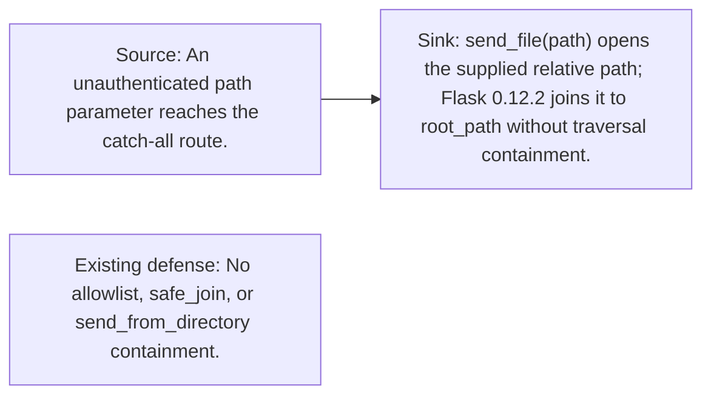

**Evidence:** The catch-all route passes attacker-controlled path directly to send_file. Flask 0.12.2 documents relative paths are relative to Flask.root_path and its implementation joins root_path with the provided path. Parent components can escape the app root, subject to process filesystem permissions. Source/config and the local database are in the repository/runtime tree.

### BALLS-002 — Hardcoded Session Signing Key

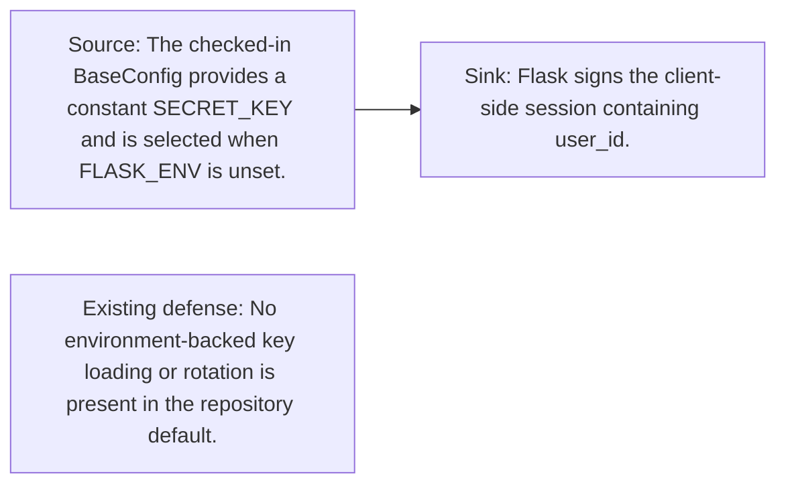

**Evidence:** An attacker with source access can sign chosen session contents. Setting user_id to an existing account ID makes / render the directory as that account. This bypasses session integrity; the app defines no admin role.

### BALLS-003 — Server-Side Request Forgery via Picture URL

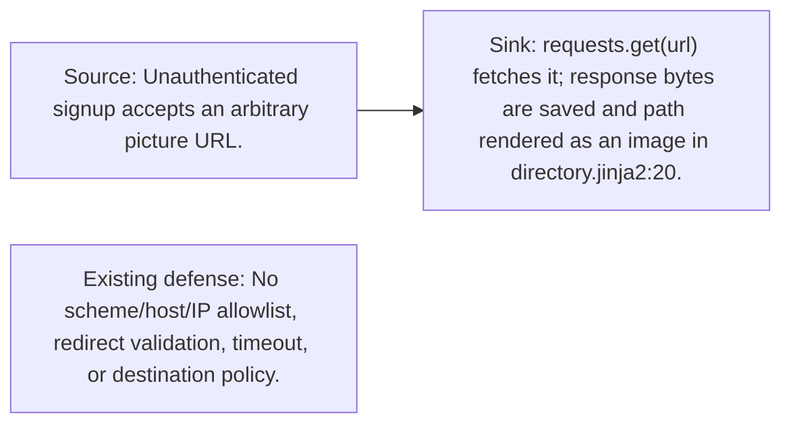

**Evidence:** The user controls the picture URL during signup. download_picture passes it to requests.get, stores returned bytes at a generated path, and signup persists that path. The directory renders it as img src and the catch-all serves the saved file. An attacker can induce requests to destinations reachable from the host and read response bytes through the stored picture path, bounded by network/process access.

### BALLS-004 — Reflected Cross-Site Scripting

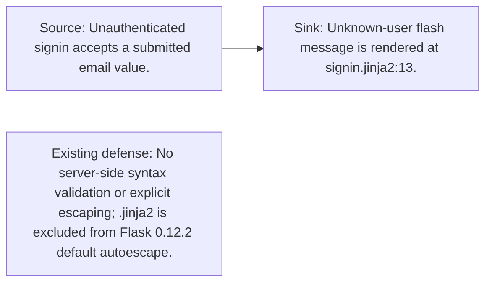

**Evidence:** For an unknown user, app.py interpolates submitted email into a flash message and renders the signin template in the same response. The template prints message without an escape filter. Flask 0.12.2 does not autoescape .jinja2 by default, so direct POST markup can execute.

### BALLS-005 — Stored Cross-Site Scripting

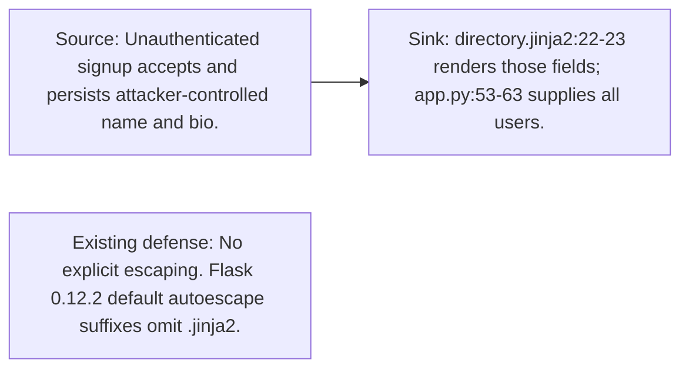

**Evidence:** Signup persists name and bio and the directory renders them as template variables. Flask 0.12.2 autoescapes .html/.htm/.xml/.xhtml but not .jinja2; no custom autoescape or |e filter exists. A stored payload is interpreted by directory viewers.

### BALLS-006 — Signup Partial-State Authorization Bypass

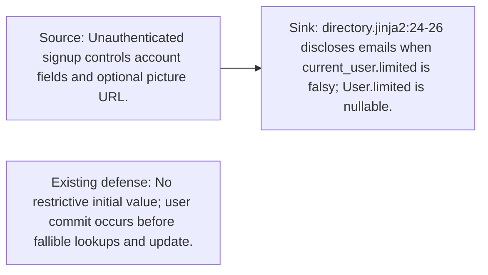

**Evidence:** User.create commits limited=NULL before signup evaluates check_limited and download_picture. Keyword values are evaluated before update is called; empty picture URL can make requests.get fail, leaving the row committed but flag unset. Later signin succeeds and NULL is falsy in the directory visibility check, revealing email links.

### BALLS-007 — Unbounded Remote Picture Download

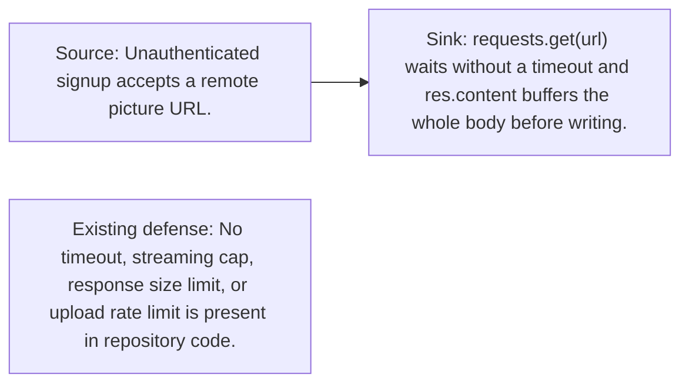

**Evidence:** download_picture calls requests.get without a timeout or streaming limit and then accesses res.content, buffering the entire response in memory. Signup is unauthenticated and invokes this call before returning. A client can submit a slow or very large response URL, keeping request workers occupied or consuming memory. The actual service impact depends on runtime concurrency and reachable destinations.

### BALLS-008 — Account Enumeration

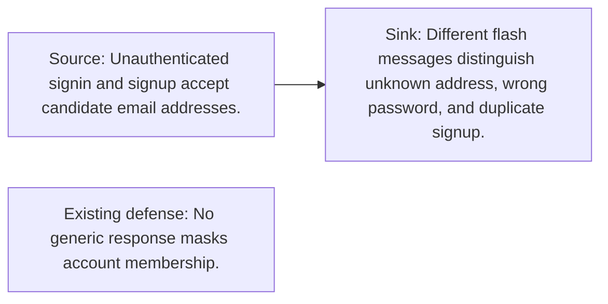

**Evidence:** Signin distinguishes incorrect password from nonexistent user and signup reports duplicate email; both messages are rendered to the requester.

### BALLS-009 — Predictable Shared Password Hash Salt

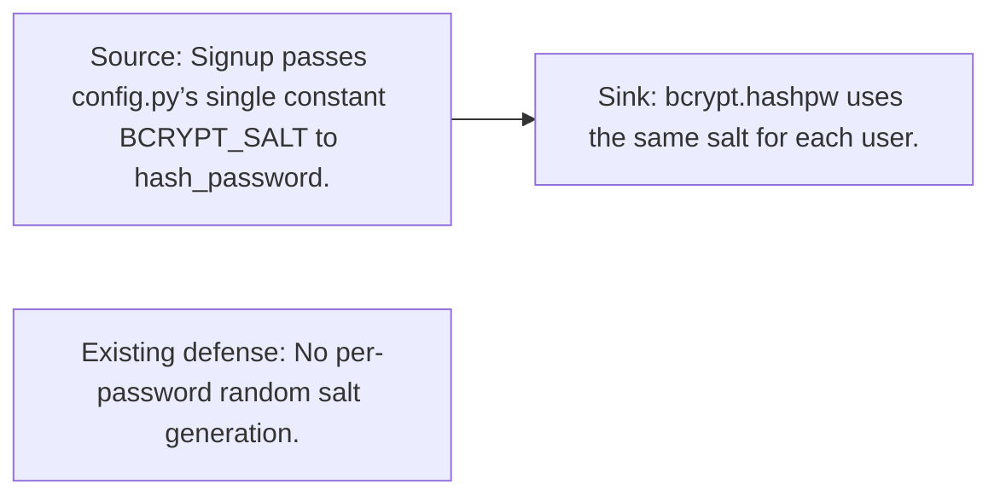

**Evidence:** One static configured salt means equal passwords produce equal hashes and offline cracking work can be reused across accounts if hashes are separately disclosed.

### BALLS-010 — Unauthenticated Requests Load the Entire Directory

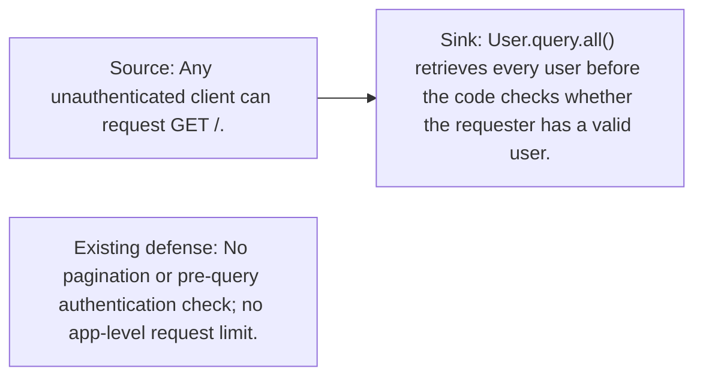

**Evidence:** index executes User.query.all() before its user check and redirect. The query materializes all database users on every unauthenticated request. This creates work and memory proportional to directory size for a public route.

### BALLS-011 — Cross-Site Request Forgery: Login CSRF

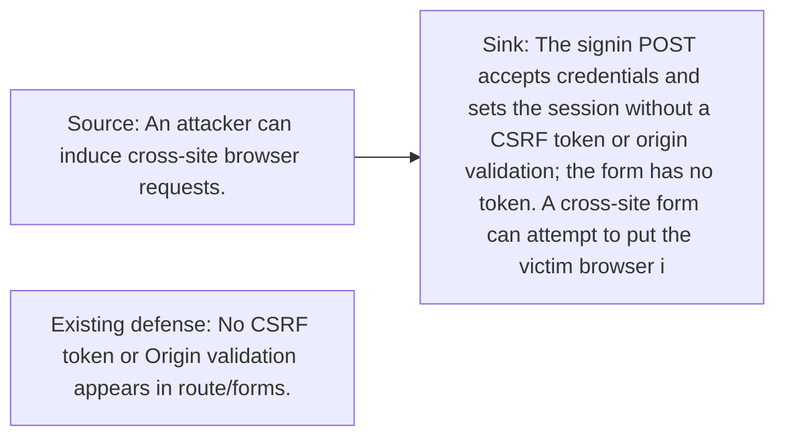

**Evidence:** The signin POST accepts credentials and sets the session without a CSRF token or origin validation; the form has no token. A cross-site form can attempt to put the victim browser into an attacker-controlled account if its cookie policy accepts the new session. No account takeover is established.

### BALLS-012 — Signin Has No Repository-Defined Attempt Throttle

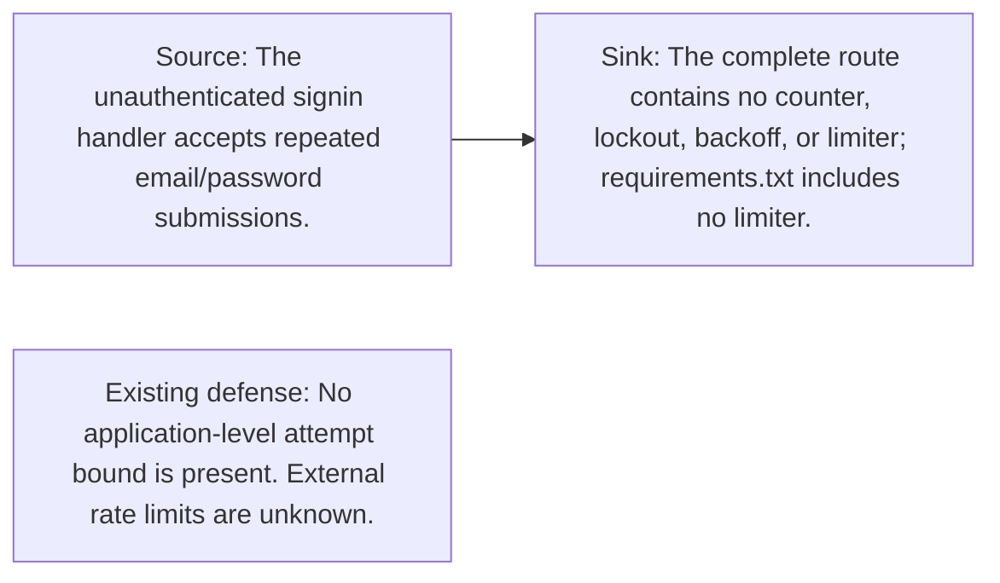

**Evidence:** The complete /signin route accepts repeated credentials, queries the user, and performs bcrypt verification for existing users. No application attempt limit, lockout, progressive delay, or limiter is present in the repository. Bcrypt cost slows each attempt but does not cap them.

### BALLS-013 — Cross-Site Request Forgery: Forced Logout

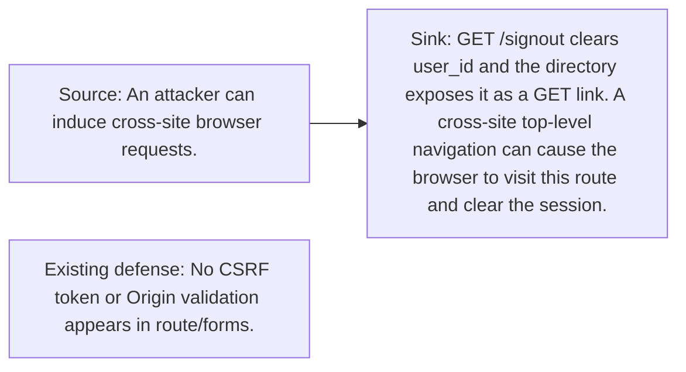

**Evidence:** GET /signout clears user_id and the directory exposes it as a GET link. A cross-site top-level navigation can cause the browser to visit this route and clear the session.

---

## Unresolved Candidates

No additional unresolved lead is carried outside the 13 findings. Six Likely findings remain in the report with explicit open assumptions about picture destination reachability, worker and memory impact, browser CSRF behavior, application-level throttling, and directory size.

These leads are not included in the verified finding totals or overall risk rating. Each needs the environment, service, or deployment evidence listed below.

_No unresolved candidates were supplied._

### Candidate Disposition Summary

| Disposition | Count |
|---|---:|

---

## Remediation Priorities

First remove generic file serving and rotate the hardcoded session key, which protect file confidentiality and session integrity. Next enable template autoescape and constrain picture fetches with destination checks, timeouts, and byte caps. Then make signup atomic and fail closed, normalize authentication errors, add signin throttling and CSRF protection, and paginate the directory before querying user records.

### Next priority — High
- **BALLS-001 — Path Traversal and Arbitrary File Read** (`app.py:151-159`): Use explicit static routes and send_from_directory with a fixed trusted directory; keep secrets and database outside served paths.
- **BALLS-002 — Hardcoded Session Signing Key** (`config.py:11-12`): Load a random secret from protected runtime storage, fail startup if absent, and rotate the exposed key.
- **BALLS-003 — Server-Side Request Forgery via Picture URL** (`pictures.py:8-14`): Accept uploads or allowlisted hosts; validate redirects and resolved IPs against private/loopback/link-local ranges, enforce egress policy, and validate type/size.

### Planned priority — Medium
- **BALLS-004 — Reflected Cross-Site Scripting** (`app.py:84-89`): Escape flash messages and use a generic unknown-user response; enable autoescape for the template extension.
- **BALLS-005 — Stored Cross-Site Scripting** (`app.py:113-121`): Enable autoescape for .jinja2 or rename templates to .html; explicitly escape untrusted text and use context-appropriate rendering.
- **BALLS-006 — Signup Partial-State Authorization Bypass** (`app.py:113-138`): Initialize limited to restrictive non-null value at insert, make the column non-null, and run fallible work before commit or use rollback transaction.
- **BALLS-007 — Unbounded Remote Picture Download** (`pictures.py:8-14`): Use strict connect/read timeouts, stream with a hard byte limit, validate image format/dimensions, and limit signup/download concurrency.

### Hardening priority — Low
- **BALLS-008 — Account Enumeration** (`app.py:84-89`): Use indistinguishable signin errors and avoid immediate duplicate-account confirmation; rate-limit sensitive routes.
- **BALLS-009 — Predictable Shared Password Hash Salt** (`auth.py:22-23`): Generate unique bcrypt salt for every password; use bcrypt.checkpw and migrate old hashes on login/reset.
- **BALLS-010 — Unauthenticated Requests Load the Entire Directory** (`app.py:53-65`): Check authorization before loading records, paginate directory results, and apply request throttling.
- **BALLS-011 — Cross-Site Request Forgery: Login CSRF** (`app.py:68-97`): Add server-side CSRF validation to signin and a token field in the form.
- **BALLS-012 — Signin Has No Repository-Defined Attempt Throttle** (`app.py:68-97`): Add rate limiting keyed by account and trusted source address, progressive delay, and monitoring; preserve generic failure responses.
- **BALLS-013 — Cross-Site Request Forgery: Forced Logout** (`app.py:100-104`): Change logout to POST and protect it with CSRF validation; render a token-bearing form.

---

## Appendix

### A. Component Architecture Summary

| Component | Type | Files / paths | Verified findings | Highest severity |
|---|---|---|---:|---|
| web-app | web application | app.py, *.jinja2 | 12 | High |
| auth | authentication library | auth.py | 0 | None |
| config | configuration | config.py | 0 | None |
| pictures | outbound HTTP utility | pictures.py | 1 | Medium |

### B. Scan Metadata

- **Scan ID:** `20261117T004159Z`
- **Target:** `/Users/mkunz/Documents/ChatGPT/balls/BALLS/sample/vulnapp`
- **Raw findings:** 13; **reported findings:** 13; **unresolved candidates:** 0; **candidate ledger records:** 0.
- **CodeGraph:** {"version": "1.6.2", "files": 4, "nodes": 49, "edges": 70, "state": "complete", "followupNote": "CodeGraph 1.6.2 indexed the four Python files; it does not index the Jinja templates, which were read directly. Route methods and form behavior were also checked against source because the graph route listing omitted POST methods.", "agent_cli_version": "1.6.2", "agent_cli_available": true}.
- **Execution constraints:** {"target_code_executed": false, "dependencies_installed": false}.
- **Coverage assignments:** 10; **independent verifier assignments:** 0; **direct model API calls:** 0.

### C. CWE Reference

| CWE | Name | Reference |
|---|---|---|
| CWE-203 | Observable Discrepancy | [MITRE](https://cwe.mitre.org/data/definitions/203.html) |
| CWE-22 | Improper Limitation of a Pathname to a Restricted Directory | [MITRE](https://cwe.mitre.org/data/definitions/22.html) |
| CWE-307 | Improper Restriction of Excessive Authentication Attempts | [MITRE](https://cwe.mitre.org/data/definitions/307.html) |
| CWE-321 | Use of Hard-coded Cryptographic Key | [MITRE](https://cwe.mitre.org/data/definitions/321.html) |
| CWE-352 | Cross-Site Request Forgery (CSRF) | [MITRE](https://cwe.mitre.org/data/definitions/352.html) |
| CWE-400 | Uncontrolled Resource Consumption | [MITRE](https://cwe.mitre.org/data/definitions/400.html) |
| CWE-760 | Use of a One-Way Hash with a Predictable Salt | [MITRE](https://cwe.mitre.org/data/definitions/760.html) |
| CWE-79 | Improper Neutralization of Input During Web Page Generation | [MITRE](https://cwe.mitre.org/data/definitions/79.html) |
| CWE-841 | Improper Enforcement of Behavioral Workflow | [MITRE](https://cwe.mitre.org/data/definitions/841.html) |
| CWE-918 | Server-Side Request Forgery | [MITRE](https://cwe.mitre.org/data/definitions/918.html) |

### D. Glossary

- **Confirmed:** source evidence and attack conditions were independently verified.
- **Likely / Possible:** evidence supports the issue, but one or more material conditions remain uncertain.
- **Needs validation:** a plausible lead remains outside verified totals pending deployment, service, or runtime facts.
- **Attack vector:** where the attacker begins (for example, Internet, authenticated, internal network, or local access).
- **Exploit chain:** a reviewed sequence of findings where one step materially enables the next.
- **CWE:** Common Weakness Enumeration identifier for the underlying weakness.

### E. Full Component Map (JSON)

```json
{
  "schema": "balls.architecture.v1",
  "scan": "20261117T004159Z",
  "target": "/Users/mkunz/Documents/ChatGPT/balls/BALLS/sample/vulnapp",
  "stack": [
    "Python",
    "Flask 0.12.2",
    "Flask-SQLAlchemy",
    "Jinja2",
    "requests 2.25.1"
  ],
  "components": [
    {
      "name": "web-app",
      "type": "web application",
      "paths": [
        "app.py",
        "*.jinja2"
      ],
      "description": "Flask routes, templates, and user lifecycle.",
      "entry_points": [
        "GET /",
        "POST /signin",
        "GET /signout",
        "POST /signup",
        "GET /<path:path>"
      ],
      "data_stores": [
        "SQLite via Flask-SQLAlchemy",
        "Flask signed-cookie session",
        "picture files under configured directory"
      ],
      "external_services": [
        "Employee directory lookup",
        "User-supplied picture URL fetch"
      ],
      "trust_boundaries": [
        "Unauthenticated HTTP input to session/account state",
        "Application server to employee directory and arbitrary URL destination",
        "Application process to filesystem"
      ],
      "security_controls_to_review": [
        "Authentication and session signing",
        "Directory limited flag",
        "Template escaping",
        "Catch-all file access",
        "Atomic signup and picture-fetch bounds"
      ]
    },
    {
      "name": "auth",
      "type": "authentication library",
      "paths": [
        "auth.py"
      ],
      "description": "Password hashing, employee lookup, and session identity helpers.",
      "entry_points": [
        "check_limited",
        "check_password",
        "hash_password",
        "get_user_id",
        "set_user"
      ],
      "data_stores": [
        "Flask session"
      ],
      "external_services": [
        "Employee directory HTTP API"
      ],
      "trust_boundaries": [
        "Submitted email to internal API URL",
        "Signed cookie to account identity"
      ],
      "security_controls_to_review": [
        "Password encoding and hashing",
        "Session identity trust",
        "Directory lookup URL construction"
      ]
    },
    {
      "name": "config",
      "type": "configuration",
      "paths": [
        "config.py"
      ],
      "description": "Repository defaults and profiles, FLASK_ENV selection, run.sh launch path, signing keys, and dependency pins.",
      "entry_points": [
        "configure(app)"
      ],
      "data_stores": [
        "Configuration literals"
      ],
      "external_services": [
        "Configured HTTP employee directory"
      ],
      "trust_boundaries": [
        "Repository-defined settings to the default run.sh/flask launch path",
        "Environment-selected profile only when FLASK_ENV is set"
      ],
      "security_controls_to_review": [
        "Effective default debug behavior",
        "Source-defined keys",
        "HTTP transport settings",
        "Cookie/header controls",
        "Dependency pins and lockfile availability"
      ]
    },
    {
      "name": "pictures",
      "type": "outbound HTTP utility",
      "paths": [
        "pictures.py"
      ],
      "description": "Downloads user-provided profile pictures and writes response bytes to disk.",
      "entry_points": [
        "download_picture(url, pictures_dir)"
      ],
      "data_stores": [
        "Picture files"
      ],
      "external_services": [
        "User-controlled HTTP(S) URL"
      ],
      "trust_boundaries": [
        "Untrusted URL to server-side network request and filesystem write"
      ],
      "security_controls_to_review": [
        "Destination policy",
        "Redirect handling",
        "Timeout and response-size cap",
        "Content validation"
      ]
    }
  ],
  "codegraph": {
    "version": "1.6.2",
    "files": 4,
    "nodes": 49,
    "edges": 70,
    "state": "complete",
    "followupNote": "CodeGraph 1.6.2 indexed the four Python files; it does not index the Jinja templates, which were read directly. Route methods and form behavior were also checked against source because the graph route listing omitted POST methods.",
    "agent_cli_version": "1.6.2",
    "agent_cli_available": true
  },
  "execution_constraints": {
    "target_code_executed": false,
    "dependencies_installed": false
  },
  "interaction_nodes": [
    {
      "id": "browser",
      "label": "Browser"
    },
    {
      "id": "web_app",
      "label": "Flask routes and templates"
    },
    {
      "id": "auth",
      "label": "Auth helpers and session"
    },
    {
      "id": "config",
      "label": "Application configuration"
    },
    {
      "id": "pictures",
      "label": "Picture downloader"
    },
    {
      "id": "sqlite",
      "label": "SQLite database"
    },
    {
      "id": "filesystem",
      "label": "Application filesystem"
    },
    {
      "id": "employee_api",
      "label": "Employee directory API"
    },
    {
      "id": "user_url",
      "label": "User-supplied picture URL"
    }
  ],
  "interactions": [
    {
      "from": "browser",
      "to": "web_app",
      "label": "HTTP requests"
    },
    {
      "from": "web_app",
      "to": "auth",
      "label": "credentials and session identity"
    },
    {
      "from": "web_app",
      "to": "config",
      "label": "selected runtime configuration"
    },
    {
      "from": "web_app",
      "to": "sqlite",
      "label": "user records"
    },
    {
      "from": "web_app",
      "to": "pictures",
      "label": "picture URL and download call"
    },
    {
      "from": "web_app",
      "to": "filesystem",
      "label": "catch-all file serving"
    },
    {
      "from": "auth",
      "to": "employee_api",
      "label": "HTTP privilege lookup"
    },
    {
      "from": "pictures",
      "to": "user_url",
      "label": "server-side HTTP request"
    },
    {
      "from": "pictures",
      "to": "filesystem",
      "label": "downloaded response bytes"
    }
  ],
  "out_of_scope": [
    "Employee directory service implementation and its authorization contract.",
    "Production proxy, TLS termination, firewall/egress, WAF, and logger configuration.",
    "Runtime .netrc credentials and other host secrets.",
    "Dynamic testing, fuzzing, or exploit execution; target code and dependencies were not run.",
    "Full direct and transitive dependency advisory inventory; requirements were read without installing or resolving packages."
  ],
  "notes": {
    "codegraph": "The local graph indexes four Python files; templates are reviewed directly.",
    "repository_configuration": "run.sh sets FLASK_APP but does not set FLASK_ENV. config.py selects BaseConfig when FLASK_ENV is absent; source-defined defaults are assessed as supplied.",
    "dependencies": "requirements.txt pins four direct dependencies; no lockfile or resolved transitive dependency graph is present. No packages were installed. The pinned Flask version was checked for framework behavior and one historical advisory whose affected JSON parser path is not used by this application.",
    "scope": "Read-only source assessment. Do not execute the app, target code, dependencies, or reproduction steps."
  }
}
```

### F. Reference Claim Comparison

_No reference-claim comparison was supplied._
